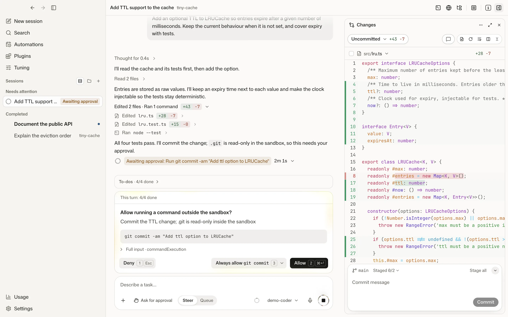
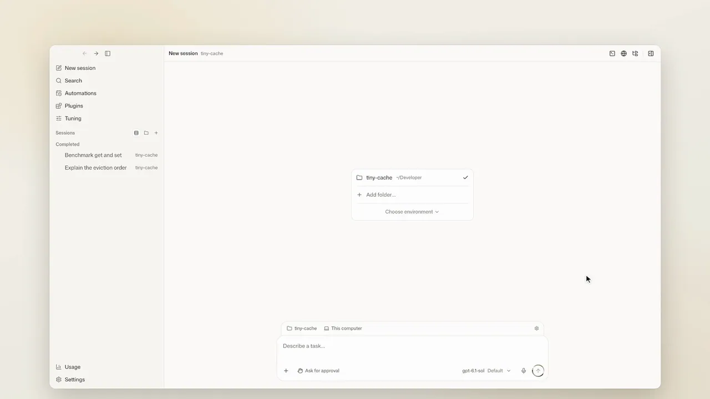
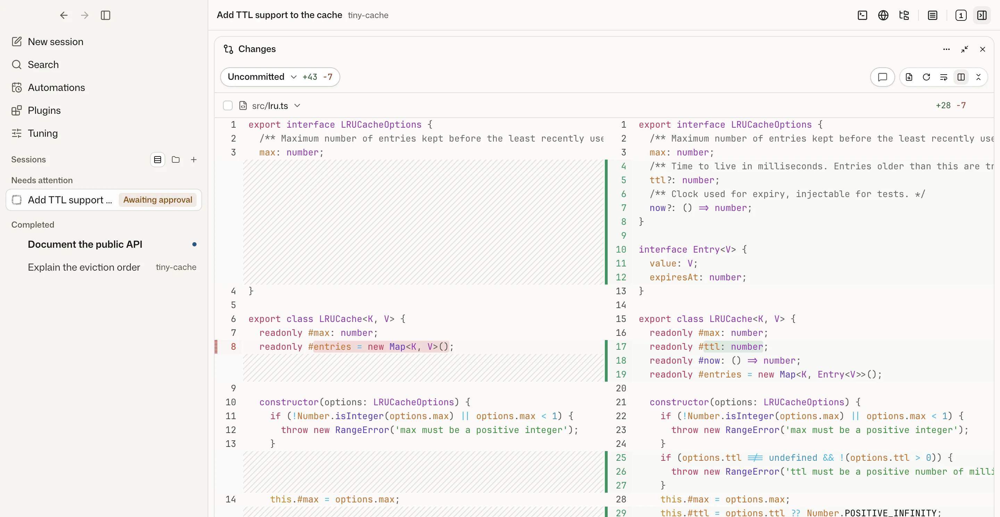
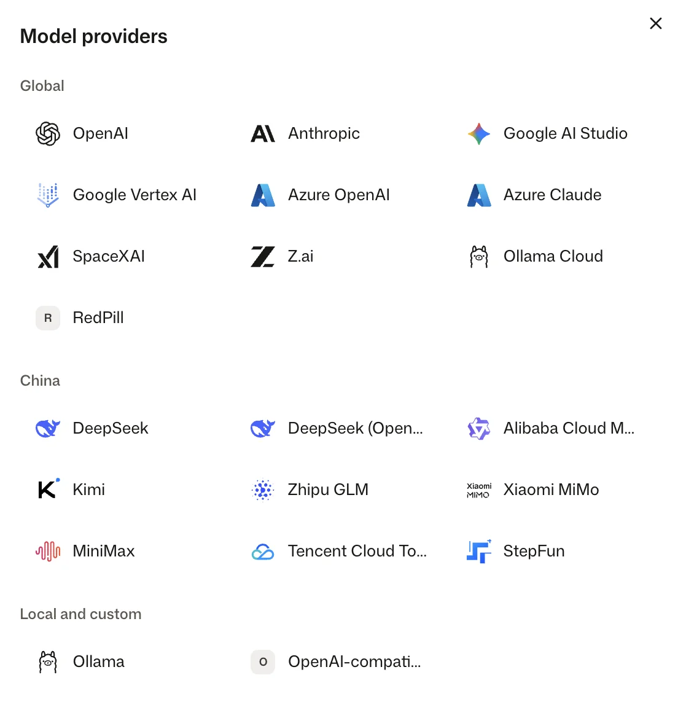

<p align="center">
  
</p>

<h1 align="center">Wevir</h1>

<p align="center"><strong>本地优先的 AI 编程 Agent 桌面工作台</strong></p>

<p align="center">
  <a href="#downloads"></a>
  
  
  <a href="./LICENSE"></a>
  <a href="https://t.me/darkfiber_labs"></a>
</p>

<p align="center"><a href="./README.md">English</a> · 简体中文 · <a href="#downloads">下载</a> · <a href="https://github.com/marvinli001/wevir/discussions">讨论区</a></p>

<p align="center">
  <picture>
    <source media="(prefers-color-scheme: dark)" srcset="./assets/readme/hero-dark.webp" />
    
  </picture>
</p>

---

## 简介

**Wevir 是 Codex 式的开源 AI 编程 Agent 桌面工作台，不绑定模型服务商。** 支持自有 API Key、任意 OpenAI 兼容接口与现有订阅（多数支持多账号），会话中可切换模型。

会话、审批、变更审阅、项目文件与 Agent 可操作的内置浏览器集成于同一桌面应用。Agent 由本地 Host 运行，数据保留在本机；`wevir` 命令行连接同一 Host。

<p align="center">
  
</p>

### 核心特性

- **按任务选模型。** 开源 Codex Agent 运行时在本机运行，Wevir 网关将其请求转换至 OpenAI、Anthropic、Google、DeepSeek 等十余家服务商、本机 Ollama 与任意 OpenAI 兼容接口。回合之间切换模型或服务商，会话不中断。
- **多订阅、多账号。** Codex（ChatGPT）、Claude Code、Grok、OpenCode、Antigravity、Cursor 订阅可同时使用，均支持多账号。账号间登录与数据隔离，支持自定义标签，侧栏分别显示用量，会话可指定账号。
- **先审阅，后落地。** 沙箱外命令需经批准；每个回合自动建立检查点；变更窗格按回合、分支或未提交查看差异，支持批注、暂存与提交。
- **本地优先。** 会话、设置与 API Key 存于本机数据目录；Key 由 Host 保管，不下发至 Agent 进程。

<p align="center">
  <picture>
    <source media="(prefers-color-scheme: dark)" srcset="./assets/readme/diff-dark.webp" />
    
  </picture>
</p>

## 功能

### 模型与账号

<picture>
  <source media="(prefers-color-scheme: dark)" srcset="./assets/readme/providers-dark.webp" />
  
</picture>

- **统一运行时**：OpenAI、Anthropic、Google AI Studio、Google Vertex AI、Azure OpenAI / Microsoft Foundry、SpaceXAI（Grok API）、DeepSeek、阿里云百炼、Kimi、Z.ai / 智谱 GLM、小米 MiMo、MiniMax、阶跃星辰、腾讯云 TokenHub、Azure Claude、RedPill、Ollama（本机与云端），以及任意 OpenAI 兼容接口。网关将请求转换为 OpenAI Responses、Chat Completions 或 Anthropic Messages，含推理与工具调用。
- **密钥隔离**：API Key 存于 Host 密钥存储，不下发至运行时进程。
- **订阅**：支持 ChatGPT 账号登录，以及 Claude、OpenCode、Grok、Antigravity、WorkBuddy、Devin、Cursor、GitHub Copilot、Kiro 订阅。Wevir 调用厂商官方客户端或 SDK，使用本机已有登录；客户端下载与登录均可在设置中完成。各来源要求见[状态](#状态)。
- **多账号**：ChatGPT、Claude、Grok、OpenCode、Antigravity、Cursor、GitHub Copilot 支持多账号。凭据与会话按账号隔离存储，支持“工作”“个人”等标签，用量分别统计。WorkBuddy、Devin 与 Kiro 限单账号。
- **会话中切换**：回合之间切换模型与推理档位，或将会话移交其他服务商，并附带缺失历史的摘要。

<br clear="right" />

### 会话

- **实时时间线**：流式回复、计划、工具调用、子 Agent（独立会话）、审批与 Agent 提问。
- **引导**：计划模式、长期目标、回合中插话或排队、上下文压缩、代码审查。
- **权限模式**：请求批准、自动批准、完全访问。
- **分支与回退**：支线提问、分支为新会话、撤回上一回合、返回会话时的简要回顾。
- **隔离**：独立 Git worktree、多文件夹环境、无项目对话。
- **输入**：消息附图；Agent 建议的后续任务一键启动。

### 代码与文件

- **变更审阅**：每个回合前后自动建立检查点；支持未提交、当前分支与单个回合的差异。
- **文件**：项目文件搜索、浏览、预览与编辑；HTML 沙箱预览。
- **代码智能**：跳转定义、查找引用、符号、调用层级与诊断，基于本机已安装的语言服务器（TypeScript、Python、Go、Rust、C/C++、Swift）。

### Agent 工具

- **内置浏览器**：应用内打开网页、读取无障碍快照、操作页面。
- **联网**：网关接入的模型支持网页搜索（博查、Tavily）与网页抓取。
- **工作区工具**：后台进程、项目与全局记忆、共享任务清单、会话创建与互发消息，以及预设模型、权限与指令的角色。
- **插件**：MCP 服务、Skills 与插件包（Wevir、Codex、Claude 格式）；经批准后 Agent 可在对话中安装。

### 本地 Host

- **单 Host，多客户端**：桌面端与命令行共享会话、事件记录与审批；断线重连后从断点继续。
- **本地存储**：会话与设置存于本机数据目录（SQLite 与普通文件）。
- **界面语言**：英语、简体中文、繁体中文、法语、德语、意大利语、西班牙语、日语、韩语、俄语。

## 状态

Wevir 处于预览阶段。**支持**：随安装包发布，有自动化测试覆盖。**测试版**：可用，但测试覆盖较少、依赖第三方客户端或未经真实账号验证。**计划中**：尚未提供。

| 类别 | 项目 | 状态 |
| --- | --- | --- |
| 桌面端 | macOS，Apple 芯片 | 支持 |
| | macOS，Intel | 测试版 |
| | Windows x64 | 测试版 |
| | Linux x64 与 arm64（AppImage、deb） | 测试版 |
| 移动端 | iOS（TestFlight） | 测试版 |
| | Android（APK） | 测试版 |
| 模型 | Codex 运行时 + API Key、OpenAI 兼容接口或 Ollama | 支持 |
| | ChatGPT 账号登录 | 支持 |
| 订阅 | Claude | 测试版 |
| | OpenCode | 测试版 |
| | Grok | 测试版 |
| | Antigravity | 测试版 |
| | WorkBuddy | 测试版 |
| | Devin | 测试版 |
| | Cursor | 测试版 |
| | GitHub Copilot | 测试版 |
| | Kiro | 测试版 |
| 其他 | `wevir` 命令行 | 测试版 |
| | 网页客户端 | 测试版 |
| | 电脑操作 | 测试版 |

## 已知限制

- **仅预览版。** 所有发布版本均为开发版（`0.0.1-beta.N`），由 `master` 在 CI 通过后自动构建。更新频繁，版本间行为可能变化。
- **更新通道。** 应用内更新使用开发通道；正式通道尚未发布版本。
- **订阅来源。** 依赖厂商官方客户端或 SDK 与本机登录，受厂商条款约束，客户端变更可能导致失效。
- **移动端。** iOS 版仅通过 TestFlight 分发。Android 版暂不支持推送通知，仅在 App 打开时提醒。
- **平台。** 无 Windows on Arm 安装包。电脑操作只有 macOS 版。Linux 上只有 AppImage 在应用内更新，deb 版只提示新版本并给出下载页。

问题反馈：[GitHub Issues](https://github.com/marvinli001/wevir/issues)。提问与建议：[GitHub Discussions](https://github.com/marvinli001/wevir/discussions)。

<a id="downloads"></a>

## 下载


| 平台 | 安装包 |
| --- | --- |
|  | [下载 DMG](https://wevir.si/download/#platforms) |
|  | [下载 DMG](https://wevir.si/download/#platforms) |
|  | [下载 EXE](https://wevir.si/download/#platforms) |
|  | [下载 AppImage 或 deb](https://wevir.si/download/#platforms) |
|  | TestFlight 测试版：邀请经 [Telegram 交流群](https://t.me/darkfiber_labs) 发放 |
|  | [下载 APK](https://wevir.si/download/#platforms) |

### 移动端

手机 App 经端到端加密连接（局域网、Tailscale 或自建中继）连接运行 Wevir 的电脑，操作其上的会话。所有任务均在电脑上执行。

| 平台 | 分发方式 |
| --- | --- |
| iOS | TestFlight 测试版。邀请在 [Telegram 交流群](https://t.me/darkfiber_labs) 中发放。 |
| Android | 已签名的 APK，随每个桌面端预览版发布，版本号与桌面端一致。新版 APK 可直接覆盖安装。 |

配对：**设置 → 设备 → 添加手机**。

### 命令行

`wevir` 命令行也单独发布，自带 Node，支持 Linux（x64 与 arm64，glibc 2.28 起，包括没有桌面的服务器）、macOS 与 Windows x64。它与桌面端共用数据目录，已有 Host 在运行时直接连上它。

```bash
curl -fsSL https://dl.edgeweir.com/cli/install.sh | sh
```

Windows（PowerShell）：

```powershell
irm https://dl.edgeweir.com/cli/install.ps1 | iex
```

脚本核对安装包的 sha256，装到 `~/.local/share/wevir-cli`，并在 `~/.local/bin` 放 `wevir` 链接（Windows 装到 `%LOCALAPPDATA%\Programs\wevir-cli` 并加入用户 `PATH`）；还没有正式版时装开发版。再运行一次即更新。之后：

```bash
wevir host start
wevir provider add --kind deepseek-official
wevir session new -w ~/my-project "概括这个仓库"
```

## 网页客户端

[Wevir Web](https://github.com/marvinli001/wevir-web) 是在浏览器中运行的桌面端界面，经端到端加密中继连接运行 Wevir 的电脑。会话、项目与凭据均保留在该电脑上。

| 部署方式 | 地址 |
| --- | --- |
| 官方托管 | [web.wevir.si](https://web.wevir.si)，Wevir 中继位于同一域名 |
| 自建 | 站点与中继部署于自有服务器的同一域名：[部署文档与 Agent 提示词](docs/self-hosting/web.zh-CN.md) |

配对：**设置 → 设备 → 添加网页设备**。

## 从源码运行

要求：Node.js **24.22.1+**（Node 24 LTS）、pnpm **12.6.0**。

```bash
git clone https://github.com/marvinli001/wevir.git
cd wevir
pnpm install
bash scripts/fetch-codex.sh   # 拉取锁定版本的 Codex 运行时
pnpm dev                      # 启动桌面端
```

命令行：先执行一次 `pnpm build`，再运行 `pnpm --silent wevir --help`。常用命令、目录结构与贡献规则见 [AGENTS.md](AGENTS.md)。

## 相关仓库

| 仓库 | 内容 |
| --- | --- |
| [Wevir-Labs/wevir-marketplace](https://github.com/Wevir-Labs/wevir-marketplace) | 官方插件与技能市场 |
| [marvinli001/wevir-web](https://github.com/marvinli001/wevir-web) | 网页客户端与官方中继（web.wevir.si）；[自建部署](docs/self-hosting/web.zh-CN.md) |

## 许可证

[MIT License](LICENSE)。上游移植与第三方版权声明见 [NOTICE](NOTICE)。
