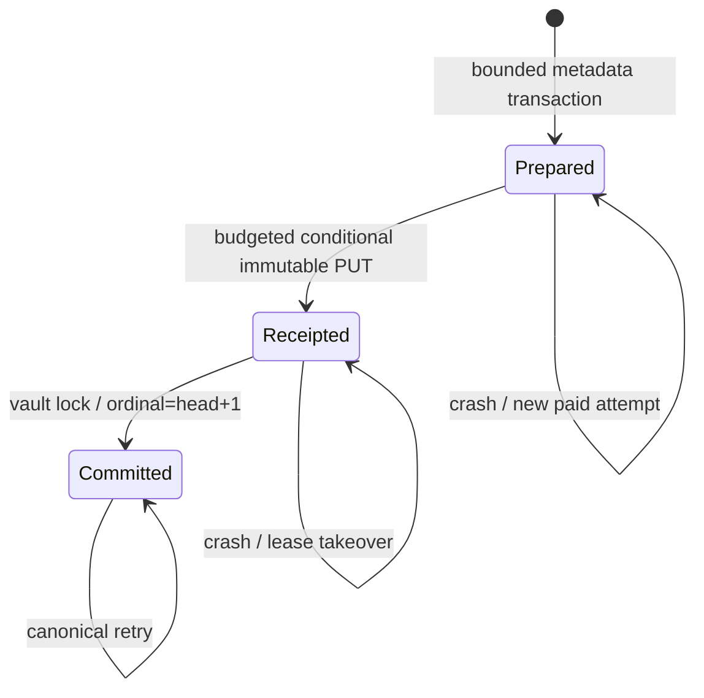
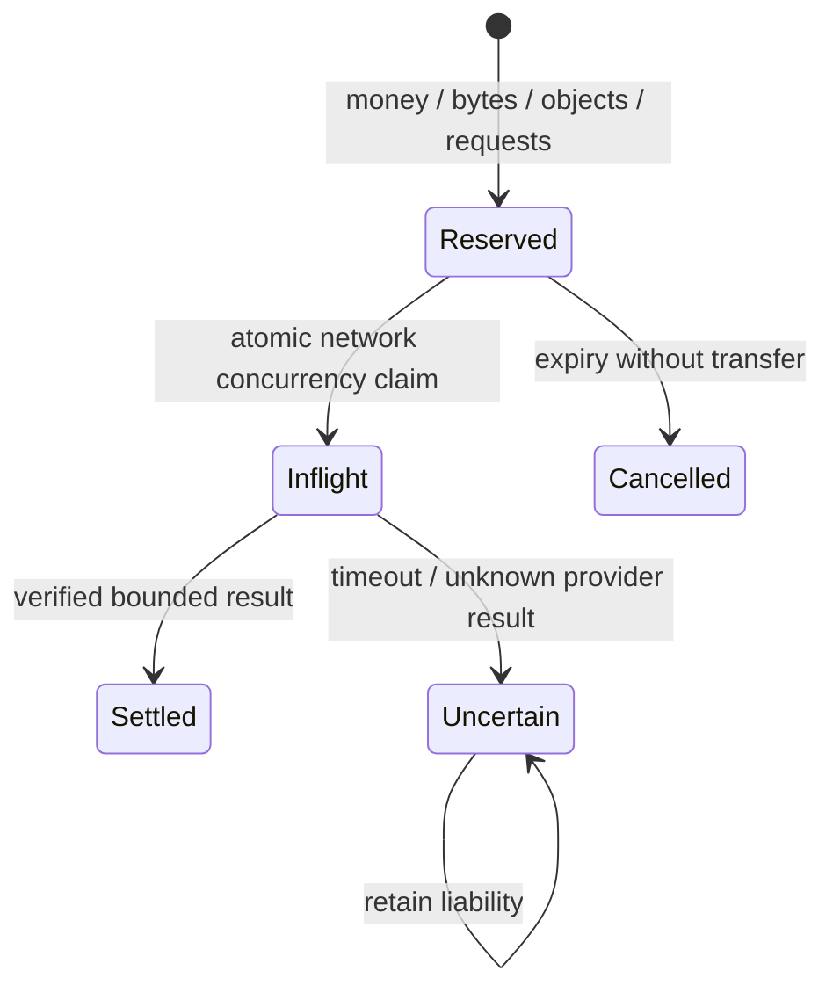
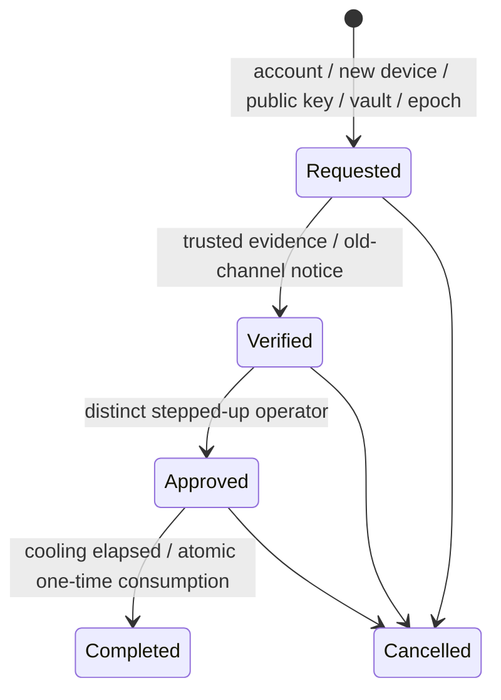

# Proposed trust, recovery and expense boundaries

This is a proposed protocol/deployment record. Tests of a synthetic provider do not establish AWS, native platform, two-Host or sustained workload readiness.

Identity uses the existing better-auth account, Wevir enrollment, access/refresh credentials and Ed25519 DPoP. Sync content additionally needs an approved vault-key device, active subscription and explicit scopes. Inference still uses its subscription allowance. Neither sync capacity nor operational estimates debit the wallet or inference allowance. PAYG credentials cannot enter these routes. An open-source client can be imitated; the boundaries are possession proofs, resource ownership and shared limits.

The gateway verifies declared event fingerprints and immutable entity/project bindings. It cannot prove that ciphertext contains those declarations. A receiving client must verify the GCM tag, canonical pack, opId/entityId/kind/parents, original record index, project and domain-separated per-event hashes before projection or applied ACK. The public decryptor returns only records covered by the provided committed envelopes; extra pack records never become an application result. Imported material is data, never an execution, approval, hook or installation instruction.

`eventDigest` hashes UTF-8 JCS of `{protocol:'wevir-sync-event/1',vaultId,hostId,sessionId,streamId,seq,event}`. Event content is complete stable event data, not just text. The same independent text in another tuple remains independent. A commit has at most 4,096 declared source sequences before any expansion, and its 1 MiB limit includes manifests. JSON nesting is bounded at 64. The v1 retained-operation quota is configurable up to 50,000 so fixed recovery snapshots remain bounded.

Refresh retains the existing device/origin identity. Reinstallation enrolls a new device/origin. Existing committed events never change source names. Recovered, unuploaded work must be retained locally and rebased as a new stream with an encrypted `recoveredFrom` reference; a new key cannot impersonate an old origin. Mirror imports never become new source events automatically.

## Durable transitions

One prepared commit fences later commits in that vault. A receipt already written cannot be abandoned into a gap. Different vaults do not share the finalize lock. Network calls never run inside the metadata transaction. An ACK requires the immutable signed receipt already persisted; prepared remains pending. Changes use the committed vault head and page position, never wall time, device sequence or a potentially late SQL MAX sequence.

Every network attempt has its own reservation. Reusing a logical ID is separate from retry cost. Upload admission precedes bounded staging. Download tickets are consumed atomically; Range and ticket replay do not reach S3. SDK maxAttempts is one, region redirects are disabled and only standard HTTPS AWS endpoints are used. Network slots begin at transfer start, not at one-hour ticket reservation. Uncertain cost and physical holds are not silently refunded. Only the unused portion of a known bounded metadata response is returned; request and incurred costs remain.

The cooling period starts again after delivered notice, not merely at request creation. Recovery is independent of subscription. A trusted old device can approve a replacement for bounded recovery after expiry. At a full device quota enrollment has one recovery-only credential slot; it cannot infer or sync normally. All-devices-lost completion revokes old devices and advances the key epoch. Existing downloaded keys and data cannot be recalled.

## Cost-bearing paths

| Entry/task | Provider work | Admission and limits |
|---|---|---|
| Enrollment, entitlements, scopes, device approvals | Postgres, small control responses | Persistent IP/account/device limits; fixed infrastructure forecast |
| Blob reservation | Postgres | Atomic global → account → device holds; staging/history/backup capacity |
| Upload attempt | One PUT; conditional collision may need separately funded HEAD | Exact length, raw SHA-256, DPoP, 4 MiB, 15 s staging |
| Commit advancement | Receipt PUT; existing receipt verification GET | New reservation per attempt; immutable key and vault lease |
| Changes/status | Postgres and metadata egress, no S3 | Bounded page, response-byte reservation and known-size settlement |
| Download | One GET and gateway egress | Single-use ticket, full byte hold, bounded chunks/rate/duration |
| Key initialization/unlock | KMS Encrypt/Decrypt; key-manifest PUT | Separate process/IAM, recovery lane, 6 unlocks/minute |
| Connection probe | Bounded metadata/DescribeKey and tiny PUT/GET/version DELETE/HEAD | One/minute, maintenance lane, worker role |
| Backup | Source GET, backup conditional PUT, checksum HEAD | Maintenance budget, planned physical copy already reserved |
| GC | HEAD, exact-version DELETE, confirming HEAD | Retention/watermark/lease checks; physical release only after confirmation |
| Expiration notice | Existing mail provider and small control writes | Maintenance budget, at most one retry/vault/hour; failed notice blocks expiration deletion |
| Disaster inventory | Prefix-scoped ListObjectVersions | Private CLI only, ≤1,000 entries/page and explicit page ceiling |
| Offline directory export | Bounded GETs, encrypted files | Maintenance budget and explicit output directory; no KMS Decrypt |

Money is integer micro-USD. Each rate is a versioned rational numerator/denominator, rounded upward for admission. Fixed infrastructure, current byte-days through retention, backup, proxy/topology, database and logs require provision. The operational ledger is independent from the financial ledger. Current storage keeps costing money during pause. Alarms do not provide request-time admission.

The approved egress upper bound is the sum of transfer holds; S3/KMS attempts cannot exceed approved attempts. Externally changed prices, infrastructure/edge attacks, stolen cloud credentials, pre-existing storage and incomplete historical metering prevent a claim that all AWS charges are absolutely capped. Unknown meter/pricing state fails closed for new paid work. A pause never deletes a user or bucket.

## Workload calibration

A synthetic planning case with two devices continuously producing one blob and one receipt every five seconds for eight hours produces 11,520 batches, 46,080 primary/backup objects and about 92,160 S3 attempts (two primary PUTs plus six backup operations per batch). Metadata traffic is additional. This exceeds the suggested 20,000 daily attempts. The service must pause at its configured boundary; these initial quotas are not an eight-hour service promise. Actual Host packing/duty cycle, Region prices and measured billing must determine launch quotas. No paid eight-hour workload is authorized by this record.

Restored indexes keep device authority revoked and synchronization disabled. The complete financial/control ledger must be restored or conservatively reconciled. A private bounded inventory accounts for current/noncurrent versions, delete markers, planned copies and uncertain reservations before storage admission can resume. An old signed control checkpoint alone cannot prove it is latest. Head, retention floor, retired-object digest, deletion and revoked-device state must come from the independent current catalog/PITR; otherwise recovery stays closed.
