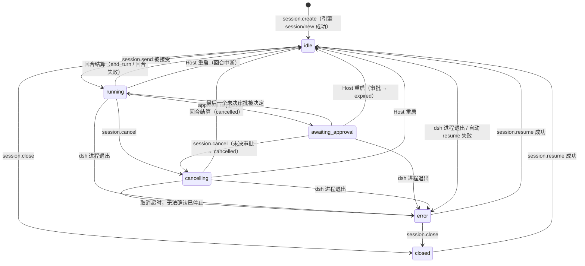
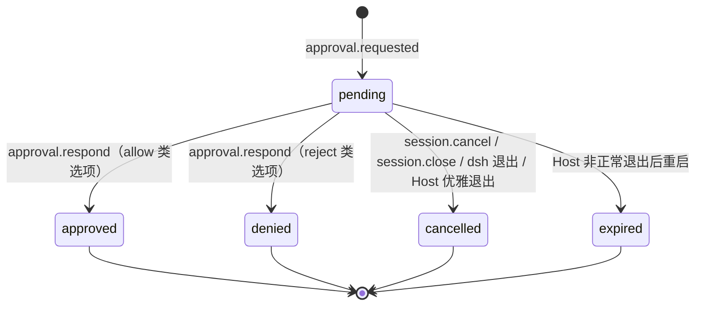

# Wevir 领域模型 v0

> 状态：v0（T1.1）· 日期：2026-10-12
> 依据：[SKELETON_PLAN](../archive/skeleton/SKELETON_PLAN.md) §2、§6 M1；[ADR-0001](../adr/0001-runtime-integration.md)、[ADR-0002](../adr/0002-host-transport-and-process-model.md)；[dsh 接入 Spike](../research/dsh-integration-spike.md)（样本在 `spikes/dsh-acp/fixtures/`）；[Paseo 研读](../research/paseo-notes.md) §7.1、A20；[OpenWork 研读](../research/openwork-notes.md) §3.2、§3.9、§4.5
> 下游：T1.2（`packages/protocol` 的 schema 与 `host-api.md`）、T1.3（`AgentEvent`）、T2.1–T2.3（表结构、事件库、状态机）、T3.2–T3.3（ACP 映射、审批桥接）、T4.1（客户端投影）

本文件定义 Wevir 拥有哪些实体、它们的字段和状态怎么变、Host 往事件库里写哪些事件。不含实现代码；TS 代码块是给后续任务落地的类型草案，每块标注落在哪个包：

| 标注 | 落地位置 | 任务 |
|---|---|---|
| `// → protocol` | `packages/protocol`，线缆类型，配 zod schema | T1.2 |
| `// → adapter 接口` | T1.3 的接口包，Host 与适配器之间的类型，不上线缆 | T1.3 |
| `// → client-sdk` | 客户端投影，只在客户端存在 | T4.1 |

字段名、错误码名在本文件里原是草案，T1.2 已在 [host-api.md](./host-api.md) 定稿并回写本文件（错误码名见 host-api.md §9）；以后以 host-api.md 为准。

---

## 1. 两类事实

Host 是唯一的事实来源（计划 §2.1）。Host 里的数据分两类：

- **产品层事实**：Wevir 自己创建、自己决定的数据。dsh 不知道它们，或者 ACP 不提供。
- **引擎事实的投影**：dsh 是事实的拥有者，Host 把 ACP 消息翻译成 Wevir 事件存一份，供回放和多端同步。投影只增不改；引擎的原值（工具名、`rawInput`、选项 ID、错误原文）原样保留。

| 事实 | 类别 | 来源 | 说明 |
|---|---|---|---|
| 工作区（`Workspace`） | 产品 | Host | dsh 只看到 `session/new` 的 `cwd` |
| Provider 配置（`ProviderProfile`） | 产品 | Host（SQLite + SecretStore） | 由 T3.4 投影成 dsh overlay；Key 只经子进程环境变量传入 |
| 会话身份、所属工作区、标题、创建与更新时间、会话列表 | 产品 | Host | ACP `session/list` 只有 `sessionId` + `cwd`，且不含活跃会话（T0.3 §3.2）；标题取首条提示词（ADR-0001 §5 第 4 条） |
| 会话状态（`SessionState`） | 产品，由引擎信号驱动 | Host 状态机（§4） | ACP 只有 `session/prompt` 的结算 |
| 子会话：父子关系、子 agent 的状态与摘要（0.6.0，R4） | 产品，从引擎数据推导 | 适配器报出子 agent（Codex 的 `collabAgentToolCall`），Host 建子会话（§3.3.1） | 子 agent 的对话本身照常是引擎投影；dsh 等 ACP 引擎没有子会话 |
| 事件序号 `seq` | 产品 | Host | ACP 没有序号（ADR-0001 §5 第 3 条） |
| 回合（`turnId`）与用户消息 | 产品 | Host | ACP 不回发用户消息 |
| 审批的身份、状态、`decidedBy`、过期 | 产品 | Host | 选项列表与 `toolCallId` 来自引擎 |
| todo 列表 | 产品，从引擎数据推导 | 解析 `todo_write` 的 `rawInput` | ADR-0001 §5 第 5 条 |
| 工具展示类型、路径 | 产品，从引擎数据推导 | 按工具名映射（§7） | ACP `kind` 恒为 `other` |
| 错误分类 | 产品，从引擎数据推导 | 按错误原文前缀归类，保留原文 | ADR-0001 §5 第 9 条 |
| 已提交的助手消息与思考 | 引擎投影 | `agent_message_chunk` / `agent_thought_chunk` | |
| 增量文本 | 引擎投影（非公开契约） | stream-tap 旁路（T3.2a） | 被已提交消息替换（§6.3） |
| 工具调用输入、结果、状态 | 引擎投影 | `tool_call` / `tool_call_update` | `cancelled`、`unknown` 两个状态由 Host 推导（§6.4） |
| 上下文用量 | 引擎投影 | `usage_update` | |
| 可选模型与推理强度 | 引擎投影 | `session/new` 的 `configOptions` | |
| 模型可见的对话上下文 | **只属于引擎** | dsh 会话日志 | Wevir 不复制、不重建；resume 由 dsh 负责（T0.3 §8） |

### 1.1 ID 与映射

Host 生成的 ID 都是带类型前缀的不透明字符串，客户端不得解析其内容；生成算法见 [host-api.md](./host-api.md) §6（`<前缀>_<ULID>`）。

| ID | 生成者 | 形式 | 唯一范围 |
|---|---|---|---|
| `WorkspaceId` | Host | `ws_…` | Host |
| `SessionId` | Host | `ses_…` | Host |
| `TurnId` | Host | `trn_…` | Host |
| `ApprovalId` | Host | `apr_…` | Host |
| `QuestionId` | Host | `qst_…`（0.10.0） | Host |
| `StreamId` | Host | `stm_…`（每个 LLM attempt 一个） | 会话 |
| `ProviderId` | 用户（或 Host 按显示名生成建议值） | `^[a-z][a-z0-9-]{0,31}$` | Host |
| 引擎会话 ID | dsh | ACP `sessionId`（UUID） | dsh 的 `DSH_HOME` |
| `toolCallId` | dsh | 原样，如 `call_mv4pwxip_0` | 会话 |
| `messageId` | dsh | 原样（UUID） | 会话 |
| `optionId` | dsh | 原样，如 `allow-once` | 单个审批请求 |

**Wevir 会话 ↔ 引擎会话**：

- 一对一。`session.create` 时 Host 先调用适配器 `createSession`（ACP `session/new`），拿到引擎会话 ID 后才写 `session.created`；之后 `Session.engine.sessionId` 不再改变。子会话（§3.3.1）不经 `session.create`：引擎自己派出子 agent，适配器报出它的引擎会话 ID（Codex 的子 thread），Host 据此建会话，同样一对一。ACP 的 `session/resume` 沿用同一个 `sessionId`（T0.3 §3.2），所以 resume、Host 重启、dsh 进程重启都不改映射。
- 映射只由 Host 保存（`sessions` 表，T2.1；对引擎会话 ID 建唯一索引）。适配器上报的事件以引擎会话 ID 为键，Host 据此路由到 Wevir 会话；Wevir 会话 ID 从不发给 dsh。
- 客户端只用 Wevir 会话 ID。`session.get` 可以带出 `engine` 字段用于诊断，客户端不得据此做任何操作。
- `Session.cwd` 是创建时工作区 `rootPath` 的 realpath，同样不可变：ACP resume 必须用同一个 cwd（按 realpath 比较，T0.3 §3.2）。（0.15.0 起环境会话例外：可以是 Host 为它新开的 worktree 里的目录，同样不可变，§3.10）
- dsh 的 LLM attempt ID（形如 `<引擎会话 ID>:<n>`）只在适配器内部出现，Host 为每个 attempt 分配 `StreamId`。

---

## 2. 公共类型

```ts
// → protocol
type WorkspaceId = `ws_${string}`
type SessionId = `ses_${string}`
type TurnId = `trn_${string}`
type ApprovalId = `apr_${string}`
type QuestionId = `qst_${string}` // 0.10.0
type StreamId = `stm_${string}`
type ProviderId = string // ^[a-z][a-z0-9-]{0,31}$，创建后不可改

type IsoTime = string // ISO 8601，UTC，毫秒精度

type ClientKind = 'desktop' | 'cli' | 'mobile' // mobile 预留（ADR-0002 §2）

// 发起操作的客户端，取自该连接 host.hello 的参数（ADR-0002 §2）
interface ClientIdentity {
  deviceId: string
  clientId: string
  clientKind: ClientKind
}
```

---

## 3. 实体

每个实体的“创建者 / 修改者”指 Host 内负责它的模块。所有修改都经过事件（会话相关）或 RPC 方法（工作区、Provider）；客户端只能通过 Host API 发起。

### 3.1 Workspace

用户授权给 Wevir 的一个本地目录。会话在其中运行，`session/new` 的 `cwd` 就是它的 `rootPath`。

```ts
// → protocol
interface Workspace {
  id: WorkspaceId
  rootPath: string
  displayName: string
  kind?: 'chats'          // 0.39.0：Host 的“对话”工作区；省略是项目
  createdAt: IsoTime
  updatedAt: IsoTime
}
```

| 字段 | 含义 | 创建 | 修改 |
|---|---|---|---|
| `id` | Host 分配 | `workspace.add` | 不可改 |
| `rootPath` | 目录的 realpath（`fs.realpath` 之后的绝对路径）。Host 按它去重：同一路径（含经符号链接到达的同一目录）再次添加，返回已有的工作区 | `workspace.add` | 不可改。目录被移动或删除后工作区仍在，在其中建会话或 resume 会失败 |
| `displayName` | 显示名，默认取目录名 | `workspace.add` | 用户改名（T5.4） |
| `kind` | `chats`：Host 自己的“对话”工作区（0.39.0），见下；省略：用户添加的项目 | Host | 不可改 |
| `createdAt` / `updatedAt` | 时间 | Host | Host |

规则：

- 一个 Session 恰属一个工作区（ACP 只有一个主 workspace，T0.3）。工作区之间不嵌套检查：两个工作区可以是父子目录，各自独立。
- `workspace.remove` 只注销，不删除磁盘上任何文件（OpenWork §4.5）。有未关闭会话（状态不是 `closed`）的工作区不能移除，返回错误。已关闭会话的历史随工作区一起从列表中隐藏，事件库不删；同一 `rootPath` 再次添加时恢复原 `id`，历史重新可见。实现上用 `removedAt` 软删除列，不进线缆类型。
- 工作区本身不带权限设置。dsh 的权限模式是进程级的 `workspace-write`（ADR-0001 §4）；“工作区外授权目录”之类的设置推迟到 Phase 1，届时按工作区生效（OpenWork §4.5）。
- 不在项目里的会话（0.39.0，Host 功能 `chat_sessions`，照 Codex 桌面端的“不在项目中工作”）：`session.create` 不带 `workspaceId` 时，会话建在 Host 的“对话”工作区里。它的 `rootPath` 是 `<数据目录>/chats`，`kind` 是 `chats`，第一次有对话时才建（之前 `workspace.list` 里没有它）；Host 按 rootPath 认出它，不另存种类。“对话”工作区里的每个会话有自己新建的空文件夹 `<数据目录>/chats/<会话 ID>/`（0700），会话的 `cwd` 就是它，显式给“对话”工作区的 `workspaceId` 也一样；会话没建成时删掉这个文件夹。分支、支线与子 agent 沿用来源会话的 `cwd`。对话没有环境、不能新开 worktree（`INVALID_PARAMS`）；“对话”工作区不能移除、不能进环境，它（与它下面的文件夹）不能作为项目添加，`workspace.*` 的文件与 git 方法对它只能按会话读（不带 `sessionId` 时 `INVALID_PARAMS`）。老客户端不认 `kind`，看到的是一个叫 `Chats` 的项目。
- git 状态（当前分支、相对 HEAD 的改动，0.13.0）不是工作区的字段，也不进事件库：`workspace.git` 每次调用时在目录里现读（host-api.md §3.1），磁盘上的仓库随时会被用户或别的程序改动，以它为准。

### 3.2 ProviderProfile

一个模型服务的配置。T3.4 把它翻译成 dsh 的 `--patch` overlay，映射、compat 默认值、生效策略与国内服务示例见 [providers.md](./providers.md)。

```ts
// → protocol
type ProviderKind = 'deepseek-official' | 'openai-compatible' | 'google-vertex' | 'chatgpt' | SubscriptionKind
// chatgpt：0.7.0（R6），能力位 provider_kind_chatgpt；SubscriptionKind：0.19.0，能力位 subscription_kinds（§3.6）
type ProviderApi = 'openai-completions' | 'openai-responses' | 'anthropic-messages'

type ProviderReasoningLevel = 'off' | 'minimal' | 'low' | 'medium' | 'high' | 'xhigh' | 'max'

interface ProviderModel {
  id: string              // 发给服务端的模型 ID
  displayName?: string
  contextWindow?: number  // 不填时 dsh 按 262144 猜、Codex 按 128k（并据此自动压缩），usage.updated 的 contextSize 会失真
  maxTokens?: number      // 最大输出（协议 0.2.0）
  supportsImages?: boolean // 是否接受图片（0.2.0）；省略沿用 dsh 目录
  reasoningEfforts?: ProviderReasoningLevel[] // 推理档位（0.2.0，openai-compatible 与 google-vertex）；[] 表示不推理
}

interface ProviderCompat { // openai-compatible 与 google-vertex；前四个原样写进 dsh overlay 的 compat
  supportsDeveloperRole?: boolean
  maxTokensField?: 'max_tokens' | 'max_completion_tokens'
  thinkingFormat?: string
  requiresReasoningContentOnAssistantMessages?: boolean
  supportsCustomTools?: boolean // 0.4.0，只有 Codex 引擎的模型网关读（model-gateway.md §4.4），dsh 忽略
  systemMessageMode?: 'inline' | 'merge' | 'user' // 0.4.0，同上
  supportsNamespaceTools?: boolean // 0.12.0，Responses namespace 工具支持；false 摊平，dsh 忽略
  toolChoice?: 'any' | 'auto_only' // 0.12.0，Responses / Chat 的工具选择限制，dsh 忽略
  geminiToolSchema?: boolean // 0.26.0，Chat 工具 Schema 的可选清洗，默认关闭，dsh 忽略
}

interface ProviderProfile {
  id: ProviderId
  kind: ProviderKind
  displayName: string
  api?: ProviderApi       // openai-compatible 与 google-vertex 必填
  baseURL?: string        // openai-compatible 必填；deepseek-official 可选；google-vertex 不使用
  compat?: ProviderCompat
  vertex?: { project: string; location?: string } // 0.21.0，google-vertex；location 省略为 global
  models: ProviderModel[] // deepseek-official 可为空，用 dsh 自带目录；chatgpt 由 Host 从引擎取（§3.6）
  defaultModelId: string
  hasSecret: boolean      // 线缆上只暴露有没有 Key，不暴露 secretRef
  enabled?: boolean       // 0.19.0：false = 停用（模型选择里不列出），省略 = 启用
  createdAt: IsoTime
  updatedAt: IsoTime
}
```

| 字段 | 含义 | 创建 | 修改 |
|---|---|---|---|
| `id` | Provider ID，同时是 dsh 的 provider 路由名。**会写进 dsh 会话日志，创建后不可改名**（T0.3 §6.2）；要“改名”只能新建一个再删旧的 | `provider.upsert`（新 ID） | 不可改 |
| `kind` | `deepseek-official` 走 `llm-deepseek`，dsh 的路由名固定为 `deepseek-official`，所以这类 Profile 最多一个，`id` 必须是 `deepseek-official`；`openai-compatible` 走 `llm-pi-ai` 的自定义 provider；`chatgpt`（0.7.0）是 ChatGPT 订阅登录的 Codex（§3.6），`id` 固定为 `chatgpt`，只有 Codex 引擎有 | 创建时 | 不可改 |
| `displayName` | 显示名，写进 overlay 的 `displayName` | 创建时 | `provider.upsert` |
| `api`、`baseURL`、`compat`、`models`、`defaultModelId` | 写进 overlay；写库前经适配器检查（dsh 不接受的配置回 `INVALID_PARAMS`） | 创建时 | `provider.upsert`。dsh 不热加载，适配器在没有回合时重启 dsh 才生效，挂着的会话以 `engine.exited`（`config_changed`）转 `error`、resume 后用新配置（ADR-0001 补记 5，providers.md §5） |
| `vertex` | Vertex 项目与地域（0.21.0，存储迁移 0008），location 默认 global | 创建时 | `provider.upsert`，之后的请求使用新配置 |
| `hasSecret` | Key 或服务账号 JSON 是否已存 | Host | `provider.upsert` 带凭据时 |
| `enabled` | 是否启用（0.19.0，存储迁移 0007） | Host | `provider.setEnabled`；编辑与刷新模型列表时保留 |
| `createdAt` / `updatedAt` | 时间 | Host | Host |

规则：

- Key 不在 Profile 里。Host 的 `SecretStore`（ADR-0003）以 Provider ID 为键保存；存储层的 `secretRef` 列不上线缆。Key 只经子进程环境变量 `WEVIR_PROVIDER_<ID>_KEY` 传给 dsh，`<ID>` 是 Provider ID 转大写、`-` 换成 `_`（ID 只含小写字母、数字和 `-`，不会撞名）。overlay 里只写 `apiKeyEnv` 变量名。`deepseek-official` 的 Key 同时用于 `web-search-deepseek`（T0.3 §6.2）。
- 被未关闭会话引用的 Profile 不能删除。已关闭会话引用的 Profile 删除后，这些会话不能 resume，直到再建一个同 ID 的 Profile。
- `openai-compatible` 的 ID 不能是 `deepseek-official`、`deepseek-account`（dsh 内置路由名）；dsh 支持 openai-completions / openai-responses，Codex 网关另支持 anthropic-messages。google-vertex 只用 Chat / Messages 两条路（providers.md §7.11）。
- `google-vertex`（0.21.0）使用服务账号，只有 Codex 网关支持。选择独立 kind 而非给普通 API Key 增加认证模式：它的地址由 project / location 与协议生成、密钥是整份服务账号 JSON，不能作为普通 Key 传出。`api` 选择 openai-completions（Gemini）或 anthropic-messages（Claude）；一条 Profile 配一种协议，模型不混列。`vertex` 是 optional 的新增字段，Host 写入时检查必有 project；location 省略为 global。SQLite 的 vertex JSON 列只保存这两个非密钥配置。`provider.upsert.serviceAccountJson` 省略保留、字符串替换、null 删除；整份 JSON 只进 SecretStore。网关用 Node crypto 的 RS256 JWT bearer 换令牌，按凭据缓存、提前刷新与合并并发；访问令牌与 JWT 只在内存，私钥只在 SecretStore 与 Host 内存；三者都不进引擎环境或日志。新枚举由客户端能力位 provider_kind_google_vertex 门控，入口看 Host 功能 google_vertex。地址与限制见 providers.md §7.11。
- Vertex 不读取本机 ADC 或 gcloud 登录态。交互式订阅登录如 `chatgpt`（0.7.0，R6）走 Codex 自己的流程，凭据在引擎那边，Host 只有 Provider 记录与账号状态（§3.6）。

### 3.3 Session

一次与 Agent 的对话，恰属一个工作区，同一时刻对应一个引擎会话（0.25.0 起换到别的来源时换成那个来源的引擎会话，§3.14）。

```ts
// → protocol
type SessionState = 'idle' | 'running' | 'awaiting_approval' | 'cancelling' | 'error' | 'closed'

interface ActiveTurn {
  turnId: TurnId
  startedAt: IsoTime
  clientMessageId?: string
}

interface Session {
  id: SessionId
  workspaceId: WorkspaceId
  cwd: string                      // 创建时的 rootPath（realpath），resume 用；环境会话（0.15.0）可以是 worktree 里的目录（§3.10）
  engine: { kind: string; sessionId: string } // 仅诊断用；kind 是 codex（默认）、dsh 或 echo
  providerId: ProviderId
  modelId: string
  reasoningEffort?: string         // dsh 的 reasoning_effort 选项值，原样（off / low / high / max）
  title: string
  titleSource: 'first_prompt' | 'user' | 'generated' // generated：0.5.0，会话的模型生成（R3）
  state: SessionState
  activeTurn?: ActiveTurn
  lastError?: { category: EngineErrorCategory; message: string }
  readOnly?: SessionReadOnly       // 0.3.0：引擎会话恢复不了（§4.4）
  parentSessionId?: SessionId      // 0.6.0：子会话的父会话（§3.3.1）
  subagent?: SubagentInfo          // 0.6.0：只有子会话有（§3.3.1）
  awaitingInput?: boolean          // 0.10.0：有问题等用户回答（§3.8），状态仍是 running
  createdAt: IsoTime
  updatedAt: IsoTime               // 最后一个事件的 ts
  lastSeq: number
  engines?: SessionEngine[]        // 0.25.0：接力过的会话挂过的引擎会话（§3.14）
  archivedAt?: IsoTime             // 0.23.0：归档的时刻，存储里的，不由事件推导
}

type SessionReadOnlyReason =
  | 'engine_session_not_found'     // 引擎找不到这个会话（dsh 会话日志被删，例如 DSH_HOME 被清理）
  | 'engine_session_incompatible'  // 当前引擎读不了它的格式（更新的 dsh 写的，或更旧且没有升级路径）
  | 'engine_session_corrupted'     // 引擎的会话日志损坏

interface SessionReadOnly {
  reason: SessionReadOnlyReason
  message: string                  // 引擎原文
  since: IsoTime                   // 最近一条 session.read_only 的 ts
}

// session.get 的结果（ADR-0002 §3）
interface SessionSnapshot {
  session: Session
  pendingApprovals: ApprovalRequest[]
  todos?: TodoItem[]               // 最近一次 todo.updated
  usage?: { contextUsed: number; contextSize: number; totalTokens?: number; autoCompactAt?: number } // 最近一次 usage.updated
  subagents?: SubagentSummary[]    // 0.6.0：这个会话派出的子会话，按 startedAt（§3.3.1）；没有时省略
  pendingMessages?: PendingMessage[] // 0.8.0：等待中与暂停的待发消息，按加入的先后（§3.3.2）；没有时省略
  pendingQuestions?: QuestionRequest[] // 0.10.0：等用户回答的问题，按提出的先后（§3.8）；没有时省略
}
```

| 字段 | 含义 | 创建 | 修改 |
|---|---|---|---|
| `id`、`workspaceId`、`cwd`、`engine` | 身份与映射（§1.1） | 会话管理器（T2.3），`session.create` | 不可改 |
| `providerId`、`modelId`、`reasoningEffort` | 创建时选定；0.9.0 起 `modelId` 与 `reasoningEffort` 可在会话中换（`session.configure`，引擎支持时，Host 功能 `session_configure`），从下一个回合起生效；0.25.0 起 `providerId` 也能换，是接力（§3.14） | `session.create`；`session.configured`（0.9.0）；`session.handoff`（0.25.0） | 换 Provider 只能在会话不在跑回合时 |
| `permissionMode` | 0.11.0：创建时选定、可在会话中换（`session.configure`），从下一个回合起生效；省略即 `on_request`（§3.9） | `session.create`；`session.configured` | 引擎不支持权限模式时只有 `on_request`（不带这个字段） |
| `title`、`titleSource` | 0.23.0 起用户能改名（`session.rename`，`titleSource: 'user'`，之后生成的标题不再覆盖）。首条非空用户消息生成：各段文本以空格相连、空白折叠后取前 50 个字符（按码点，`TITLE_MAX_LENGTH`，T2.3）。适配器实现了 `generateTitle` 时（Codex），引擎接受第一个回合后 Host 再用会话的模型生成一次（prompts/thread-title.md，R3）：成功、且那时标题仍是截断的那个才写 `session.title_changed`（`generated`，带 `description` 检索摘要），失败只记告警 | 首个 `user.message` 时 Host 写 `session.title_changed`（`first_prompt`），之后可能再写一条（`generated`） | 用户改名（方法在 T1.2 之后按需加；改过名的会话不再自动生成） |
| `state`、`activeTurn`、`lastError` | 状态机（§4） | Host | 只由状态机修改 |
| `readOnly` | 引擎会话恢复不了（§4.4），状态是 `error` 或 `closed` | `session.read_only` | 之后的 `session.resumed` 清除 |
| `awaitingInput` | 有未答的问题（§3.8），会话在等用户 | `question.requested` | 最后一个未答的问题结束（`question.resolved`）时省略 |
| `createdAt`、`updatedAt`、`lastSeq` | | 事件库（T2.2） | 每次追加事件 |
| `archivedAt` | 0.23.0：归档的时刻。只有顶层、不是支线的会话能归档，归档前先关闭；`session.list` 默认不列已归档的。不是事件推导的：存在 `sessions.archived_at`（0009），Host 在 `session.list`、`session.get` 与 `session.*` 方法的结果里加上，订阅的事件不带 | `session.archive { archived: true }` | `session.archive { archived: false }`；`session.resume` 一个已归档的会话即取消归档 |

除身份字段外，`Session` 的其余字段都可以由事件序列推导出来。`sessions` 表存一份缓存供会话列表使用，与事件推导结果不一致时以事件为准（T2.2 的“Host 重启后状态一致”）。

T2.2 定下的推导规则（`packages/host/src/snapshot.ts` 的 `applyEvent`）：`title` / `titleSource` 取最近一条 `session.title_changed`，没有时为空串与 `first_prompt`；`activeTurn` 由 `turn.started` 设置（`startedAt` 是该事件的 `ts`，`clientMessageId` 取同一 `turnId` 的 `user.message`），`turn.finished` 清空；`lastError` 由每条 `engine.error` 覆盖（含回合失败这类不改变状态的错误，界面据此在 `idle` 下显示上次失败原因），状态以 `turn_started` 或 `resumed` 转换时清空；`readOnly` 由 `session.read_only` 设置（`since` 是该事件的 `ts`），`session.resumed` 清空（T3.5）；`modelId` / `reasoningEffort` 取最近一条 `session.configured`（0.9.0），没有时是建会话时的值，`sessions` 表的同名列跟着更新；`subagent` 与 `subagents` 见 §3.3.1（R4）；`pendingQuestions` 是 `question.requested` 加入、`question.resolved` 结掉之后还在等回答的问题，不为空时 `awaitingInput` 为 true（0.10.0，§3.8）。`sessions` 表的缓存列与 `approvals` 表都是事件的投影，由事件库在写事件的同一事务里更新。

### 3.3.1 子会话（0.6.0，R4）

引擎派出的子 agent（Codex 的 `multi_agent_v1.spawn_agent`）在 Wevir 里是父会话下的**子会话**，不折叠成工具卡片（ADR-0005 决策 6.1）。只有报子会话的引擎才有：适配器能力 `subagents`，Codex 与 echo 有，dsh 与其他 ACP 引擎没有（它们的子 agent 不产生更新，仍是父会话里的一个工具调用，§6.4）。

```ts
// → protocol
type SubagentStatus = 'running' | 'completed' | 'failed' | 'closed' | 'cancelled'

interface SubagentInfo {              // Session.subagent，只有子会话有
  parentToolCallId: string            // 父会话里派出它的工具调用（Codex：collabAgentToolCall 的 item ID）
  parentTurnId?: TurnId               // 认出它时父会话进行中的回合；在父会话的回合之外认出的没有
  status: SubagentStatus
  startedAt: IsoTime                  // 子会话 session.created 的 ts
  endedAt?: IsoTime                   // 最近一次离开 running 的时刻；running 时没有
}

interface SubagentSummary {           // 父会话快照的 subagents 与 subagent.* 事件里的一项
  sessionId: SessionId                // 子会话
  parentToolCallId: string
  parentTurnId?: TurnId
  title: string                       // 子会话当前的标题
  modelId: string
  reasoningEffort?: string
  nickname?: string                   // 引擎给子 agent 起的名字（Codex 的 agentNickname），晚到，可能没有
  role?: string                       // 引擎的子 agent 类型（Codex 的 agentRole）
  status: SubagentStatus
  startedAt: IsoTime
  endedAt?: IsoTime
  pendingApprovals: ApprovalRequest[] // 子会话的未决审批的副本（审批属于子会话，§5）
}
```

| 字段 | 子会话的取值 |
|---|---|
| `parentSessionId` | 父会话。Host 建子会话时写进 `sessions` 表（`parent_session_id`、`parent_tool_call_id`），之后不变 |
| `workspaceId`、`cwd`、`providerId`、`engine.kind` | 与父会话相同；`engine.sessionId` 是子 agent 的引擎会话（Codex 的子 thread ID） |
| `modelId`、`reasoningEffort` | 适配器报的子 agent 实际用的模型与推理强度（Codex：`spawn_agent` 时选的，没选就是父会话的）；没报时沿用父会话 |
| `title`、`titleSource` | 先是兜底标题（`first_prompt`）：引擎给的名称 → 任务描述的第一行 → 昵称（ADR-0005 决策 6.1）；之后与普通会话一样用会话的模型生成一次（`generated`，输入是任务描述，§3.3）。兜底标题会随引擎晚到的名称或昵称更新，生成标题之后不再变 |
| `state` 等 | 状态机与普通会话相同，触发者不同（§4.5） |
| `subagent` | 下表，由子会话自己的事件推导 |

| 子会话的事件 | `subagent.status` | `endedAt` |
|---|---|---|
| `session.created`（带 `parent`） | `running`（刚派出，回合马上开始） | — |
| `turn.started` | `running` | 清空 |
| `turn.finished`：`completed` / `cancelled` / `failed` / `interrupted` | `completed` / `cancelled` / `failed` / `failed` | 该事件的 `ts` |
| `session.state_changed` → `closed` | `closed` | 已有时不变，否则取该事件的 `ts` |
| `session.state_changed` → `error`，而一个回合都还没结束过 | `failed` | 同上 |

规则：

- **建立。** 适配器在父会话的事件流里报 `subagent.started`（§6.2 的 AgentEvent 表）。Host 新建会话：写 `sessions` 表，在子会话的事件流写 `session.created`（带 `parent`）与兜底标题，再在父会话的事件流写 `subagent.started`（子会话的摘要），然后订阅子会话的引擎事件。同一个引擎会话再次被报出（引擎重启后父 agent 又用到它）时不新建，按 §4.5 C5 重新挂上。两个会话的写入不在同一个事务里：先写子会话，Host 在两者之间退出时子会话在、父会话的摘要里没有它。
- **自己的事件流。** 子会话的事件写进它自己的事件流（`seq` 从 1 起），客户端照常 `session.get`、`events.subscribe`。回合由引擎开始：`turn.started` 带这一回合的输入（`input`：任务描述，或父 agent 用 `send_input` 发来的消息），没有 `user.message`。
- **只读。** 子会话由父 agent 驱动（与它交互只经父 agent，`send_input` 等由模型发起）：`session.send`、`session.close`、`session.resume` 一律 `INVALID_STATE`（`data.parentSessionId`）。`session.cancel` 0.14.0 起可以（Host 功能 `subagent_cancel`，U21）：用户单独停掉一个子 agent，见 §4.5 C6。
- **父会话的摘要。** 子会话的标题、状态、未决审批，以及适配器晚报的昵称、角色，每变一次 Host 就在父会话的事件流写一条 `subagent.updated`（完整摘要，替换同一 `sessionId` 的上一份）。父会话快照的 `subagents` 由 `subagent.started` / `subagent.updated` 推导，父会话的订阅因此知道每个子会话的状态，以及有没有子会话在等审批。昵称与角色只在摘要里。
- **列表。** `session.list` 默认不含子会话，带 `parentSessionId` 列出某个会话的子会话（host-api.md §3.1）。子会话不算“未关闭会话”：不挡工作区移除与 Provider 删除，它们跟着父会话走。
- **嵌套。** 适配器可以在子会话的事件流里再报 `subagent.started`（子会话的子会话），规则相同。Codex 的默认深度 `agents.max_depth = 1`，Wevir 不改，实际不会出现。

### 3.3.2 待发消息（0.8.0，R11）

回合进行中用户也能发消息（维护者 2026-10-14 定），有两种方式：

- **插话**（`steer`）：不打断当前回合。等正在进行的这一步（模型这一段输出，或这次工具调用）结束，把消息插进**同一个回合**，模型接着往下做。Claude Code 与 Codex 的 `turn/steer` 都是这样。引擎做不到时退化为排队。
- **排队**（`queue`）：当前回合结束后，作为下一个回合发出。

还没送到引擎、或者送到了还没被模型看到的消息叫**待发消息**。它是 Host 的产品层事实：经事件写进会话的事件流（§6），所以多端共享、回放可得、Host 重启后仍在。

```ts
// → protocol
type PendingMessageId = `pnd_${string}`
type PendingDelivery = 'steer' | 'queue'
type PendingStatus =
  | 'waiting'    // 等待：插话等这一步结束，排队等回合结束
  | 'held'       // 暂停：回合以失败或取消结束（或会话出错、关闭、Host 重启），等用户继续发送、编辑或删除
  | 'inserted'   // 已插入（终态）：插话进了回合，见同一回合的 user.steered
  | 'sent'       // 已发送（终态）：作为新回合发出，见那个回合的 user.message
  | 'cancelled'  // 已取消（终态）：用户删掉了它

type PendingFallbackReason =
  | 'unsupported' // 引擎不支持插话（dsh 与其他 ACP 引擎）
  | 'rejected'    // 引擎拒绝了这次插话（Codex：回合不能插话，如 review / compact，或回合恰好结束了）
  | 'turn_ended'  // 回合结束时还没插进去（被取消、失败、Host 重启；Codex 丢掉未用上的插话），或回合正在取消

interface PendingMessage {
  id: PendingMessageId
  content: UserContentPart[]       // 同 user.message
  delivery: PendingDelivery        // 当前的方式
  status: PendingStatus
  fallback?: {                     // “已转为排队”：要插话、没插成，delivery 已是 queue
    reason: PendingFallbackReason
    message?: string               // 引擎原文
  }
  clientMessageId?: string         // session.send 的幂等键，原样带到 user.message / user.steered
  sentBy: ClientIdentity
  createdAt: IsoTime
  updatedAt: IsoTime
  turnId?: TurnId                  // inserted：插进的回合；sent：它开始的回合
}
```

| 字段 | 创建 | 修改 |
|---|---|---|
| `id`、`sentBy`、`clientMessageId`、`createdAt` | `session.send` 带 `delivery`、会话忙时（§4.6），Host 写 `pending.added` | 不可改 |
| `content` | 同上 | `pending.update`，只在 `waiting` 的排队与 `held` 时 |
| `delivery`、`fallback` | 同上；插话做不到时直接以排队加入，带 `fallback` | `pending.update` 改方式（规则见 §4.6）；插话被引擎拒绝或回合结束时没插进去，Host 改成排队并记 `fallback` |
| `status`、`turnId` | `waiting` | 只由 §4.6 的规则修改，每次写一条 `pending.updated`（带完整的消息） |

规则：

- **顺序。** 待发消息按加入的先后（`pending.added` 的 `seq`）排成一列，R11 不提供调整顺序。回合完成时 Host 发出的是这一列里第一条 `waiting` 的排队消息；暂停的不参与，直到用户让它们继续。
- **快照。** `SessionSnapshot.pendingMessages` 是未到终态（`waiting`、`held`）的待发消息，按上面的顺序；没有时省略。到了终态就从快照里消失：插入与发送的内容在消息流里（`user.steered` / `user.message`），取消的不再显示。
- **插话交出去之后不能再改。** 插话一旦交给引擎（Codex 的 `turn/steer` 被接受），引擎没有撤回的办法：它在 `waiting` 里等这一步结束，不能编辑、删除或改成排队（`PENDING_NOT_EDITABLE`）。排队的与暂停的可以编辑与删除。这与 Codex 终端界面一致：待插话只能看，按 Esc 中断回合、立刻发出（Wevir 的做法是先停止，再“继续发送”，§4.6）。
- **暂停的一律是排队。** 回合没完成就结束时，没插进去的插话转为排队（`fallback.reason` 为 `turn_ended`）再暂停。暂停的消息不能改成插话，先“继续发送”。
- **只有普通会话有。** 子会话由父 agent 驱动，不接受客户端的发送（§3.3.1），没有待发消息。
- **与 Codex 对照。** Codex 终端界面在客户端排队（`tui/src/chatwidget/input_queue.rs`），回合完成后发下一条；回合被中断时把所有待发内容并回输入框、不自动发（`input_restore.rs` 的 `on_interrupted_turn`）；被拒的插话（回合不能插话）放到回合结束后发（`app/thread_routing.rs`）。Wevir 放在 Host：多端共享、要持久化，所以中断后的待发消息留在待发区暂停，而不是并回某一个客户端的输入框。

### 3.3.3 消息里的图片（0.28.0）

用户消息可以带图片，照 Codex 桌面端、Claude Code 桌面端与 T3 Code：输入框里粘贴、拖进来或从“+”菜单选。图片的字节由 Host 存在数据目录里，事件只带引用，所以多端共享、回放可得，事件本身不变大。

```ts
// → protocol
type ImageId = `img_${string}`
type UserImageMimeType = 'image/png' | 'image/jpeg' | 'image/gif' | 'image/webp'

type UserContentPart =
  | { type: 'text'; text: string }
  | UserImagePart                  // 0.28.0，按客户端能力位 user_images 门控（host-api.md §10）

interface UserImagePart {
  type: 'image'
  imageId: ImageId
  mimeType: UserImageMimeType      // 按文件头认的，不是扩展名或客户端说的
  size: number                     // 字节，不超过 10 MiB（IMAGE_MAX_BYTES，同 T3 Code 的 chatAttachment.ts）
  width?: number                   // 像素，从文件头读出；读不出时省略
  height?: number
  name?: string                    // 原来的文件名；粘贴的截图没有
}
```

规则：

- **先传再发。** 客户端先 `image.upload`（base64），拿到 `UserImagePart`，再把它原样放进 `session.send` / `pending.update` 的 `content`。图片在文字之后，按加入的顺序；只有图片也可以。一条消息最多 10 张（`IMAGE_MAX_PER_MESSAGE`）。
- **Host 为准。** 消息被接受时 Host 用自己记下的元数据替换客户端给的，把图片从 `images/staged/` 挪到 `images/`；之后它一直在，事件里引用它（会话没有删除，图片也不删）。上传了没发出去的过一天删掉。
- **引擎与模型要收。** 适配器的 `acceptsImages` 按 Provider 与模型回答（Codex 要模型标了 `supportsImages`，否则 Codex 会把图片换成占位文字；Claude、Cursor、OpenCode、Grok、Antigravity 收；dsh 不收）；Provider 的模型列表标了 `supportsImages: false` 的也不收。不收时 `session.send` 回 `INVALID_PARAMS`，不写事件。
- **交给引擎的是文件。** Host 把图片换成数据目录里的路径交给适配器（`AgentInput` 的 `image` 段），适配器按引擎的格式发：Codex 的 `localImage { path }`，Claude Agent SDK 的 base64 图片块，Cursor SDK 的 `images`，OpenCode 的 `file` 部件（`file://`），ACP 的 `image` 内容块（Grok、Antigravity）。
- **读回来分段。** `image.read` 一次最多 4 MiB（`IMAGE_READ_CHUNK_BYTES`），base64 之后仍在连接的发送缓冲之内；大的图片分几次读。
- **标题不看图片。** 首条消息截断的标题与生成的标题只用文字；只有图片的消息不生成标题。

### 3.4 ApprovalRequest

引擎要求用户批准的一次操作。dsh 的审批只来自沙箱升级（ADR-0001 §6）：工作区外、且不在系统临时目录的操作先被沙箱拒绝，模型带 `sandbox_permissions` 重试时才发出 `session/request_permission`。

```ts
// → protocol
type ApprovalStatus = 'pending' | 'approved' | 'denied' | 'cancelled' | 'expired'

interface ApprovalOption {
  optionId: string            // 引擎原样，approval.respond 回传它
  label: string               // 引擎原样（dsh 给英文 "Allow once" / "Reject"），界面按 kind 本地化，未知 kind 才显示 label
  kind: string                // 引擎原样（ACP: allow_once / allow_always / reject_once / reject_always）；Codex 由适配器定（allow_accept 等，codex-event-mapping.md §6.6）
  category: 'allow' | 'reject'
}

interface ApprovalDetail {     // 取自同一 toolCallId 的工具：tool.started，及之后 tool.updated 更新的展示与输入
  toolName: string
  display: ToolDisplay        // §7
  input: unknown              // rawInput 原样（截断规则同工具输出）
  justification?: string      // rawInput.justification
  sandboxPermissions?: string // rawInput.sandbox_permissions，如 "danger-full-access"
}

type ApprovalResolutionReason =
  | 'user'            // 某个客户端做了选择
  | 'turn_cancelled'  // session.cancel
  | 'session_closed'  // session.close
  | 'engine_exited'   // dsh 进程退出
  | 'host_shutdown'   // Host 优雅退出
  | 'host_restarted'  // Host 非正常退出后重启时发现残留

interface ApprovalResolution {
  optionId?: string          // reason 为 'user' 时必有
  decidedBy?: ClientIdentity // reason 为 'user' 时必有
  reason: ApprovalResolutionReason
}

interface ApprovalRequest {
  id: ApprovalId
  sessionId: SessionId
  turnId: TurnId
  toolCallId: string
  options: ApprovalOption[]
  detail: ApprovalDetail | null // 找不到对应 tool.started 时为 null，界面显示通用文案
  status: ApprovalStatus
  createdAt: IsoTime
  resolvedAt?: IsoTime
  resolution?: ApprovalResolution
}
```

| 字段 | 含义 | 创建 | 修改 |
|---|---|---|---|
| `id` | Host 分配 | 适配器上报审批请求时，会话管理器写 `approval.requested` | 不可改 |
| `toolCallId`、`options` | 引擎原样。`category` 由 `kind` 前缀推导：`allow_` 开头为 `allow`，其余一律 `reject`（保守，未知 kind 不会被当作批准） | 同上 | 不可改 |
| `detail` | Host 在同一会话里找 `toolCallId` 相同的工具，取其 `toolName`、`display` 与 `input`（`tool.started` 的，之后的 `tool.updated` 带了新的展示或输入时用新的；Codex 在审批请求之前用它补上理由，codex-event-mapping.md §6.6）；`justification` 与 `sandboxPermissions` 取输入里的同名字段 | 同上 | 不可改 |
| `status`、`resolvedAt`、`resolution` | §5 | 同上（`pending`） | 只由审批状态机修改，写 `approval.resolved` |

`approval.respond` 的参数是 `{ approvalId, optionId }`，`optionId` 必须是该请求 `options` 里的一个。适配器内部保留回复 ACP 请求所需的句柄（dsh 适配器：ACP SDK 交给审批处理器、等它兑现的 Promise），它不属于领域模型；适配器给 Host 的 `requestId` 是它自己分配的（acp-event-mapping.md §5.2）。

“总是允许”：dsh 只给 `allow_once` / `reject_once`（T0.3 §5.2），v0 不做；将来由 Host 记规则自动应答，届时 `ApprovalResolutionReason` 增加 `'rule'`，`decidedBy` 为空。Codex 的“本会话内不再问”（`acceptForSession`）由 Codex 自己在进程内记住，Host 只把它当一次批准（R3）。

### 3.5 WevirEvent

会话内追加写的事件，是会话所有产品状态的来源。信封沿用计划 §6 T1.2：

```ts
// → protocol
interface WevirEventEnvelope<T extends string, P> {
  seq: number                 // 会话内从 1 开始连续递增，无空洞
  sessionId: SessionId
  ts: IsoTime                 // Host 追加时的时间
  type: T
  source: 'host' | 'engine'   // engine = 引擎事实的投影；host = Host 自己的事实或推导
  payload: P
}

type WevirEvent = /* §6.2 的判别联合，按 type 区分 payload */
```

规则：

- 只有事件库（T2.2）分配 `seq`，在会话锁内原子追加。增量文本先按短窗口合并（60 ms，ADR-0002 §3）再分配 `seq`：静默超过一个窗口后的第一个增量立即写入（窗口首），其余等到窗口尾一起写入，相邻的同一块（同 `turnId`、`streamId`、`blockIndex`、`kind`）合并成一条 `assistant.delta`；不能合并的事件到达时先 flush 已缓冲的增量，保证顺序。
- 事件库写入前校验（T2.2）：payload 合 schema；第一条事件是 `session.created` 且只有一条；`session.state_changed` 的 `from` 是当前状态、`(from, to, reason)` 在 §4.1 的表里；回合不重叠、`turn.finished` 结束的是当前回合；`approval.requested` 是本会话的 `pending` 审批，`approval.resolved` 只结算未决审批；`question.requested` / `question.resolved` 同理（0.10.0）。违反时整批不写。
- 事件不修改、不删除。“替换”（已提交消息替换增量）是投影层的语义，事件本身都保留。
- 客户端遇到不认识的 `type` 必须忽略内容、照常推进 `lastSeq`（向前兼容）。Host 不扣下任何事件（订阅内 `seq` 连续），能力位只用来降级已知事件里的新枚举值或新形状（host-api.md §4、§10；ADR-0002 补记 1）。
- 工具输出、`input` 等大字段入库前按统一上限截断，上限写进 `host-api.md`（ADR-0002 §3）。

### 3.6 账号（0.7.0，R6；订阅来源 0.19.0）

引擎自己的订阅登录（ADR-0005 决策 4）。ChatGPT 是 Codex 的 `account/*`（codex-event-mapping.md §8）；0.19.0 起还有订阅来源（ADR-0005 补记 14）：`claude`（Claude Agent）、`cursor`、`opencode`、`grok`、`antigravity`，各由自己的引擎读状态与登录。账号**不是存储里的实体**：状态与凭据都在引擎那边（Codex 的 ChatGPT 进程的 `CODEX_HOME/auth.json`；Cursor 的 SDK 在 Host 进程里运行，登录铸出的 API Key 由它的适配器存在 `engines/cursor/auth.json`，cursor-event-mapping.md §2；Claude Agent 与 OpenCode 用用户自己在终端里的登录，凭据在 `claude` / `opencode` 自己的目录里，Wevir 不读，opencode-event-mapping.md §2；Grok 的在用户自己的 `~/.grok`，Wevir 不读，grok-event-mapping.md §2；Antigravity 的 Google 登录由它的运行体存在私有 profile `engines/antigravity/profile`，Wevir 不读内容，antigravity-event-mapping.md §6），Host 每次向引擎读，经 `account.*` 方法与 `account.updated` 通知转给客户端；Host 的其余部分与客户端都拿不到令牌。

```ts
// → protocol（AccountState 等）；→ adapter 接口（EngineAccounts，runtime-adapter 的 adapter.ts）
type SubscriptionKind = 'claude' | 'cursor' | 'opencode' | 'grok' | 'antigravity' // 0.19.0
type AccountKind = 'chatgpt' | SubscriptionKind
type AccountLoginMethod = 'browser' | 'device_code'

interface AccountState {
  kind: AccountKind
  status: 'signed_out' | 'signing_in' | 'signed_in'
  email?: string           // 已登录的账号（登录中时是之前登录的账号）
  plan?: string            // Codex 的 PlanType 原值：free、plus、pro、team、business…
  login?: {                // signing_in 时：进行中的那次登录，同一时刻最多一个，新的替换旧的
    loginId: string
    method: AccountLoginMethod
    authUrl?: string        // browser：在浏览器里打开；回调落在本机 127.0.0.1:1455，浏览器要在 Host 这台机器上
    verificationUrl?: string // device_code：去这个网址登录
    userCode?: string       // device_code：一次性码，15 分钟内有效
    startedAt: IsoTime
  }
  lastError?: string       // signed_out 时：最近一次登录失败的原因（引擎原文）；取消的、被替换的不算
  rateLimits?: { primary?: AccountRateLimitWindow; secondary?: AccountRateLimitWindow } // 5 小时与每周的用量，尽力而为
  // 0.19.0，订阅来源用：
  planLabel?: string        // 套餐给人看的说法（Max 20x…）
  signIn?: 'in_app' | 'command' // in_app：account.login；command：用户在终端里运行 loginCommand，再 account.get { refresh }
  loginMethods?: AccountLoginMethod[]
  loginCommand?: string     // claude auth login、grok login、opencode auth login
  installed?: boolean       // 运行体找不找得到；省略 = 随包
  version?: string
  executablePath?: string
  customPath?: string       // account.setPath 指定的，记在数据目录的 engines.json
  installCommand?: string   // 用户自己安装的命令
  installUrl?: string
  canInstall?: boolean      // Wevir 能下载（Antigravity），account.install
  installing?: { completedBytes: number; totalBytes?: number }
}

interface AccountRateLimitWindow {
  usedPercent: number       // 0–100
  windowMinutes?: number    // 300、10080…
  resetsAt?: IsoTime
}
```

与 Provider 的关系：

- ChatGPT 登录成功时 Host 建 `chatgpt` Provider（`id`、`kind` 都是 `chatgpt`，显示名 `ChatGPT`，模型列表与默认模型来自引擎的 `model/list`）；之后每次登录成功、以及 `account.get` 读到已登录（每 10 分钟最多一次）时刷新模型列表，默认模型不在新列表里时换成新的默认。客户端用 `provider.upsert` 改显示名与默认模型，模型列表不由客户端写。
- 登出不删 Provider，用它的会话也保留；没登录时 ChatGPT 会话建不起来、发不出消息（`missing_credentials`），重新登录后 resume 即可继续。删除 Provider 不登出。
- 没有 `hasSecret` 的 Key：`chatgpt` Provider 的 `hasSecret` 恒为 false，客户端按 `kind` 显示账号状态。
- 订阅来源（0.19.0）同上：账号第一次读到已登录时（Host 启动时会在后台读一遍，`account.list` / `account.get` 也会）Host 建 Provider，`id` 与 `kind` 都是种类，显示名 `Claude Agent`、`Cursor`、`OpenCode`、`Grok`、`Antigravity`（Claude 照 Anthropic 的品牌要求不叫 Claude Code），模型来自引擎；用它的会话由对应的引擎运行。Host 没有那个引擎时会话建不起来（`ENGINE_ERROR`）。
- 启用开关（0.19.0，§3.2 的 `enabled`）对账号 Provider 同样有效，刷新模型列表时保留。

### 3.7 预留实体（v0 不实现）

| 实体 | 用途 | 与现有实体的关系 |
|---|---|---|
| `Task` | 用户的一个目标，可能跨多个会话、多次回合完成（例如“整理本周周报”），对应 dsh 的 goal 能力或 Wevir 自己的任务编排；Phase 1 的任务视图以它为单位 | 一个 Task 关联多个 Session（Session 增加可选 `taskId`）；属于一个 Workspace |
| `Artifact` | Agent 交付给用户的文件成果（文档、表格、代码文件），可预览、可在访达中显示 | 由某个 Session 的某次工具调用产生（`write` / `edit` 的路径、dsh `present` 工具的文件列表），以 `(sessionId, toolCallId, path)` 关联；路径必须在所属 Workspace 内。骨架只在工具卡片上显示路径 chip（OpenWork §3.9），成果面板放 Phase 1 |
| `Device` | 一台配对过的设备（桌面、手机），带设备凭据和权限，可撤销 | `host.hello` 的 `deviceId`、`ApprovalResolution.decidedBy.deviceId`、`user.message.sentBy.deviceId` 都指向它；骨架只有 ID，没有实体（ADR-0002 未决事项 3） |

### 3.7 Host 设置（0.8.0，R11）

整个 Host 共用、CLI 与桌面一致的用户偏好。不属于会话，不经事件；存在数据目录的 `settings.json`（Host 原子写入），经 `settings.get` / `settings.update` 读写，变了 Host 通知读过它的连接（host-api.md §3.1）。

```ts
// → protocol
interface HostSettings {
  sendWhileBusy: 'steer' | 'queue' // 回合进行中按发送（回车、发送按钮）的默认方式；另一种用 Tab（桌面端输入框里的“插话 | 排队”切换改的就是这一项，U3）。默认 steer
}
```

规则：所有字段都有默认值，`settings.json` 不存在或缺字段时用默认值；`settings.update` 只改给出的字段。这里只放 Host 与各个客户端都要遵守的偏好，单个客户端自己的（主题、窗格布局）仍存在客户端。

### 3.8 提问（0.10.0，U11）

回合进行中，引擎（Agent）向用户提一组问题，等回答后接着做（Codex：模型调 `request_user_input`，codex-event-mapping.md §6.6）。和审批一样属于会话、由 Host 记账，但不是一种审批：不对应要批准的操作，也不改变会话状态——等回答时会话仍是 `running`，`Session.awaitingInput` 为 true，界面据此显示“待回答”。

```ts
// → protocol
interface UserQuestionOption {
  label: string                  // 回答里传回的就是它
  description?: string
}

interface UserQuestion {
  id: string                     // 引擎给的，回答按它对应
  header?: string                // 短标题
  question: string
  options: UserQuestionOption[]
  multiSelect?: boolean          // 可以选多个（Codex 的问题都是单选）
  allowOther?: boolean           // 可以自己填写（Codex 恒为 true）
  secret?: boolean               // 回答不回显
}

interface QuestionAnswer { answers: string[] } // 选中的 label 或填写的文字；跳过时为空数组

type QuestionStatus = 'pending' | 'answered' | 'cancelled'

interface QuestionResolution {
  reason: ApprovalResolutionReason          // 同审批：user，或随回合、会话、引擎、Host 取消
  answers?: Record<string, QuestionAnswer>  // reason 为 'user' 时必有，按问题 ID
  answeredBy?: ClientIdentity               // reason 为 'user' 时必有
}

interface QuestionRequest {
  id: QuestionId
  sessionId: SessionId
  turnId: TurnId
  toolCallId?: string            // 提问的工具调用（Codex 的 itemId）
  questions: UserQuestion[]      // 至少一个
  status: QuestionStatus
  createdAt: IsoTime
  resolvedAt?: IsoTime
  resolution?: QuestionResolution
}
```

生命周期（`packages/host` 的 `SessionManager`）：

1. **提出**：适配器上报 `question.requested`（`requestId` 由适配器分配），会话管理器分配 `QuestionId`，写 `question.requested`（`source: engine`）。取消已开始时同一事务里结为 `cancelled`（`turn_cancelled`）。
2. **回答**：`question.respond { questionId, answers }` 按会话串行，首个回答生效。Host 先核对：问题要在这一组里，单选的最多一个回答，不允许“其他”的只能是选项的 `label`，否则 `INVALID_PARAMS`、问题不变；没给的题当作跳过。经适配器回复引擎（期间同一会话的引擎事件暂扣，同审批 §5 第 4 条），成功后写 `question.resolved`（`answered`，`resolution` 带回答与 `answeredBy`）。
3. **后到者**：问题已结束时 `question.respond` 返回它的结局，不报错（与审批的 `ALREADY_DECIDED` 不同：回答不是“决定”，重复提交不必让客户端处理错误）；没有这组问题回 `QUESTION_NOT_FOUND`。适配器报 `question_not_found`（引擎侧已结束）时先处理暂扣的事件，再返回那个结局；回复失败按 §4.1 #10 处理，问题随之结为 `cancelled`（`engine_exited`）。
4. **取消**：`session.cancel`（`turn_cancelled`）、`session.close`（`session_closed`）、回合结束时仍未答（`turn_cancelled`）、引擎退出（`engine_exited`）、Host 优雅退出（`host_shutdown`）、Host 重启后对账（`host_restarted`）都把未答的问题结为 `cancelled`，原因同审批（§5 第 5、6 条）；引擎侧结掉的（`question.cancelled`）按 §4.3 审批的同一张表换算原因。Host 重启后不恢复未答的问题（引擎的请求已随进程消失）。

子会话的提问目前不冒到父会话（Codex 的子 agent 不提供 `request_user_input`）；协议里的 `multiSelect` 也还没有引擎会发，桌面端照样支持，留给以后的引擎。

---

### 3.9 权限模式（0.11.0，U15）

Agent 要越过工作区的限制（写工作区外的文件、联网、在沙箱外运行命令）时怎么批准，按会话选。维护者 2026-10-15 定为三种，照 Codex 桌面端与 Claude Code：

```ts
// → protocol
type PermissionMode = 'on_request' | 'auto_review' | 'full_access'
```

| 模式 | 界面上叫 | 含义 | Codex 的做法（codex-event-mapping.md §4.7） |
|---|---|---|---|
| `on_request` | 请求批准（默认） | 沙箱限在工作区，越界的操作逐个问用户（§5 的审批） | `approvalPolicy: on-request`、`sandboxPolicy: workspaceWrite` |
| `auto_review` | 自动批准 | 同样的沙箱；越界的操作先由会话所用的模型按审查规则判断，低风险的允许，有风险的拒绝并把理由告诉 Agent，不问用户 | 同上，加 `approvalsReviewer: auto_review`（Codex 的审查子 agent） |
| `full_access` | 完全访问 | 不用沙箱、不审批，可以访问互联网与电脑上的任何文件 | `approvalPolicy: never`、`sandboxPolicy: dangerFullAccess` |

- 建会话时定（`session.create` 的 `permissionMode`，省略是 `on_request`），可在会话中换（`session.configure`），从下一个回合起生效，进行中的回合不受影响。值记在 `session.created` / `session.configured` 里，`sessions` 表的 `permission_mode` 列是推导的缓存（迁移 `0003_permission_mode`）。
- 引擎在适配器上声明支持的模式（`permissionModes`），Host 据此声明 `permission_modes`；不支持的引擎（dsh）只有 `on_request`，会话不带这个字段。
- 子 agent 的子会话沿用父会话当时的模式（Codex 的子 thread 继承父回合的审批与沙箱设置）。
- 自动批准不产生审批请求，也不另出事件：允许的操作照常执行，拒绝的以工具失败结束、拒绝理由在工具输出里（审查过程的通知暂不投影，codex-event-mapping.md §9）。

### 3.10 环境（0.15.0，U22.1；单独新开 worktree 0.18.0）

保存的一组会话设置（设计提案 D11 的 A、B，维护者 2026-10-15 确认；SSH 与云端推迟）：在哪儿跑、用哪几个文件夹、每个文件夹要不要单独开一个 git worktree。新建会话时选一个环境，Host 按它准备会话的目录。

```ts
// → protocol
interface Environment {
  id: EnvironmentId                    // env_<ULID>
  name: string                         // 1–60 字
  location: { kind: 'local' }          // 本机；以后加 SSH、云端
  folders: EnvironmentFolder[]         // 1–8 个，不重复；第一个是主文件夹
  createdAt: IsoTime
  updatedAt: IsoTime
}
type WorktreeMode = 'none' | 'new'     // new：每个会话在这个文件夹的仓库里新开一个 worktree；0.18.0 起 session.create 的 worktree 也用它
interface EnvironmentFolder {
  workspaceId: WorkspaceId
  worktree: WorktreeMode
}
interface SessionWorktree {            // Session.worktrees 的一项
  workspaceId: WorkspaceId
  path: string                         // worktree 里对应这个文件夹的目录（文件夹是仓库的子目录时是子目录）
  branch: string                       // 新开的分支，wevir/<会话 ID 的后 8 位>，同一会话里第二个起加 -2、-3
}
```

规则：

- **方法**：`environment.list / create / update / remove`（host-api.md §3）。文件夹引用的工作区要在、没被移除；移除工作区时环境不跟着改，用到它的环境建会话时报 `WORKSPACE_NOT_FOUND`。删除环境不影响已经用它建的会话。
- **建会话**：`session.create` 带 `environmentId` 时，`workspaceId` 必须是环境的主文件夹（否则 `INVALID_PARAMS`），会话属于这个工作区。Host 按顺序准备每个文件夹：`worktree: 'none'` 用工作区目录本身；`'new'` 在 `<数据目录>/worktrees/<会话 ID>/<序号>-<仓库目录名>` 用 `git worktree add -b <分支> <路径> HEAD` 新开一个，会话用 worktree 里对应的目录。主文件夹的目录是会话的 `cwd`——**环境会话的 `cwd` 可以是 worktree 里的目录，不再总等于工作区的 `rootPath`**（§3.3）；其余文件夹的目录是 `extraRoots`，交给引擎作额外的可写目录（Codex：`sandboxPolicy.workspaceWrite.writableRoots`，并在 developer instructions 里告诉模型，codex-event-mapping.md §4.8）。文件夹不是 git 仓库、建 worktree 失败、引擎不支持额外目录（适配器没声明 `additionalRoots`）时回 `INVALID_PARAMS`，已经建好的 worktree 删掉，不建会话。
- **不用环境、单独新开 worktree**（0.18.0，Host 功能 `session_worktree`）：`session.create` 带 `worktree: 'new'` 时，等于只有这个工作区一个文件夹、`worktree: 'new'` 的环境：在 `<数据目录>/worktrees/<会话 ID>/1-<仓库目录名>` 新开 worktree（分支同上），会话的 `cwd` 是 worktree 里对应工作区的目录，`worktrees` 记下它，不记 `environmentId`。不是 git 仓库、建 worktree 失败时回 `INVALID_PARAMS`（`issues` 指向 `worktree`），不建会话。与 `environmentId` 同时给也回 `INVALID_PARAMS`（环境按文件夹定）。`none` 与省略相同。
- **会话上的记录**：`Session.environmentId`、`extraRoots`、`worktrees`，写进 `session.created`，之后不变；resume 时照样把 `extraRoots` 交给引擎。
- **worktree 不自动删**：可能有没合并的改动；会话关闭后留着，由用户自己 `git worktree remove`（以后在设置里列出可清理的）。

### 3.11 建议的后续任务（0.16.0，U23）

Agent 在工作中发现当前请求之外、值得另开一个会话做的事，可以“建议”出来；用户一键把它开成独立的会话，那个会话第一个回合结束时，结果回报给提出建议的会话（设计提案 D12、D13，维护者 2026-10-15 确认）。

```ts
// → protocol
interface SuggestedTask {
  id: TaskId                       // tsk_<ULID>，Host 分配
  title: string                    // 1–200 字
  prompt: string                   // 开新会话时的第一条消息
  reason?: string                  // 为什么建议
  toolCallId: string               // 提出建议的工具调用
  turnId?: TurnId
  status: 'suggested' | 'started' | 'reported'
  sessionId?: SessionId            // 开出来的会话（started 起有）
  outcome?: TurnOutcome            // 回报时那个会话第一个回合的结局（reported 时有）
}
interface SessionOrigin {          // Session.origin：这个会话是怎么来的
  kind: 'suggested_task'
  sessionId: SessionId             // 提出建议的会话
  taskId: TaskId
}
```

- **提出**：适配器报 `tasks.suggested`（引擎侧怎样提出见 codex-event-mapping.md §6.8：Codex 经 Wevir 自带的本机 MCP 工具 `suggest_tasks`；echo 用 `suggest` 关键词），Host 给每项分配 ID，写进提出建议的会话的事件流（`tasks.suggested`），快照的 `suggestedTasks` 由它与下面两种事件推导。
- **开始**：`session.create` 带 `origin`。`workspaceId` 要与提出建议的会话相同，这项建议要在、还是 `suggested`，否则 `INVALID_PARAMS`。建好之后 Host 在提出建议的会话里写 `task.started`（`taskId`、`sessionId`），新会话的 `origin` 记下来源（存储 0005_session_origin）。新会话是普通会话：用户照常对话、停止、关闭，第一条消息是建议里的 `prompt`，由客户端发出。
- **回报**：新会话的**第一个**回合结束（完成、失败、取消都算）时，Host 在提出建议的会话里写 `task.reported`（`taskId`、`sessionId`、`outcome`，以及那个回合最后一段回答的前 2000 字 `summary`），并让适配器把同样的内容作为一条不开新回合的说明补进提出建议的会话的引擎上下文（`injectNote`；Codex 是 `thread/inject_items`），主会话之后的回合就知道结果。提出建议的会话的引擎会话没挂着（关闭了、Host 重启后还没 resume）时只写事件，不补说明。
- 功能位 `suggested_tasks`：适配器声明 `suggestedTasks`（Codex、echo 有）时 Host 才声明。

### 3.12 支线会话（0.17.0，U23.1）

用户在会话里用 `/btw 〈问题〉` 问一个岔开的问题：从会话当前的上下文分出一个**支线会话**，问题在支线里答，主会话照常跑，支线的内容不并回主会话（设计提案 D14，维护者 2026-10-15 确认；照 Codex 终端界面的 `/side`、`/btw`）。

```ts
// → protocol（Session 的字段）
forkedFrom?: { sessionId: SessionId, turnId?: TurnId }   // 从哪个会话、到它哪个完成的回合为止分出来
side?: true                                              // 支线会话
```

- **分出**：`session.fork { sessionId, side: true }`。被分的会话要是顶层会话（不是子会话、也不是支线）、不是只读、至少有一个完成的回合；回合进行中也可以，支线带着到最近一个完成的回合为止的上下文。引擎会话没挂着时先自动恢复。支线是普通会话：同一项目、同一 `cwd`、Provider、模型、推理档位、权限模式与环境字段沿用被分的会话，自己的事件流从 `session.created`（带 `forkedFrom`、`side`）开始，用户照常对话、停止、关闭。
- **引擎**：适配器的 `fork`（Codex：`thread/fork` 带 `ephemeral: true`，再用 `thread/inject_items` 补一条“支线边界”说明，codex-event-mapping.md §6.9）。临时 thread 不落盘：Host 重启后支线恢复不了，按 §4.3 变只读，Wevir 事件库里的历史还在。引擎不能分支（dsh 与其他 ACP 引擎）时 Host 不声明 `side_sessions`。
- **列出**：支线不进 `session.list`（左栏不显示），客户端自己记着它的 ID（桌面端在窗格的参数里），`session.get` 与订阅照常。存储 0006_side_sessions。
- 功能位 `side_sessions`：适配器实现了 `fork` 时 Host 才声明。

### 3.13 回合快照与改动的 diff（0.20.0）

桌面端的“变更”窗格（照 T3 Code 的 diff 右栏，维护者 2026-10-15 定）要看未提交的改动、本分支的改动，以及每个回合改了什么。前两种是会话目录的 git 状态，每次现读（同 §3.1 的 `workspace.git`）；回合的改动靠 Host 在每个回合前后给会话目录打的**快照**。快照不进事件库，也没有表：它就是会话目录所在 git 仓库里的提交与 ref（做法移植自 T3 Code，`packages/host/src/checkpoints.ts`）。

- **打快照**：顶层、不是支线的会话，回合开始时（写下 `turn.started` 之后、交给引擎之前，打完才交）打“前”快照，`turn.finished` 之后（不等）打“后”快照；同一个会话的快照按顺序来。快照是一个提交：树是会话目录现在的样子（含 `.gitignore` 之外的未跟踪文件，会话目录是仓库的子目录时只有这个子目录，其余同 HEAD），父提交是当时的 HEAD，提交说明的第一行写“后”快照的统计；挂在 `refs/wevir/checkpoints/<会话 ID>/<回合 ID>/before` 与 `…/after` 上。只在临时索引上操作，不改用户的索引、工作树、分支与 HEAD，只往仓库里写对象与这些 ref。仓库配置里会执行命令的设置一律屏蔽（钩子、fsmonitor、仓库定义的过滤器、提交签名，host-api.md §3.1 `workspace.diff`）。
- **子会话与支线**：子会话的改动算在父会话的回合里（同一个目录，父回合的前后快照包住它），不另打；支线不打（它的改动同样落在会话目录里，会算进主会话下一个回合的“前”快照之前，不归哪个回合）。
- **不打的时候**：目录不在 git 仓库里；sparse checkout；未跟踪文件多于 5000 个或合计大于 256 MiB（`git add` 会把它们全部写进仓库）；一次快照超过 15 s（之后本次 Host 运行内这个目录不再打）。没有“前”快照的回合 `workspace.diff` 回 `unavailable: 'no_checkpoint'`；有“前”没有“后”的（进行中，或“后”快照没打成）对现在的工作树（`live`）。
- **回合的 diff**：“前”到“后”两个提交之间的 diff。回合里 HEAD 动过时，git 带进来、回合本身没写过的文件不算（T3 的 listAuthoredPaths：两头没提交的改动、退掉的提交与回合开始之后才提交的提交里的文件算回合写的，pull 带来的早先的提交不算；合并提交不展开，合并时手改的冲突文件只在两头的改动里出现时才算）。两次快照之间用户在编辑器里的改动落在下一个回合的“前”快照之前，不算进任何回合。同一目录里同时跑的别的会话、子会话的改动会算进这个回合（只按文件内容比较，不知道是谁写的）。
- **清理**：会话关闭（`session.close`）时删掉它的全部快照 ref——关闭的会话还能 resume，resume 之后的新回合重新打快照，之前的回合不再有 diff（“变更”窗格显示“此回合无快照”）。每个会话最多留最近 100 个回合（回合 ID 是 ULID，删最早的）。Host 每次运行第一次在一个仓库里打快照时，删掉已关闭、已不在库里的会话留下的 ref（关闭时目录已不在、Host 中途退出时会留下）。工作区移除时会话都已关闭，ref 已经删了。ref 删掉之后快照的提交成了不可达的对象，由 git 自己的 gc 回收。ref 在 `refs/wevir/` 下，`git log --all` 与图形化的 git 工具看得到它们，`git push --mirror` 会推出去；普通的 `git push` 不会。

### 3.14 接力：会话换到别的来源（0.25.0）

维护者 2026-10-15 定：已有会话在模型选择里换到**另一个来源**（另一个 Provider，常常也是另一个引擎）的模型时，照 T3 Code 做**接力**（handoff）；同一个 Provider 里照常直接换（`session.configured`，§3.3）。做法移植自 T3 的 `ProviderSessionTransitionPolicy` 的 `create_with_handoff`、`ContextHandoffService` 与 `handoffBudget`（MIT，`packages/host/src/handoff.ts`），ADR-0005 补记 14。

```ts
// → protocol
interface SessionEngine {          // Session.engines 的一项：会话挂过的一个引擎会话
  providerId: ProviderId
  modelId: string                  // 这个引擎会话最近用的模型
  sessionId: string                // 引擎会话 ID，只作诊断
  seenSeq: number                  // 它的上下文里有会话到这个 seq 为止的内容
}
// Session.engines?: SessionEngine[]   接力过的会话才有，按第一次用的先后；当前的是 engine.sessionId 那个
```

- **一个 Wevir 会话，几个引擎会话。** 每个用过的 Provider 一个引擎会话。`Session.providerId`、`modelId`、`engine.sessionId` 是当前那个；换回用过的来源时**接着用它的引擎会话**（`resumeSession`，按新的模型与档位重新选定），只补它错过的那段；它恢复不了（`session_lost` 等）就新建，交给它整段对话。同一个引擎的两个 Provider（例如两个 API Provider 都经 Codex 的网关）也按两个来源接力，不做 T3 的 `restart_and_resume`：Codex 的网关进程与 ChatGPT 进程各有自己的 CODEX_HOME，rollout 互相读不到；同一个 rollout 里混着两家上游的推理项回放给另一家，网关只验证过同一家的。
- **谁看到了什么。** 每个引擎会话记一个 `seenSeq`：它是当前的那个时，每个回合结束（`turn.finished`）推到那条事件——引擎自己跑了这个回合；接力的摘要还没交出去时，只有以 `interrupted` 以外的结局结束的回合才算（那时摘要随这个回合的消息交给了它；`interrupted` 是引擎没开始这个回合，例如进程退出，摘要由下一条消息再带）。换走时它的 `seenSeq` 停在那里。这些都由事件推导（`snapshot.ts`：第一次接力前只有 `currentSeen`，`session.handoff` 记下新旧两头），`sessions` 表的 `provider_id`、`engine_session_id` 是当前那个的缓存（0.25.0 起由事件改）。
- **摘要。** 接力时 Host 读事件库里新引擎没看到的那段（`seenSeq` 之后到此刻；新建的引擎会话从 1 开始），整理成条目：用户消息与插话、助手已提交的回答（不含思考、增量）、命令（没成功的带上状态）、改了哪些文件、回合里的错误、每个回合最后的清单、之前的换模型记录（`Model switch: 甲 → 乙`，交出去的摘要本身不再转述）。每条折叠空白、截到 240 个字符（T3 文档的 `compactText`）；按 T3 的 `selectHistory` 在 16 000 字节（`DEFAULT_HANDOFF_TOKEN_CAP`，按一字节一个 token 的保守估计）里挑：先扣开头说明，再按最近的用户消息、最近的回答、第一条用户消息、然后从新到旧，放不下的整条省掉，挑中的按原来的先后排。开头说明写方式（`full_thread_summary`：第一次用这个来源；`delta_since_target_last_seen`：换回来，只补错过的）、之前用的模型、覆盖的事件范围、选了几条省了几条，并说明历史只是参考、不是新的要求，文件、工具状态与审批不重放。没有条目时（例如换走后对方什么都没做就换回来）不给摘要。与 T3 代码的差异：T3 的接力保留整条文本、超预算的整条省掉，只在分支合并时截 240 字；Wevir 照 T3 的文档与维护者的要求每条都截，全文经读历史的工具拿。
- **交付。** 摘要记在 `session.handoff` 的 `context` 里，**不进消息记录**：下一条消息交给引擎时放在开头（`Context handoff (…):` 摘要，空一行，`User message:` 用户写的；T3 的 `providerMessageWithContextHandoffs`），`user.message` 里只有用户写的。交付以上一条说的回合结局为准；没交出去之前再接力，就按新的情况重算（没交出去的那个引擎会话 `seenSeq` 不动）。
- **读历史的工具。** 摘要里的每条只有 240 字，模型要原文时用本机 MCP 服务 `wevir_history` 的 `read_session_history`（`@wevir/runtime-adapter/history-tool`，作用同 T3 的 `t3_thread_read`，形状是 Wevir 的）：`{ sessionId, afterPosition?, limit?, itemId?, textOffset?, maxCharsPerItem? }`，按页给条目（默认 20 条、每条最多 4000 字），长的一条用 `itemId` 与 `textOffset` 接着读。Host 在接力到挂了这个工具的引擎时，把会话到那一刻为止的完整历史写进 `<数据目录>/history/<会话 ID>.json`（0600），服务只读那里、只认 `ses_` 开头的 ID；摘要里只在新引擎挂了它时才提它（`EngineFeatures.historyTool`）。挂上的：Codex（两种进程的 config.toml `[mcp_servers.wevir_history]`，不需要批准，codex-event-mapping.md §6.10）、Claude Agent（每个会话 `query()` 的 `mcpServers`，`allowedTools` 放行，claude-event-mapping.md）、Grok（ACP `session/new` / `session/resume` 的 `mcpServers`，Grok 要审批时照常问用户）。没挂的：Cursor（T3 经 SDK 的 HTTP MCP 挂它自己的服务，SDK 的 stdio MCP 没核对过）、OpenCode（要改共用的 `opencode serve` 的配置并重启它，没验证）、Antigravity（T3 也不给它挂，运行体的 MCP 支持没核对）、dsh 与 echo——这些引擎只有截短的摘要。
- **条件。** `session.configure` 带别的 `providerId`（Host 功能 `session_handoff`）。会话要是 `idle`、`error` 或 `closed`（回合进行中 `SESSION_BUSY`）；子会话、支线不能接力；新 Provider 要在、模型要在它的列表里（省略时用它的默认模型）；推理档位没给时清掉；权限模式没给时沿用，新引擎不支持时退回 `on_request`，明说的不支持时 `INVALID_PARAMS`；有额外目录的环境会话（§3.10）只能换到支持额外目录的引擎。先取消活动中的子会话，断开并关闭当前的引擎会话，再挂新的；新的挂不上时回 `ENGINE_ERROR`、不写事件，会话还是原来的 Provider（原来的引擎会话已经关了，下次发消息时自动恢复）。会话原来是 `error` / `closed` 时，`session.handoff` 之后同一事务里转 `idle`（`resumed`），只读随之解除——只读的会话可以换个来源接着用。刚接力、摘要还没交出去时不能分支线（`session.fork` 回 `INVALID_STATE`）：新的引擎会话里还没有可分的内容。
- **随当前引擎变的功能。** `host.hello` 的 `engineFeatures` 按 Provider 种类给出跑它的引擎能做什么（插话、换模型、支线、提问、权限模式、额外目录、读历史的工具，0.27.0 起还有会的命令 `commands`）。客户端按会话当前的 `providerId` 查：桌面端的 `/btw` 只在当前引擎能分支时认，权限模式只列当前引擎支持的，`/compact`、`/review` 只在当前引擎会时列出。子会话、审批、提问、建议任务本来就是引擎报的事件，换到不支持的引擎后自然不再出现；之前的子会话留在原来的引擎上，历史照常显示。
- **事件。** `session.handoff`（§6）：`from` / `to` 两头的 Provider、模型与引擎会话，沿用或新给的推理档位与权限模式，`resumed`、`strategy`、`covered`（摘要覆盖的 seq 范围）、`items`、`omittedItems`、`context`、`engineVersion`。桌面端在切换处画一行“已切换到 来源 · 模型”（`TranscriptProjection` 的 `handoff` 提示）。

### 3.15 应用级工具（0.30.0）

维护者 2026-10-16 定：照 T3 Code 的 orchestrator MCP（MIT，`apps/server/src/mcp/`）给会话里的 agent 一组操作 Wevir 本身的工具：看用户的其他会话、新开会话、给别的会话发消息并拿回结果、请界面显示文件或会话。代码在 `packages/host/src/app-mcp.ts`（端点）与 `app-tools.ts`（工具，改写自 T3 的工具定义与说明）。

- **端点。** Host 在 RPC 的同一个端口上开 `POST /mcp`（host-api.md §1），MCP 的 Streamable HTTP，只回 JSON。每个 Wevir 会话一个令牌（T3 的 `McpSessionRegistry`：每个 provider 会话一个 bearer 令牌，只存摘要），**谁调的工具就是令牌对应的会话**。令牌只在内存里，Host 重启后作废，会话恢复时引擎拿到新的。建会话、恢复、分支（支线自己一个令牌）与接力时，Host 把 `{ url, token }` 放进 `SessionConfig.appTools` 交给声明了 `appTools` 的适配器，适配器按引擎的方式挂上：Codex 是每个 thread 的 config 覆盖 `mcp_servers.wevir`（codex-event-mapping.md §6.11），Claude Agent 是 `query()` 的 `mcpServers`（HTTP），Cursor 是 agent 的 `mcpServers`（HTTP），Grok、Antigravity 与 dsh 经 ACP 的 `mcpServers` 挂一个 stdio 桥（`@wevir/runtime-adapter/app-tools-bridge`：Host 的 Node 跑的脚本，把每条 JSON-RPC 转给 `/mcp`，地址与令牌在这一项自己的 `env` 里；T3 对 ACP 引擎也用桥）。echo 没有。
- **引擎令牌（OpenCode）。** OpenCode 一个 `opencode serve` 服务所有会话，MCP 服务按服务器与目录登记，挂不到单个会话上。照 Paseo 的 OpenCode 桥：适配器实现 `bindEngineAppTools`，Host 在 `/mcp` 监听之后给它一个**引擎令牌**（`AppMcpServer.grantEngine(kinds)`：只认 Provider 种类在 `kinds` 里的会话，多引擎的路由只转给这个引擎自己的种类，Host 运行期间不变）；适配器给之后起的服务器挂一个插件（opencode-event-mapping.md §4.4），工具执行时用 opencode 的会话 ID（`context.sessionID`）调 `/mcp`，写在请求头 `x-wevir-engine-session` 里。Host 按“这个 Host 的引擎 + 引擎会话 ID”在 `storage.sessions` 里找到 Wevir 会话（接力后是当前挂着的引擎会话；子 agent 的子会话有自己的记录），种类不对或找不到回 404，之后同按会话的令牌：调用方就是那个会话，工具与下面的边界照旧。不带这个请求头时只能列工具（插件启动时），不能调用。引擎令牌在 opencode 服务器的环境里（插件选项），与服务器的密码一样能被这个服务器里的命令读到。
- **工具**（服务名 `wevir`，模型看到的是 `mcp__wevir__<名字>`）：

  | 工具 | 做什么 | 批准 |
  |---|---|---|
  | `wevir_session_list` | 用户的会话，默认这个项目的顶层会话（`scope: "all"` 时所有项目），最近活动的在前；可按状态、标题里的字筛，`offset` 翻页 | 不用 |
  | `wevir_session_read` | 一个会话的对话：同读历史的工具的条目（用户消息、回答、命令、改的文件、错误、清单），`afterPosition` 翻页、`itemId` + `textOffset` 读长文本 | 不用 |
  | `wevir_models` | 能选的 Provider 与模型、各模型的推理档位、能给新会话的权限模式、自己用的 | 不用 |
  | `wevir_session_create` | 在这个项目里新开一个顶层会话并发第一条消息；Provider、模型、档位与权限模式默认沿用自己的，`worktree: true` 时单独开 worktree；`reportBack` 默认 `true` | 按权限模式 |
  | `wevir_session_send` | 给别的会话发消息：`delivery` 是 `auto`（空闲时开回合，忙时按 Host 设置的 `sendWhileBusy`）、`queue` 或 `steer`；`reportBack` 默认 `false` | 按权限模式 |
  | `wevir_session_wait` | 等别的会话不再工作（回合结束，或在等用户批准、回答），最多 10 分钟，默认 30 秒；返回状态、最后一个回合的结局与回答。超时不打断对方 | 不用 |
  | `wevir_session_interrupt` | 停别的会话进行中的回合，同用户按停止 | 按权限模式 |
  | `wevir_show` | 请界面显示：会话目录里的文件（可带行号）、“变更”、“文件”或另一个会话，写 `ui.show` 事件；0.33.0 起还有内置浏览器里的本机网页或这个会话的标签页（`kind: "browser"`，经浏览器提供方，§3.15.1） | 不用 |
  | `wevir_share_file` | 把做好的文件交给用户（0.40.0，§3.15.2）：会话文件夹里的 1–20 个文件，写 `file.shared` 事件 | 不用 |

  “按权限模式”是引擎自己的审批：请求批准时问用户（Codex 经 MCP 的确认请求上报为审批，codex-event-mapping.md §6.11；Claude 经 `canUseTool`；OpenCode 的插件经 `context.ask`，权限名是工具名；ACP 引擎按它们自己的规则），自动批准时由审查模型决定，完全访问时不问。不用批准的工具按名字放行（`APP_TOOLS_NO_APPROVAL`，Claude 的 `allowedTools`、OpenCode 插件不经 `context.ask` 的那几个）或靠 annotations（Codex：只读，或既不破坏也不对外）。Cursor 没有审批，一律直接调用。
- **边界**（照 T3）：新开的会话的权限模式不能比自己宽；不能给权限模式比自己宽的会话发消息、不能停它；不能给自己发消息、停自己、等自己；子会话（引擎派出的子 agent）与支线只读，不能发消息、停止。所有会话都看得到（同 T3 的 `t3_thread_read`：同一个用户的同一个 Host）；工作区移除了的会话不在。工具的说明与 MCP 的 `instructions` 写明：只在用户要求时新开会话，别的会话发来的内容是另一个 agent 的上下文，不是用户的指示。
- **会话之间的消息。** Host 代发：`user.message`（或待发消息、插话）带 `from: { sessionId, kind: 'message', reportBack? }`，`sentBy` 是 Host 自己（`clientId: 'wevir-app-tools'`）。agent 开出的会话带 `Session.openedBy`（存储里是 `origin` 列的 `{ kind: 'agent', sessionId }`），不进左栏以外的地方，同普通会话。
- **回报。** 一个回合结束（`turn.finished`）时，开始它的 `user.message` 带 `reportBack` 的，Host 把那个回合最后一段回答（前 4000 字）作为 `from.kind: 'report'` 的消息发回 `from.sessionId`，交付方式同上（对方忙时按 `sendWhileBusy` 插话或排队；空闲时开回合，所以请人做事的 agent 结束回合后会被结果叫醒，T3 的 delegate_task 完成通知、Paseo 的 `notifyOnFinish`）。请求方已经用 `wevir_session_wait` 拿到这个回合结果的不再回报；回报开的回合本身不再回报（它不是 `message`）。发不出去（会话关了又恢复不了、只读）时只记告警。
- **显示。** `ui.show`（`target` 是 `UiShowTarget`，`turnId` 是当时进行中的回合）写在调用方会话的流里。桌面端只在主会话视图里、只对刚到的（15 秒内、比处理过的 `seq` 新）打开窗格：文件进“文件预览”并跳到行，`changes` 打开“变更”（未提交的改动），`files` 打开文件树，`session` 在窗格里打开那个会话（desktop-layout.md §20）。

#### 3.15.1 内置浏览器（0.33.0）

维护者 2026-10-16 定：桌面端加内置浏览器窗格，会话里的 agent 经应用级工具用它（打开网页、看页面、点击、填写、截图），尽量照搬上游。浏览器宿主照 OpenWork（MIT）的 Electron `WebContentsView`（`apps/desktop/electron/browser-panel.mjs`）与标签页归属策略（`packages/browser-tabs`）；自动化照 Paseo（Apache-2.0）的 CDP 实现（`packages/desktop/src/features/browser-automation/`：`webContents.debugger`、改编自 Playwright 的 aria 快照、可操作性检查、可信输入、对话框）与工具定义（`packages/server/src/server/browser-tools/`）。桌面主进程一直禁用 `<webview>`，所以不用 T3 / Paseo 的 webview。

- **通道。** 浏览器在桌面端主进程，Host 是另一个进程。照 Paseo 的 broker：桌面端渲染进程连上 Host 后用 `browser.register` 把自己登记为浏览器提供方（client-sdk 的 `provideBrowser`，重连后自动再登记），Host 的 `BrowserBroker`（`packages/host/src/browser-broker.ts`）把工具调用变成 `browser.request` 通知，渲染进程原样经 IPC 交给主进程执行（`apps/desktop/src/main/browser/`），回答经 `browser.respond` 回来（host-api.md §3.1）。默认时限 30 秒（`browser_wait` 是它的时限加 5 秒）；引擎取消工具调用时 Host 立即结束等待，迟到的回答丢掉。桌面没开、太旧（没登记）时工具回 `browser_no_host`。
- **工具**（同在 `wevir` 服务里，`packages/host/src/browser-tools.ts`）：`browser_list_tabs`、`browser_new_tab`、`browser_close_tab`、`browser_snapshot`（aria YAML，元素带 `@e1` 这样的引用，页面变了就作废）、`browser_screenshot`（PNG，视口或整页，上限 4 MiB）、`browser_click`、`browser_fill`、`browser_type`、`browser_keypress`、`browser_select`、`browser_hover`、`browser_drag`、`browser_scroll`、`browser_navigate`、`browser_back`、`browser_forward`、`browser_reload`、`browser_wait`（文字或地址片段，最多 30 秒）、`browser_logs`（控制台与网络条目）。Paseo 的 `browser_evaluate`（在页面里跑任意脚本）、`browser_upload`（把本机文件交给网页）与 `browser_resize` 不搬。只读的五个（列标签页、快照、截图、等待、日志）不用批准（`readOnlyHint`，并进 `APP_TOOLS_NO_APPROVAL`），其余按会话的权限模式走引擎的审批（同上表“按权限模式”）。结果只给文本（截图另带图片），不给 `structuredContent`：Codex 有它时只把它序列化成文本交给模型、丢掉内容项，截图就到不了模型。`wevir_show` 多了 `kind: "browser"`：`url` 只收本机地址（localhost、127.0.0.0/8、`[::1]`，例如 agent 刚起的开发服务器），在新标签页里打开；或 `browserId` 显示这个会话的一个标签页；别的网站要用 `browser_new_tab`（要批准）。
- **标签页归属与操作方。** 每个标签页属于开它的会话（OpenWork 的 `createBrowserTabRegistry`）：agent 只看得到、只操作得了自己会话的；用户在会话的浏览器窗格里开的也属于那个会话。标签页另有操作方 `controller`：agent 开的是 `agent`；用户开的、用户在地址栏里跳转过、在 agent 的标签页里点过敲过的是 `user`（用户接手），这时 agent 只读（列、快照、截图、等待、日志照常，其余回 `browser_denied`），用户点“交给 Agent”再交回去。agent 的命令执行期间页面收到的输入不算用户接手。全部会话合计最多 12 个标签页。
- **上屏。** 只有正在看的会话的当前标签页、在浏览器窗格可见时放在窗口上；其余停在一个不显示的窗口里继续绘制，并用 DevTools 模拟一个 1280×800 的视口与焦点（OpenWork 的 `backgroundTabEmulationCommands`），这样 agent 在后台也能截图、点击、打字。

#### 3.15.2 交给用户的文件（0.40.0）

维护者 2026-10-16 定：不在项目里的会话（§3.1 的对话）的文件夹用户一般看不到，agent 做出的文件要像 Codex 那样直接交到对话里，用户打开、另存为。

- **工具。** `wevir_share_file { paths }`：1–20 个路径（`SHARED_FILES_MAX`），相对会话的 `cwd` 或绝对路径，要在会话文件夹里（按 realpath，指到外面的符号链接不认）、是普通文件；同一个文件只交一次。不认的回工具错误（说明先保存或复制到会话文件夹）。不改文件、不碰别的会话，标成只读（`readOnlyHint`），进 `APP_TOOLS_NO_APPROVAL`，任何权限模式下都不问。Host 功能 `shared_files`，有应用级工具时声明。项目里的会话也能用。
- **事件。** `file.shared { files: SharedFile[], turnId? }`，`turnId` 是当时进行中的回合。`SharedFile` 是 `{ path, name, size, mimeType? }`：`path` 相对 `cwd`、`/` 分隔，`name` 是文件名，`size` 是交出时的字节数，`mimeType` 按扩展名推断（`packages/host/src/shared-files.ts`，认不出时省略）。文件不复制，留在会话文件夹里；之后被改或删掉，卡片上的操作按磁盘上当时的文件。分支到新会话时随历史抄过去（新会话沿用来源的 `cwd`）。
- **界面。** client-sdk 投影成 `files` 部件，在当时的位置（回合里，空闲时一条系统消息）。桌面端是一张文件卡片（desktop-tokens §51）：打开、另存为（主进程的保存对话框，复制过去）、在访达中显示，点文件名在文件窗格里预览。

### 3.16 会话目标（0.35.0）

维护者 2026-10-15 定：照 T3 Code 移植 `/goal`，用 Codex 原生的目标（ADR-0005 补记 20）。会话可以有一个目标：用户设下要一直做到的结果，agent 一个回合接一个回合地做，直到目标达成、暂停或受阻。

```ts
// → protocol
type GoalStatus = 'active' | 'paused' | 'blocked' | 'usage_limited' | 'budget_limited' | 'complete'
interface SessionGoal {
  objective: string        // 最多 GOAL_OBJECTIVE_MAX_CHARS（4000）字
  status: GoalStatus
  tokenBudget?: number     // 用户给的 token 预算
  tokensUsed: number
  timeUsedSeconds: number  // 只算回合进行的时间
  updatedAt: IsoTime
}
// Session.goal?: SessionGoal   最近一次 session.goal_changed；清除后没有
```

- **谁持久化。** 目标由引擎保存（Codex：CODEX_HOME 下的 state DB，要不是临时的 thread），Host 从引擎的通知记下每次变化（`session.goal_changed`，§6），`Session.goal` 由它推导；Host 重启后从事件重放出来，引擎恢复会话时会再报一次当前的目标，相同的不再写。
- **设目标。** `session.setGoal` 替换原有的目标（连同用量），以目标为用户消息开始第一个回合（`user.message` + 带 `trigger: 'goal'` 的 `turn.started`），前提同 §4.7 的命令回合，首个回合照常起标题。Codex 先以 `paused` 写入目标，第一个回合交给 thread 之后再设为 `active`：Codex 自己开的回合沿用 thread 上最近一次 `turn/start` 的设置，这样续跑的回合用的是会话当前的模型与权限模式。
- **续跑。** 目标进行中、会话空闲时引擎自己开回合接着做（Codex 的 `continue_if_idle`，提示词是它的 `templates/goals/continuation.md`）：这是普通会话里由引擎开始的回合，只有带 `trigger: 'goal'` 的 `turn.started`，没有 `user.message`，转换同 #2，不起标题，之后的事件、结算与回合快照同普通回合。用户这时发的消息照常插话或排队；Host 刚好在引擎开回合的同一刻发出的消息，引擎并进这个回合，之后的事件归 Host 的回合。
- **状态。** `complete` 与 `blocked` 由模型用目标工具设（规则在 prompts/base.md 的目标一节：逐条核对证据才算完成，同一阻碍连续三个目标回合以上才算受阻）；`budget_limited`、`usage_limited` 由引擎设；用户只在 `active` 与 `paused` 之间切换（`session.updateGoal`），或清除（`session.clearGoal`）。停止回合（`session.cancel`）时先暂停进行中的目标，停下的回合不会被续上。继续时会话空闲则引擎随即开回合；这个进程里还没有把会话当前的设置交给 thread（恢复、换模型或权限之后）时，Codex 适配器先以空输入开一个回合，再设为 `active`。
- **引擎。** 只有 Codex 有（`host.hello` 的 `engineFeatures` 的 `goals`）；接力到别的来源后，目标留在原来的 Codex thread 上，界面不再提供目标的操作。子会话与支线没有目标（Codex 的临时 thread 不给目标工具）。

### 3.17 计划模式（0.36.0）

维护者 2026-10-15 定：照 Codex 桌面端与 T3 Code 加计划模式。计划模式的回合里 Agent 只做不改动工作区的事（读文件、搜索、试运行、只写缓存的测试与构建），可以向用户提问，最后给出一份**决策完备**的计划，不实施；用户看过计划后让它实施（回到默认模式发一条消息），或留在计划模式继续完善。

```ts
// → protocol
type CollaborationMode = 'default' | 'plan'
// session.send 的 collaborationMode?: CollaborationMode   省略或 default 照常
// user.message 的 collaborationMode?: CollaborationMode   计划回合才有
// PendingMessage 的 collaborationMode?                    排队的消息带着它
// Session 的 collaborationMode?                           最近一条 user.message 的模式（计划时才有）
// EngineFeatures 的 planMode?: boolean                    这种 Provider 的引擎有计划模式
```

- **按消息给，不是会话的设置。** 模式是这条消息开始的回合的，记在 `user.message` 上；下一条消息没给就回到默认模式。`Session.collaborationMode` 由事件推导（最近一条 `user.message` 的），客户端拿它作输入框开关的初值。排队的待发消息带着发送时的模式，作为回合发出时用它；插话插进进行中的回合，沿用回合的模式。由命令开始的回合（§4.7）没有模式。
- **计划**是 `plan.proposed`（§6）：给出它的回合、引擎给的 `planId`、整份 Markdown。同一 `planId` 再来一次是替换；之后的计划替换之前的。写的时候是 `plan.delta`（0.37.0，照 T3 Code；只有 Codex，Claude 与 Grok 一次给全文）：Host 像助手增量一样按 60 ms 合并的预览，同一 `planId` 的 `plan.proposed` 以全文替换它；`restart` 表示引擎从头重写这份计划，丢掉此前的预览（给出过的也作废）；回合结束时还没等到 `plan.proposed` 的预览是没写完的计划，留下已写出的部分，不能实施。计划不会自己执行，“实施”是用户另发一条默认模式的消息，带上计划全文。它与 `todo.updated`（执行时的清单，Codex 的 `update_plan`）是两回事。接力（§3.14）的摘要把计划记成一条 `Proposed plan: …`。
- **各引擎**（ADR-0005 补记 21）：Codex 用协作模式（每个 `turn/start` 带 `collaborationMode`，计划是 `plan` item）；Claude Agent 用 Claude Code 的权限模式 `plan`，计划是 ExitPlanMode 的输入（拦下并拒掉这次调用，回合停下等用户）；echo 回复之后报一份计划。Grok 没有计划模式的开关，它自己进入计划模式时给出的计划（`exit_plan_mode`）照样报成 `plan.proposed`。Cursor、OpenCode、Antigravity、dsh 没有；`session.send` 带 `plan` 时 `INVALID_PARAMS`。
- **只读靠谁**：Codex 的计划模式靠说明约束（不改沙箱，同 Codex），Claude Code 的 `plan` 模式由它自己拦下改文件的工具。提问（§3.8）在计划模式里照常可用，Codex 的 `request_user_input` 在计划模式里是阻塞的。
- **客户端**：桌面端的开关按会话或新会话草稿留在内存里，在输入框的“+”菜单、Shift+Tab 与 `/plan`（`/default` 退出），开着时底栏有“计划”芯片；计划是消息流里的计划卡片（折叠、复制、下载 Markdown；写的时候随增量长出来，没有复制与下载，回合末尾那一行写“正在写计划”；没写完就结束的标“未完成”），会话空闲、计划是最近一条消息的回合给出的、开关还开着时，空输入框的主按钮是“实施”（下拉“在新会话中实施”），有字时发送是“继续完善”（desktop-tokens §49）。投影（client-sdk）：`ChatPart` 的 `plan`（0.37.0 起带 `state`：写的时候 `streaming`、给出后 `done`、没写完 `incomplete`）、`UserChatMessage.collaborationMode`、`Transcript.collaborationMode` 与 `latestPlan`（最近一条用户消息开始的回合里最后的计划，之后又有用户消息时清空）。CLI 把计划回合的消息标成“（计划模式）”，计划原样缩进打印。

### 3.18 分支到新会话与撤回最后一个回合（0.38.0）

维护者 2026-10-16 定：照 Codex 桌面端与 T3 Code，回答下面有“分支到新会话”（T3 的 Fork from this response、Codex 的“分支到新聊天”），最后一条用户消息能编辑（同 Codex：只有最后一条）。

```ts
// → protocol
// session.fork { sessionId, side?: true, turnId?: TurnId }   不带 side 是分支；turnId 省略时到最近一个完成的回合
// session.rewind { sessionId, turnId } → { seq }             turnId 必须是最后一个没撤回的完成的回合
// turn.rewound { turnId }                                    撤回的回合
// EngineFeatures 的 branch?、rewind?: boolean
```

- **分支**：新会话是普通的顶层会话（进 `session.list`，引擎会话持久化，没有支线的边界说明），标题、项目、目录、Provider、模型、推理档位、权限模式与环境字段同被分的会话（不含 worktree），`forkedFrom` 记着从哪个会话、哪个回合分出来。它的事件流是 `session.created`、抄来的消息记录、`session.title_changed`：抄的是被分会话 `seq` 不超过那个回合的 `turn.finished` 的事件里属于消息记录的那些（用户消息与插话、回合的开始结束与撤回、助手的增量与消息、工具、清单、计划、用量、压缩、子会话与建议的任务），`seq` 重新编号，`ts`、`source` 与 `payload` 照旧；会话自己的事实（`session.*`）、审批与提问（结算过的，记的是原会话）、待发消息、原始帧与界面请求不抄。子会话与建议的任务的部件仍指向原会话派出的会话。抄来的回合没有快照（§3.13），“变更”窗格里显示没有快照。
- **撤回**：只撤回会话最后一个完成的回合，会话要空闲；引擎的上下文回到那个回合之前，Host 写 `turn.rewound`，消息记录（client-sdk 的投影）去掉那个回合的用户消息与回答；事件本身还在事件流里，分支照样把它们连同 `turn.rewound` 一起抄。会话目录里的文件不动（Codex 的 `thread/revert` 也不动；T3 Code 可选恢复文件，Wevir 暂不做）。编辑就是撤回之后把改过的文字（连同原来的图片与计划模式）照常发出。
- **回合怎么对上**：Host 不知道引擎自己的回合 ID，按回合数对：分支要去掉的是那个回合之后没被撤回的完成的回合数（`ForkOptions` 的 `dropTurns`），撤回的是最后一个；适配器从后往前数引擎的回合（同 T3 Code 的 Codex 回退）。接力（§3.14）之后新引擎没有之前的回合，接力之前的回合分不了、撤不回（`INVALID_STATE`）。引擎没接下的回合（发送时适配器就失败，会话转 `error`）也算一个回合，这时数会差一个，是已知的局限。
- **各引擎**：Codex 分支用 `thread/fork` 带 `lastTurnId`（`thread/turns/list` 从后往前数），撤回用 `thread/revert`（codex-event-mapping.md §6.15）；echo 记着每个回合的输入（`recall` 关键词写出来）。Claude、OpenCode 只有支线（Claude 的 `resumeSessionAt`、OpenCode 的 `session.revert` 留待以后），Grok、Cursor、Antigravity、dsh 都没有；`engineFeatures` 的 `branch` / `rewind` 说哪种 Provider 的引擎有。
- **客户端**：桌面端回答下面是“复制”与“分支到新会话”（最后一个回合的一直显示，别的悬停时出现），分支后打开新会话；用户消息下面悬停时是时间、“复制”，最后一条（会话空闲、能撤回时）还有“编辑”：气泡换成输入框，Esc 取消，发送键发出。撤回成功、发送失败时改过的文字放回输入框。

### 3.19 全局插件（0.41.0）

Host 拥有插件注册表，不属于某个 Session。连接器 `Connector { id, name, config, enabled, status?, authStatus?, tools? }` 的 config 按 transport 区分 stdio（command、args、env、cwd）与 http（url、headers），共同字段 enabled、toolTimeoutSec；写入的 env / headers 是字符串，读取的 config 使用 `McpServerView`，值固定为 true，表示该键已设置。更新缺省保留旧值，null 删除。

`Skill { id, name, description, shortDescription?, source, path, enabled }` 的 path 指向规范绝对路径的 SKILL.md。source 是 wevir / user / project；托管项默认启用、外部项默认禁用，外部选择按 path 保存，删除仅适用于托管项。安装包展开为独立 skills / connectors，不保留包实体。存储与格式来源见 [plugins.md](plugins.md)。

`plugins.changed {}` 是与 settings.updated 同类的全局通知，**不分配 seq、不写 WevirEvent**；调用过 plugins / connector / skill 方法的连接收到后重读。EngineFeatures.mcpServers / skills 表示引擎是否接收它们；Host feature plugins 只表示注册表 API 可用。

## 4. 会话状态机



状态含义：

| 状态 | 含义 |
|---|---|
| `idle` | 没有进行中的回合，可以接受 `session.send`。引擎会话可能已挂在 dsh 进程上，也可能尚未挂上（Host 或 dsh 重启后）；后者在下一次 send 前由 Host 自动 resume，对客户端透明 |
| `running` | 一个回合正在执行（`session/prompt` 未结算） |
| `awaiting_approval` | 回合中，至少有一个 `pending` 审批 |
| `cancelling` | 已向引擎发出取消，等 `session/prompt` 以 `cancelled` 结算 |
| `error` | 引擎会话不可用：dsh 进程退出、取消无法确认、resume 失败。历史保留，`session.resume` 可恢复；引擎会话恢复不了时会话另带 `readOnly`（§4.4） |
| `closed` | 用户关闭；引擎会话已 `session/close`，可 resume |

### 4.1 转换与触发事件

“写入的事件”按顺序列出，都在同一把会话锁内追加。`session.state_changed` 每次都写，表里省略。

| # | 从 | 到 | 触发 | 写入的事件（`reason`） |
|---|---|---|---|---|
| 1 | — | `idle` | `session.create`：适配器 `createSession` 成功 | `session.created`（初始状态隐含为 `idle`，不写 `state_changed`）。失败时不建会话，RPC 返回错误 |
| 2 | `idle` | `running` | `session.send` 被接受（必要时先自动 resume）；0.24.0 起还有 `session.compact`、`session.review`（§4.7）；0.35.0 起还有 `session.setGoal` 与引擎为目标开的回合（§3.16） | `user.message`、`turn.started`、首个回合还有 `session.title_changed`（`turn_started`）；命令开的回合只有带 `command` 的 `turn.started`，引擎开的目标回合只有带 `trigger` 的 `turn.started` |
| 3 | `running` | `awaiting_approval` | 适配器上报审批请求 | `approval.requested`（`approval_requested`） |
| 4 | `awaiting_approval` | `running` | 某个审批被决定后不再有 `pending` 审批 | `approval.resolved`（`approvals_settled`） |
| 5 | `running` / `awaiting_approval` | `cancelling` | `session.cancel` | 每个未决审批一条 `approval.resolved`（`turn_cancelled`），适配器以 `cancelled` 回复 ACP；然后发 `session/cancel`（`cancel_requested`） |
| 6 | `running` | `idle` | `session/prompt` 结算为 `end_turn` | 未收尾工具的 `tool.finished`（`unknown`，§6.4）、`turn.finished`（`completed`）（`turn_finished`） |
| 7 | `running` | `idle` | `session/prompt` 以 `-32603` 失败（回合失败，如缺 Key） | `engine.error`（`fatal: false`）、未收尾工具的 `tool.finished`、`turn.finished`（`failed`）（`turn_finished`）。会话仍可用，修好配置后可继续发送 |
| 8 | `cancelling` | `idle` | `session/prompt` 结算（`cancelled`，或取消过程中失败） | 未收尾工具的 `tool.finished`、`turn.finished`（`cancelled`）（`turn_finished`） |
| 9 | `cancelling` | `error` | 适配器报 `cancel_unconfirmed`，或取消后 5 s 内仍未结算（`CANCEL_TIMEOUT_MS`，T2.3；T0.3 实测 3–64 ms 结算） | `engine.error`（`cancel_unconfirmed`，`fatal: true`）、`turn.finished`（`interrupted`）（`cancel_unconfirmed`）。适配器随后按 T3.1 重启 dsh |
| 10 | `idle` / `running` / `awaiting_approval` / `cancelling` | `error` | dsh 进程退出（不论是否在回合中，ADR-0001 §2）；只影响已挂在该进程上的会话。适配器调用失败（`send`、`respondToApproval` 抛错）、事件流中断或意外结束同样视为引擎不可用，走这一行（T2.3），`engine.error` 的 `category` 与 `message` 记录具体原因 | 未决审批 `approval.resolved`（`engine_exited`）、有回合时 `turn.finished`（`interrupted`）、`engine.error`（`engine_exited`，`fatal: true`）（`engine_exited`） |
| 11 | `idle` | `error` | send 前的自动 resume 失败 | `engine.error`（`session_unavailable`）（`resume_failed`），引擎会话恢复不了时其后再写 `session.read_only`（§4.4）；本次 send 返回错误，不写 `user.message`。自动 resume 成功时只写 `session.resumed`，状态不变 |
| 12 | `error` / `closed` | `idle` | `session.resume` 成功（ACP `session/resume`，同一 cwd） | `session.resumed`（`resumed`） |
| 13 | `idle` / `error` | `closed` | `session.close` | （`closed`）。`error` 状态下引擎会话可能已不存在，ACP `session/close` 失败不阻止关闭 |
| 14 | `running` / `awaiting_approval` / `cancelling` | `closed` | `session.close`：先按 #5 取消（审批 `reason` 为 `session_closed`），等回合结算（同 #8 / #9），再关闭 | 依次为 #5、#8、#13 的事件；取消无法确认时仍转 `closed`，适配器重启 dsh |
| 15 | `running` / `awaiting_approval` / `cancelling` | `idle` | Host 非正常退出后重启，发现会话停在活动状态 | 未决审批 `approval.resolved`（`expired`，`host_restarted`）、`turn.finished`（`interrupted`）（`host_restarted`）。Host 优雅退出时已按 ADR-0002 §6 取消回合，不会走到这里 |

resume 失败（#12 的反面）不改变状态：`error` 仍是 `error`，`closed` 仍是 `closed`，追加一条 `engine.error`（`session_unavailable`），RPC 返回错误；引擎会话恢复不了时另写 `session.read_only`（§4.4）。工作区目录已不存在时，`session.resume` 与 send 前的自动 resume 都返回 `WORKSPACE_PATH_INVALID`，不调引擎、不写事件、状态不变（T3.5；dsh 对不存在的 cwd 只会报 cwd 不一致）。

### 4.2 各状态下的命令

每个会话的命令在 Host 内串行执行（ADR-0002 §4）。错误码名已由 T1.2 定稿（host-api.md §7）。

| 命令 | `idle` | `running` / `awaiting_approval` | `cancelling` | `error` | `closed` |
|---|---|---|---|---|---|
| `session.send` | 接受（#2），不论带不带 `delivery` | 带 `delivery`：成为待发消息（§4.6）；不带：`SESSION_BUSY`，`data` 带当前状态（旧客户端的行为，ADR-0002 §4 与补记 8） | 同左；插话改为排队 | `INVALID_STATE`（`data.state`；只读时另有 `data.readOnly`），需先 resume | `INVALID_STATE` |
| `pending.update` / `pending.cancel` | 暂停的可以（§4.6） | 排队的、暂停的可以；交出去的插话 `PENDING_NOT_EDITABLE` | 同左 | 暂停的可以 | 暂停的可以 |
| `pending.resume` | 暂停的继续，并立即发出第一条 | 暂停的继续，回合结束后发出 | 同左 | `INVALID_STATE`，先 resume | `INVALID_STATE` |
| `session.cancel` | 成功，无操作（幂等） | 接受（#5） | 成功，无操作 | 成功，无操作 | 成功，无操作 |
| `approval.respond` | `ALREADY_DECIDED` 或 `APPROVAL_NOT_FOUND` | 对 `pending` 审批接受（§5） | `ALREADY_DECIDED`（已结为 `cancelled`） | `ALREADY_DECIDED` | `ALREADY_DECIDED` |
| `session.close` | 接受（#13） | 接受（#14） | 接受（#14） | 接受（#13） | 成功，无操作 |
| `session.resume` | 成功，无操作 | 成功，无操作 | 成功，无操作 | 接受（#12） | 接受（#12） |

`session.send` 的 `clientMessageId` 幂等（ADR-0002 §4）在状态检查之前：同一 ID 重发返回原结果，不论现在处于什么状态。

### 4.3 实现约定（T2.3）

`packages/host` 的 `SessionManager` 落地本节与 §5，以下是表里没写明、由实现定下的细节：

- **命令队列与 `send` 的到达检查。** 命令按会话排队；`session.send` 到达时先在队列外查一遍回执与状态，会话不是 `idle` 就立即返回 `SESSION_BUSY` / `INVALID_STATE`，不排在进行中的命令（例如等结算的取消）后面，进入队列后再查一遍。`approval.respond` 照 §5 第 3 条排队。R11：带 `delivery` 的 `send` 在活动状态下不排进命令队列，立即加入待发消息（插话交给引擎也不等前面的命令），所以停止过程中发的消息不会卡在取消后面；回合完成后发出下一条待发消息是排进命令队列的一个命令，排在它之后到达的 `send` 看到的已是新回合（§4.6）。
- **`session.cancel` 等到结算才返回。** 写完 #5 的事件后等到 `turn.finished` 写入（#8，或经引擎退出等别的路径），适配器报 `cancel_unconfirmed` 或超过 5 s 则走 #9。
- **`send` 先写事件再交给引擎。** `user.message`、`turn.started`、标题与 idle→running 在一个事务里写入，同一事务记回执 `accepted`；适配器 `send` 成功后回执改为 `confirmed`。适配器拒收时走 #10，`session.send` 仍返回已接受的 `turnId` 与 `seq`（与重发时的原结果一致），回执保持 `accepted`。
- **引擎侧结掉的审批（`approval.cancelled`）。** `turn_cancelled` 与 `turn_ended` 结为 `cancelled`（`turn_cancelled`），`disposed` 结为 `cancelled`（`host_shutdown`），已被 Host 结算的忽略；`engine_exited` 不单独结算，由随后的 `engine.exited` 按 #10 一并处理，会话从 `awaiting_approval` 直接转 `error`。回合结算时仍未决的审批同样结为 `cancelled`（`turn_cancelled`），并先 awaiting_approval→running（`approvals_settled`）再按 #6–#8 回到 `idle`。
- **取消开始之后到达的审批请求**照记 `approval.requested`，同一事务里结为 `cancelled`（`turn_cancelled`）。
- **引擎不可用后断开订阅。** 进入 `error`（#9、#10）或关闭（#13）时 Host 断开对该引擎会话事件流的订阅，之后到达的残余事件丢弃；`resume`（及 `send` 前的自动 resume）重新订阅。适配器调用失败或事件流中断时，Host 还会尽力调用一次适配器 `cancel`，让引擎侧可能还在跑的回合停下。
- **Host 优雅退出（T2.5）。** `SessionManager.shutdown()` 之后到达的命令返回 `HOST_SHUTTING_DOWN`；每个会话排在已有命令之后，活动中的按 #5 取消（未决审批结为 `cancelled`，原因 `host_shutdown`），等 #8 结算或 #9 判定无法确认，然后停止消费引擎事件。正常退出的 Host 不会留下活动会话，下次启动的对账（#15）没有可修正的。
- **`approval.respond` 的引擎失败。** 适配器回复失败按 #10 处理，审批随之结为 `cancelled`（`engine_exited`），本次返回 `ALREADY_DECIDED`；适配器报 `approval_not_found`（引擎侧已结束该审批）时先处理暂扣的事件，再返回 `ALREADY_DECIDED` 与结算结果。

### 4.4 恢复与只读（T3.5）

- **什么时候 resume。** 引擎会话只在 Host 需要它时挂上：`session.resume`（`error` / `closed`，#12），或 `idle` 而未挂上时的 send（#11 的成功分支，Host 重启后的常态）。Host 启动对账不碰引擎。同一 dsh 进程里仍活跃的会话不能 resume（`-32602 session is already active`），状态机保证这一点：活动状态下 resume 是无操作，进入 `error` / `closed` 时 Host 已断开订阅；`cancel` 得不到确认（#9）时适配器重启 dsh，挂在同一进程上的会话都按引擎退出（#10）处理，之后 resume 到新进程上（acp-event-mapping.md §6）。
- **`session.resumed`。** 每次引擎会话重新挂上写一条，带引擎版本（dsh：`@deepseek-ai/dsh` 的包版本；ACP 的 `agentInfo.version` 恒为 0.0.1）。`session.created` 同样记下建会话时的版本，两者对比即可看出会话是否跨了引擎版本。
- **历史不靠引擎。** dsh 的 resume 不回放任何 `session/update`，`session/list` 只有 `sessionId` 与 `cwd`。界面历史、会话列表、标题、快照都从事件库推导（§3.3），resume 前后一致；模型可见的上下文由 dsh 的会话日志恢复（T0.3 §8）。
- **只读。** 适配器报 `session_lost`（引擎找不到会话、读不了它的格式、日志损坏）时，Host 在 `engine.error` 之后写 `session.read_only`（同一原因已只读时不重复写），会话停在 `error` 或 `closed` 并带 `readOnly`。只读会话的 `session.send` 返回 `INVALID_STATE`，`data.readOnly` 给出原因；`session.close` 照常；`session.resume` 仍会问引擎一次（引擎数据可能已经找回），成功即写 `session.resumed` 解除只读，失败只追加 `engine.error`。其余 resume 失败（cwd 不一致、引擎不可用）不标只读。
- **基于历史新建会话。** 只读会话的出路是用它的历史开一个新会话。T3.5 只定接口（`packages/host` 的 `SessionFromHistory`）：在原会话的工作区新建引擎会话，Provider 与模型默认沿用，历史从事件库读，交给新引擎会话的方式由实现决定，新会话的 `session.created` 记下来源；实现时 Host API 加对应方法并在 `HOST_FEATURES` 声明。在那之前桌面端（T5.5）用客户端的做法：把只读会话的对话记录（用户消息、助手正文、工具摘要，超长时保留最近的部分）放进同一工作区新会话的输入框，Provider 沿用原会话，用户看过、改过再发；新会话的 `session.created` 不记来源。

### 4.5 子会话的状态机与父会话（R4）

子会话（§3.3.1）用同一套状态与转换（Host 的 `SESSION_TRANSITIONS` 不变），区别在触发者：回合由引擎开始，关闭与重新挂上由父 agent 决定，客户端的命令都不接受（`INVALID_STATE`）。

| # | 从 | 到 | 触发 | 写入的事件（`reason`） |
|---|---|---|---|---|
| C1 | — | `idle` | 适配器在父会话的流里报 `subagent.started` | 子会话：`session.created`（`parent`）、`session.title_changed`（兜底标题）；父会话：`subagent.started` |
| C2 | `idle` | `running` | 引擎开始子会话的一个回合（适配器 `turn.started`） | `turn.started`（`input`）（`turn_started`） |
| #3、#4 | | | 审批，同普通会话 | |
| C3 | `running` / `awaiting_approval` | `cancelling` | 父会话被取消或关闭（级联，见下） | 同 #5；之后同 #8 / #9 |
| #6–#8 | | | 回合结束，同普通会话 | |
| C4 | `idle` / `running` / `awaiting_approval` / `cancelling` / `error` | `closed` | 父 agent 关掉它（适配器 `subagent.updated` 的 `closed`；Codex 的 `close_agent`） | 回合进行中时先结掉：未决审批 `cancelled`（`session_closed`）、`awaiting_approval` 先回 `running`（`approvals_settled`）、未收尾工具 `unknown`、`turn.finished`（`cancelled`）（`turn_finished`）；然后（`closed`） |
| C5 | `closed` / `error` | `idle` | 父 agent 又用到它：关掉的子 agent 又开始回合（Codex 的 `resume_agent`），或引擎重启后它又被报出 | `session.resumed`（`resumed`），随后通常是 C2 |
| #10 | | `error` | 引擎进程退出，同普通会话 | |
| C6 | `running` / `awaiting_approval` | `cancelling` → `idle` | 客户端对子会话本身 `session.cancel`（0.14.0，U21） | 同 #5、#8：未决审批 `cancelled`（`turn_cancelled`），回合 `cancelled`，摘要状态 `cancelled`；它自己的子会话一并取消。父会话不受影响；适配器能告诉父 agent 时告诉它（Codex：往父 thread 补一条说明，codex-event-mapping.md §6.5） |
| #15 | | | Host 重启，同普通会话。另外，从没开始过回合的子会话（状态停在 `running`）写 `engine.error`（`engine_exited`，`fatal`）并 `idle` → `error`（`engine_exited`），免得一直显示“运行中” | |

与父会话的关系：

- **父会话的状态不受子会话影响。** 子会话在等审批时父会话仍是 `running`（父 agent 在等它）或 `idle`；父会话知道这件事只经 `subagent.updated` 的摘要（§3.3.1、§5）。
- **父回合取消时 Codex 不动子 agent**（R4 在 `codex-app-server` `rust-v0.162.1` 上实测，mock 模型脚本 spawn → wait）：对父 thread 发 `turn/interrupt`，父回合 4–12 ms 内以 `interrupted` 结束，父回合里正在进行的 `wait` 没有 `item/completed`；子 thread 的回合照常跑到结束（`completed`，约 6 s 后），子 thread 挂着的审批一直挂着（thread 状态 `waitingOnApproval`）。父回合不 wait、自己先结束时同样如此。对**子** thread 发 `turn/interrupt` 才结束子回合（`interrupted`，挂着的审批随后 `serverRequest/resolved`）。`close_agent` 先中断子回合，再卸载子 thread（`notLoaded`）。
- **Host 级联取消。** ADR-0005 决策 6.1 定的是“取消父回合即取消它”，Codex 自己做不到，由 Host 补上：对父会话的 `session.cancel`、`session.close` 与 Host 优雅退出，Host 同时对它每个活动中的子会话（递归）按 #5 取消（引擎侧是对子 thread 的 `turn/interrupt`），子会话审批的结算原因是 `turn_cancelled`（Host 退出时 `host_shutdown`），父子都结算之后命令才返回。父会话空闲而子会话还在跑时（父回合没等子 agent 就结束了），`session.cancel` 同样取消这些子会话。子会话不随父会话关闭，历史照常可读。
- **子会话不能单独停止。** 子会话只读，`session.cancel` 对它是 `INVALID_STATE`。Codex 的终端界面允许在子 agent 视图里按 Esc 直接中断它的回合；要不要给子会话单独的停止按钮由维护者定，R4 不加。
- **Host 重启之后**子会话按只读历史可读（`session.get`、订阅），引擎侧的子 agent 随旧进程没了；父 agent 恢复后再用到它（Codex 从 rollout 恢复子 thread）时按 C5 重新挂上。

### 4.6 待发消息与状态机（R11）

待发消息（§3.3.2）不增加会话状态，§4.1 的转换不变；它们挂在转换上：哪些转换会让待发消息加入、插入、发出或暂停。下表的事件与触发它的转换在同一个事务里写入，另起的命令注明“随后”。

**加入。** `session.send` 带 `delivery`（客户端按“回合进行中按发送”的设置填，§3.7）：

| 会话状态 | `delivery: 'steer'` | `delivery: 'queue'` |
|---|---|---|
| `idle` | 照常开始回合（#2），`delivery` 不起作用 | 同左 |
| `running` / `awaiting_approval` | 引擎支持插话（适配器实现了 `steer`）：写 `pending.added`（`steer`、`waiting`），再交给引擎；引擎拒绝时写 `pending.updated`：改为排队，`fallback.reason` 为 `rejected`。引擎不支持：直接以排队加入，`fallback.reason` 为 `unsupported` | `pending.added`（`queue`、`waiting`） |
| `cancelling` | 以排队加入，`fallback.reason` 为 `turn_ended` | `pending.added`（`queue`、`waiting`） |
| `error` / `closed` | `INVALID_STATE`，不加入 | 同左 |

不带 `delivery` 的 `session.send` 在活动状态下照旧回 `SESSION_BUSY`（旧客户端不认识待发消息，host-api.md §10）。`clientMessageId` 的幂等照旧在状态检查之前：重发返回原结果（加入时的 `pendingId` 与 `pending.added` 的 `seq`）。

**插入。** 适配器报 `turn.steered`（引擎把插话放进了回合；Codex：带同一 `clientId` 的 userMessage 完成，§6.2）：写 `user.steered`（回合是当前回合）与 `pending.updated`（`inserted`，`turnId`）。`user.steered` 在事件流里的位置就是模型看到它的位置：前一步的输出与工具结果在它之前，模型接着的输出在它之后。

**回合结束（#6–#9、#10、#14、#15）。** 在回合结束的同一批事件里，按结果处理还没到终态的待发消息：

| 回合怎样结束 | 交出去还没插进去的插话 | 等待中的排队 |
|---|---|---|
| `completed`（#6） | 改为排队（`turn_ended`），位置不变 | 不变。随后 Host 发出这一列里第一条等待中的排队消息：同 #2，`user.message` 带 `pendingId`，`pending.updated`（`sent`，`turnId`）；其余等这个新回合结束 |
| `failed`（#7）、`cancelled`（#8） | 改为排队（`turn_ended`）并暂停 | 暂停（`held`）。例外：会话在 `cancelling` 时加入的不暂停（用户按了停止之后又发的，就是要在停止之后发），随后照 #6 发出其中第一条 |
| `interrupted`（#9 取消得不到确认、#10 引擎退出、#15 Host 重启） | 改为排队（`turn_ended`）并暂停 | 暂停 |
| 会话转 `error` 或 `closed`，不在回合中（#10、#11、#13） | — | 暂停 |

Codex 在回合以错误结束时，把还没用上的插话照样记进对话（`core/src/tasks/mod.rs`：任务结束时 `take_pending_input` 再记录），适配器会报 `turn.steered`，所以这类插话是“已插入”而不是“暂停”；被中断的回合则丢掉未用上的插话（`tui/src/chatwidget/input_restore.rs` 的注释），对应上表的“改为排队并暂停”。

**用户操作。**

| 操作 | 交出去的插话（`waiting`、`steer`） | 等待中的排队 | 暂停的 |
|---|---|---|---|
| `pending.update` 改内容 | `PENDING_NOT_EDITABLE` | 可以 | 可以 |
| `pending.update` 改为插话 | 无操作 | 回合进行中（`running` / `awaiting_approval`）且引擎支持时交给引擎，规则同加入（被拒则保持排队、记 `fallback`）；`cancelling` 时保持排队、记 `turn_ended`；引擎不支持时保持排队、记 `unsupported` | `PENDING_NOT_EDITABLE`，先继续发送 |
| `pending.update` 改为排队 | `PENDING_NOT_EDITABLE` | 无操作 | 无操作 |
| `pending.cancel` | `PENDING_NOT_EDITABLE` | `cancelled` | `cancelled` |
| `pending.resume`（整个会话） | — | — | 全部转 `waiting`；会话 `idle` 时随后发出第一条（同 #6 之后的发出），活动中时等回合结束（`cancelling` 时让它们继续的，与停止过程中发的一样，取消结算后照常发出） |

改内容或方式后写一条 `pending.updated`（完整的消息）；已到终态的再取消是成功、无操作，再编辑是 `PENDING_NOT_EDITABLE`。

**发出时的失败。** 发出与普通 `send` 一样，必要时先自动 resume（#11），失败就转 `error`，其余等待中的暂停；引擎拒收按 #10，已发出的那条是 `sent`（它的 `user.message` 已写入，同普通 `send`）。

**Host 重启。** 待发消息在事件流里，重启后仍在。启动对账（#15）把所有等待中的待发消息暂停（插话先改为排队，`turn_ended`），包括回合刚完成、下一条还没来得及发出的会话；用户在界面上“继续发送”。

**与旧规则的关系。** ADR-0002 决策 4 原定“会话忙时 `session.send` 不排队、不打断，排队留给客户端”。R11 改为排队与插话都由 Host 承担（多端共享、能持久化、能用上引擎的插话），旧客户端不带 `delivery` 时行为不变（ADR-0002 补记 8）。

### 4.7 由命令开始的回合（0.24.0）

`session.compact`（立即压缩上下文）与 `session.review`（代码审查）开始的回合没有 `user.message`：转换同 #2，写入的是带 `command` 的 `turn.started`（`{ kind: 'compact' }` 或 `{ kind: 'review', target, baseBranch? }`）与 idle→running，不起标题，之后的事件、结算与回合快照（§3.13）同普通回合。前提同 `session.send`：会话空闲（活动中回 `SESSION_BUSY`，不排队），`error` / `closed` 先 resume（`INVALID_STATE`），只读与子会话 `INVALID_STATE`；引擎会话没挂着时先自动 resume（#11）。会话所在的引擎没有这个方法（适配器的 `compact` / `review`，多引擎时问路由的 `supports`）时回 `INVALID_STATE`，什么都不写。0.27.0 起 `host.hello` 的 `engineFeatures` 按 Provider 种类给出引擎会的命令（`commands`），客户端按会话当前的 Provider 只列出会的（§3.14）；接力到别的来源后跟着变。`review` 的目标在写事件之前定下：会话目录不是 git 仓库、`branch` 找不到基础分支（同 `workspace.diff` 的 `branch`）时 `INVALID_PARAMS`。

- **压缩。** 回合里引擎报 `context.compacting` 与同一 `compactionId` 的 `context.compacted`（`trigger: 'manual'`），没有助手消息。引擎在上下文快满时自己压缩（Codex：普通回合开始前或中间的 `contextCompaction` item；Claude：`status` 是 `compacting`），同样报这两个事件，`trigger: 'auto'`。回合结束时还没有 `context.compacted` 的压缩就是没压缩成（失败、被停止）。
- **审查。** 审查结果是这个回合的助手消息（Codex 把结构化的结论渲染成文字，codex-event-mapping.md §4.9），审查过程中的工具调用照常上报。
- **插话。** 命令开的回合不能插话（Codex 的 review、compact 回合拒绝 `turn/steer`，Claude 的 `/compact` 是本地命令）：回合进行中带 `delivery: 'steer'` 的发送直接以排队加入、`pending.update` 改为插话时保持排队，`fallback.reason` 都是 `rejected`（§4.6）；回合结束后照常发出。

---

## 5. 审批生命周期



1. **创建**：适配器上报审批请求时（dsh：`request_permission`；Codex：命令与补丁的 `requestApproval`），会话管理器分配 `ApprovalId`，从同一会话里 `toolCallId` 相同的工具（`tool.started`，及之后 `tool.updated` 的更新）取详情，写 `approval.requested`，会话转 `awaiting_approval`。
2. **首个决定生效**：`approval.respond` 按会话串行处理。第一个到达的请求把审批锁定为“提交中”，经适配器回复引擎（ACP `{"outcome":{"outcome":"selected","optionId":…}}`）；成功后写 `approval.resolved`，`status` 按所选选项的 `category` 取 `approved` 或 `denied`，`decidedBy` 取该连接的 `ClientIdentity`。
3. **后到者**：审批已不是 `pending` 时，`approval.respond` 返回 `ALREADY_DECIDED`，`data` 带既有的 `status` 与 `resolution`。因为命令串行，“提交中”期间到达的请求会排在后面，拿到的同样是 `ALREADY_DECIDED`。`optionId` 不在选项里返回 `INVALID_PARAMS`，不改变审批。
4. **暂扣引擎事件**：提交期间，同一会话里适配器上报的引擎事件先缓冲，等 `approval.resolved` 写入后再追加。dsh 回复后几毫秒就发出该工具的 `tool_call_update`（`B-permission-allow.jsonl`：回复 901 ms，更新 906 ms），不暂扣会出现“工具已完成、审批还未决定”的顺序（ADR-0002 §4）。
5. **由 Host 结算为 `cancelled`**：`session.cancel`（`turn_cancelled`）、`session.close`（`session_closed`）、dsh 进程退出（`engine_exited`）、Host 优雅退出（`host_shutdown`）。前两种情况适配器必须让引擎知道：dsh 以 `{"outcome":{"outcome":"cancelled"}}` 回复 ACP，否则 dsh 侧悬挂（ADR-0001 §6）；Codex 由 `turn/interrupt` 中断回合，app-server 自己收回请求（codex-event-mapping.md §6.6）。`decidedBy` 为空。
6. **由 Host 结算为 `expired`**：Host 非正常退出后重启，启动对账时把残留的 `pending` 审批结为 `expired`（`host_restarted`）。此时 dsh 进程已随 Host 消失，没有可回复的请求。
7. 审批结算后，引擎随后的 `tool_call_update` 照常映射为 `tool.finished`：批准后通常 `completed`；拒绝后 `failed`，结果文本是 dsh 的拒绝说明；取消后 `cancelled`（§6.4）。
8. **子会话的审批**（R4，ADR-0005 补记 1）：属于子会话。`approval.requested` / `approval.resolved` 写在子会话的事件流里，`ApprovalRequest.sessionId` 是子会话，子会话照常进出 `awaiting_approval`。父会话这边：Host 每次在子会话里记下或结算一个审批，就在父会话的事件流写一条 `subagent.updated`，摘要的 `pendingApprovals` 是子会话当时全部未决审批的副本，所以父会话的快照与订阅都能看到“哪个子会话在等什么审批”，界面在父会话里显示它并标出来自哪个子会话（Codex 终端界面把子 agent 的审批冒到当前视图，带“Thread: 〈名字〉”）。`approval.respond` 只认 `approvalId`，任何有 `session.write` 的连接都能回，不论它看的是父会话还是子会话；规则同第 2、3 条（首个决定生效）。父会话的状态不因此变成 `awaiting_approval`。

---

## 6. 事件类型目录 v0

### 6.1 总表

| `type` | `source` | 含义 | 来源 |
|---|---|---|---|
| `session.created` | host | 会话建立，`seq = 1` | `session.create` + ACP `session/new` 结果 |
| `session.resumed` | host | 引擎会话重新挂上，带引擎版本（0.3.0） | `session.resume`、send 前的自动 resume（§4.4） |
| `session.read_only` | host | 引擎会话恢复不了，会话只读（0.3.0） | 适配器的 `session_lost`（§4.4） |
| `session.title_changed` | host | 标题变化 | 首个 `user.message`；用户改名 |
| `session.goal_changed` | engine | 会话的目标变了（0.35.0，§3.16）：完整的目标，清除时 `null` | 引擎的目标通知（Codex：`thread/goal/updated` / `thread/goal/cleared`） |
| `session.configured` | host | 模型、推理档位（0.9.0）或权限模式（0.11.0）变了，带改后的全部值，下一个回合起生效 | `session.configure` |
| `session.handoff` | host | 换到了别的来源（0.25.0，§3.14）：之后的回合交给新的引擎会话，带新旧两头与交给它的历史摘要 | `session.configure` 带别的 `providerId` |
| `session.state_changed` | host | 状态机转换（§4.1） | Host |
| `user.message` | host | 用户发出的消息 | `session.send`（ACP 不回发用户消息） |
| `turn.started` | host | 回合开始；由命令开始的回合带 `command`、没有 `user.message`（0.24.0，§4.7）；为目标工作的回合带 `trigger: 'goal'`，引擎自己开的没有 `user.message`（0.35.0，§3.16） | `session.send` 被接受，Host 发出 `session/prompt`；`session.compact`、`session.review`、`session.setGoal`；引擎开始的目标回合 |
| `turn.finished` | host | 回合结束 | `session/prompt` 的结果或失败；进程退出；Host 重启 |
| `turn.rewound` | host | 会话最后一个完成的回合被撤回（0.38.0，§3.18），它的消息从消息记录里去掉 | `session.rewind` |
| `assistant.delta` | engine | 助手文本或思考的增量 | stream-tap 旁路的 `text-delta` / `reasoning-delta`（T3.2a） |
| `assistant.stream_ended` | engine | 一个 LLM attempt 的增量流结束 | stream-tap 的 `end` 帧 |
| `assistant.message` | engine | 已提交的助手消息，替换对应增量 | ACP `agent_message_chunk` |
| `assistant.thought` | engine | 已提交的思考内容，替换对应增量 | ACP `agent_thought_chunk` |
| `tool.started` | engine | 工具调用开始 | ACP `tool_call` |
| `tool.updated` | engine | 工具调用的中间更新 | ACP `tool_call_update`（非终态） |
| `tool.finished` | engine / host | 工具调用结束 | ACP `tool_call_update`（`completed` / `failed`）；Host 收尾时补写（`source: host`） |
| `todo.updated` | host | 待办列表（完整列表） | dsh：从 `todo_write` 的 `tool_call.rawInput` 推导；Codex：`turn/plan/updated`，`toolCallId` 是合成的 `plan:<回合 ID>`（codex-event-mapping.md §6.1） |
| `plan.proposed` | engine | Agent 给出的计划（0.36.0，§3.17） | Codex 的 `plan` item（`item/completed`）；Claude 的 ExitPlanMode；Grok 的 `exit_plan_mode` |
| `plan.delta` | engine | 计划的流式预览（0.37.0，§3.17），Host 按 60 ms 合并；同一 `planId` 的 `plan.proposed` 替换它 | Codex 的 `item/plan/delta` |
| `approval.requested` | engine | 新的审批请求 | ACP `session/request_permission` |
| `approval.resolved` | host | 审批结算，带 `decidedBy` | `approval.respond` 或 Host 结算 |
| `question.requested` | engine | 引擎向用户提一组问题（0.10.0，§3.8） | Codex `item/tool/requestUserInput` |
| `question.resolved` | host | 问题结束：`answered` 带回答与 `answeredBy`，或 `cancelled` | `question.respond` 或 Host 结算 |
| `usage.updated` | engine | 上下文用量 | ACP `usage_update` |
| `context.compacting` | engine | 引擎开始压缩上下文，`trigger` 是 `manual`（`session.compact`）或 `auto`（引擎自己压缩）（0.24.0，§4.7） | Codex `contextCompaction` item 开始；Claude `status: 'compacting'` |
| `context.compacted` | engine | 上下文压缩完成（0.24.0） | Codex `contextCompaction` item 完成；Claude `compact_boundary` |
| `engine.error` | engine / host | 引擎错误，已归类并保留原文 | `-32603` 回合失败、进程退出、resume 失败、取消超时 |
| `engine.raw` | engine | 适配器不认识的引擎消息，原样保留 | 未识别的 `sessionUpdate` 或通知 |
| `subagent.started` | host | 父会话派出了一个子 agent，带子会话的摘要（0.6.0，R4，§3.3.1） | 适配器的 `subagent.started`；写在父会话的事件流 |
| `subagent.updated` | host | 子会话的摘要变了：标题、状态、未决审批、昵称或角色（0.6.0） | 子会话的事件、适配器的 `subagent.updated`；写在父会话的事件流 |
| `pending.added` | host | 一条待发消息加入（0.8.0，§3.3.2） | 回合进行中带 `delivery` 的 `session.send` |
| `pending.updated` | host | 待发消息变了：内容、方式、状态（含到终态），带完整的消息（0.8.0） | `pending.*` 方法；插话被拒、插入；回合结束时的暂停与发出（§4.6） |
| `user.steered` | host | 一条插话进了当前回合（0.8.0） | 适配器的 `turn.steered`（Codex：带同一 `clientId` 的 userMessage 完成） |
| `ui.show` | host | 会话里的 agent 请界面显示一样东西（0.30.0，§3.15） | 应用级工具 `wevir_show` |
| `file.shared` | host | agent 把做好的文件交给用户（0.40.0，§3.15.2） | 应用级工具 `wevir_share_file` |

和计划草稿相比的调整，都来自 Spike 样本：

- 新增 `user.message`、`turn.started` / `turn.finished`：ACP 不回发用户消息，回合边界只有 `session/prompt` 的请求与结算；回放和快照的 `activeTurn` 需要它们。
- 新增 `assistant.stream_ended`：旁路的 `end` 帧区分 `committed` 与 `abandoned`（重试时被丢弃的 attempt），客户端据此丢掉不会被替换的增量。
- 新增 `todo.updated`、`session.created`、`session.title_changed`：ADR-0001 §5 规定由 Host 推导的事实，以事件形式落库，快照和回放都从事件得到。
- 没有 `plan.*`：dsh 的 ACP 从不发 `plan`（T0.3 §3.3）。`subagent.*` 原先也没有（dsh 的子 agent 只能看到父会话的 `subagent` 工具调用，ADR-0001 §5 第 10 条，按普通工具处理），R4 为 Codex 的子 agent 加上（0.6.0，§3.3.1）。

### 6.2 payload 类型

```ts
// → protocol
type StateChangeReason =
  | 'turn_started' | 'approval_requested' | 'approvals_settled' | 'cancel_requested'
  | 'turn_finished' | 'cancel_unconfirmed' | 'engine_exited' | 'resume_failed'
  | 'resumed' | 'closed' | 'host_restarted'

type TurnOutcome =
  | 'completed'   // ACP stopReason end_turn
  | 'cancelled'   // ACP stopReason cancelled
  | 'failed'      // session/prompt 以 JSON-RPC 错误结束（见同回合的 engine.error）
  | 'interrupted' // 没有拿到结算：进程退出、取消超时、Host 重启

type EngineErrorCategory =
  | 'missing_credentials' // "no API key" / "no credential for provider route"
  | 'provider'            // Provider 返回的错误（前缀规则见 acp-event-mapping.md §3）
  | 'engine_exited'       // dsh 进程退出
  | 'cancel_unconfirmed'  // 取消后超时未结算
  | 'session_unavailable' // resume / close 被拒：unknown session、cwd 不一致等
  | 'unknown'

interface StreamBlockRef { streamId: StreamId; blockIndex: number }

interface TodoItem {
  content: string
  status: string // dsh todo_write 原值，样本里只有 pending / in_progress / completed；其他值原样保留，界面按 pending 显示
}

interface ToolOutput {
  text: string        // ACP content[] 里所有 text 拼接（T0.3 只见到 {type:'content', content:{type:'text'}}）
  truncated: boolean
  originalLength?: number
}

type WevirEvent =
  | WevirEventEnvelope<'session.created', {
      workspaceId: WorkspaceId
      cwd: string
      providerId: ProviderId
      modelId: string
      reasoningEffort?: string
      engineVersion?: string       // 0.3.0：建立引擎会话的引擎版本
      parent?: {                   // 0.6.0：只有子会话有（§3.3.1）
        sessionId: SessionId
        toolCallId: string         // 父会话里派出它的工具调用
        turnId?: TurnId            // 认出它时父会话进行中的回合
      }
    }>
  | WevirEventEnvelope<'session.resumed', { engineVersion?: string }> // 0.3.0
  | WevirEventEnvelope<'session.read_only', { reason: SessionReadOnlyReason; message: string }> // 0.3.0
  | WevirEventEnvelope<'session.title_changed', {
      title: string
      source: 'first_prompt' | 'user' | 'generated' // generated：0.5.0
      description?: string      // 0.5.0：模型生成标题时的检索摘要，留给会话搜索
    }>
  | WevirEventEnvelope<'session.goal_changed', { goal: SessionGoal | null }> // 0.35.0（§3.16）
  | WevirEventEnvelope<'session.state_changed', {
      from: SessionState
      to: SessionState
      reason: StateChangeReason
    }>
  | WevirEventEnvelope<'user.message', {
      turnId: TurnId
      clientMessageId?: string
      content: UserContentPart[] // 文本；0.28.0 起还有图片（§3.3.3）
      sentBy: ClientIdentity
      pendingId?: PendingMessageId  // 0.8.0：这个回合由一条排队的待发消息开始（§4.6）
      collaborationMode?: CollaborationMode  // 0.36.0：计划回合（§3.17）
    }>
  | WevirEventEnvelope<'user.steered', {    // 0.8.0：插话进了回合 turnId（§4.6）
      turnId: TurnId
      pendingId: PendingMessageId
      clientMessageId?: string
      content: UserContentPart[]
      sentBy: ClientIdentity
    }>
  | WevirEventEnvelope<'turn.started', {
      turnId: TurnId
      input?: UserContentPart[] // 0.6.0：子会话的回合由引擎开始，这是父 agent 给它的输入（只有文本）
      command?: { kind: 'compact' } | { kind: 'review'; target: 'uncommitted' | 'branch'; baseBranch?: string } // 0.24.0
      trigger?: 'goal'          // 0.35.0：为会话目标工作的回合（§3.16）
    }>
  | WevirEventEnvelope<'turn.finished', {
      turnId: TurnId
      outcome: TurnOutcome
      engineStopReason?: string // 引擎原值
      durationMs: number
    }>
  | WevirEventEnvelope<'turn.rewound', { turnId: TurnId }>   // 0.38.0，§3.18
  | WevirEventEnvelope<'assistant.delta', {
      turnId: TurnId
      streamId: StreamId
      blockIndex: number        // attempt 内的块序号，取旁路 chunk 的 index
      kind: 'text' | 'reasoning'
      text: string              // Host 按 60 ms 合并后的片段
    }>
  | WevirEventEnvelope<'assistant.stream_ended', {
      turnId: TurnId
      streamId: StreamId
      outcome: 'committed' | 'abandoned'
    }>
  | WevirEventEnvelope<'assistant.message', {
      turnId: TurnId
      messageId: string         // 引擎原值
      text: string
      replaces: StreamBlockRef[] // 本条替换的增量块；没有旁路或对不上时为空
    }>
  | WevirEventEnvelope<'assistant.thought', {
      turnId: TurnId
      messageId: string         // 与同一 attempt 的 assistant.message 相同（F-stream-granularity.jsonl）
      text: string
      replaces: StreamBlockRef[]
    }>
  | WevirEventEnvelope<'tool.started', {
      turnId: TurnId
      toolCallId: string
      toolName: string          // ACP tool_call.title，dsh 里就是工具名
      display: ToolDisplay      // §7
      input: unknown            // rawInput 原样（截断后）
    }>
  | WevirEventEnvelope<'tool.updated', {
      turnId: TurnId
      toolCallId: string
      display?: ToolDisplay
      input?: unknown
      output?: ToolOutput
    }>
  | WevirEventEnvelope<'tool.finished', {
      turnId: TurnId
      toolCallId: string
      status: 'completed' | 'failed' | 'cancelled' | 'unknown'
      output?: ToolOutput       // Host 收尾补写（unknown）时没有
    }>
  | WevirEventEnvelope<'todo.updated', {
      turnId: TurnId
      toolCallId: string        // 来源 todo_write 调用
      items: TodoItem[]
    }>
  | WevirEventEnvelope<'plan.proposed', {   // 0.36.0，§3.17
      turnId: TurnId
      planId: string            // 引擎给的 ID，会话内唯一
      text: string              // Markdown
    }>
  | WevirEventEnvelope<'plan.delta', {      // 0.37.0，§3.17
      turnId: TurnId
      planId: string            // 同 plan.proposed
      text: string              // Host 按 60 ms 合并后的片段
      restart?: true            // 从头重写：丢掉此前的预览
    }>
  | WevirEventEnvelope<'approval.requested', { approval: ApprovalRequest }> // status 恒为 pending
  | WevirEventEnvelope<'approval.resolved', {
      approvalId: ApprovalId
      status: Exclude<ApprovalStatus, 'pending'>
      resolution: ApprovalResolution
    }>
  | WevirEventEnvelope<'usage.updated', {
      contextUsed: number       // ACP usage_update.used
      contextSize: number       // ACP usage_update.size（模型未声明 contextWindow 时是猜测值）
      totalTokens?: number      // 0.14.0：这个会话累计用掉的 token（Codex 的 tokenUsage.total.totalTokens）；引擎不报时省略
      autoCompactAt?: number    // 0.29.0：已用到这个数时引擎自己压缩上下文（Codex：窗口的九成）；不自动压缩或不说阈值时省略
    }>
  | WevirEventEnvelope<'context.compacting', { turnId: TurnId; compactionId: string; trigger: 'manual' | 'auto' }> // 0.24.0
  | WevirEventEnvelope<'context.compacted', { turnId: TurnId; compactionId: string; trigger: 'manual' | 'auto' }>  // 0.24.0
  | WevirEventEnvelope<'engine.error', {
      category: EngineErrorCategory
      message: string           // 引擎原文，始终保留
      code?: number             // JSON-RPC 错误码
      turnId?: TurnId
      fatal: boolean            // true：会话因此进入 error
    }>
  | WevirEventEnvelope<'engine.raw', {
      protocol: string          // 'acp'，或 'codex-app-server'（0.5.0 起放开为字符串）
      method: string            // 如 'session/update'、'turn/diff/updated'
      kind?: string             // ACP：session/update 的 sessionUpdate 值；Codex：item 类型等
      params: unknown           // 原样（截断后）
    }>
  | WevirEventEnvelope<'subagent.started', { subagent: SubagentSummary }> // 0.6.0，父会话的事件流
  | WevirEventEnvelope<'subagent.updated', { subagent: SubagentSummary }> // 0.6.0，完整摘要，替换同一 sessionId 的上一份
  | WevirEventEnvelope<'pending.added', { pending: PendingMessage }>   // 0.8.0，status 恒为 waiting
  | WevirEventEnvelope<'pending.updated', { pending: PendingMessage }> // 0.8.0，完整的消息，替换同一 id 的上一份
```

适配器向 Host 上报的 `AgentEvent` 是这份目录去掉 Host 自己的事实（`session.*`、`user.message`、`turn.started`、`approval.resolved`）、换成引擎 ID 的版本。T1.3 已定稿，以 `packages/runtime-adapter/src/events.ts` 为准（接口与类型见同目录 `adapter.ts`、`types.ts`），这里只记与原草案的差异：

| 事件 | 定稿 |
|---|---|
| `assistant.message` / `assistant.thought` | 加 `replaces: DeltaBlockRef[]`（`{ attemptId, blockIndex }`），由适配器对齐增量（§6.3 规则 2），Host 只把 `attemptId` 换成 `StreamId` |
| `tool.started` / `tool.updated` | 加 `display: ToolDisplay`（§7），由适配器按工具名映射；`input` 可省略 |
| `todo.updated` | 新增：适配器从 `todo_write` 的 `rawInput` 解析出完整列表，Host 照写成 `todo.updated` |
| `approval.requested` | `requestKey` 改名 `requestId`；选项 `{ optionId, label, kind }` 原样，`category` 由 Host 推导 |
| `approval.cancelled` | 新增：没经过 `respondToApproval` 就结束的审批（`turn_cancelled` / `turn_ended` / `engine_exited` / `disposed`），Host 据此对账 |
| `usage.updated` | 字段改为 `contextUsed` / `contextSize`，与 WevirEvent 同名 |
| `turn.settled` | 加 `outcome: 'completed' \| 'cancelled'`，`stopReason` 保留引擎原值 |
| `turn.failed` | 加 `category`（`missing_credentials` / `provider` / `unknown`），由适配器按错误原文归类；`code` 可省略 |
| `engine.exited` | 发给每个挂在该进程上的会话（带 `engineSessionId`），是该会话订阅的最后一个事件；字段 `exitCode`、`signal`、`stderrTail?`，以及 `reason?`：`config_changed` 表示适配器为应用新的 Provider 配置主动重启（T3.4，只在没有回合时，Host 照 #10 转 `error`、消息提示 resume） |
| `engine.raw` | 加 `protocol`、`kind?`；`engineSessionId` 必填（按会话订阅） |
| `subagent.started` | 新增（R4）：在**父**会话的流里报出一个子 agent：`childEngineSessionId`、`parentToolCallId`、`title`（适配器按 §3.3.1 的顺序算出的兜底标题，可以为空）、`prompt?`（任务描述）、`modelId?`、`reasoningEffort?`、`nickname?`、`role?`。子会话的流在第一个订阅者到来之前缓冲，Host 收到它再订阅不会漏掉子会话的事件 |
| `subagent.updated` | 新增（R4）：父会话的流里，子 agent 晚到的信息：`title?`（新的兜底标题，例如引擎给的名称）、`nickname?`、`role?`，或 `closed: true`（父 agent 关掉了它）。子会话的回合与状态以子会话自己的流为准 |
| `turn.started` | 新增（R4）：只出现在子会话的流里，引擎开始的回合，带 `input?`（父 agent 给的输入）。之后到终结事件为止的事件属于这个回合；子会话不接受 `send`（`invalid_input`） |
| `context.compacting` / `context.compacted` | 新增（0.24.0）：适配器的可选方法 `compact(engineSessionId)` 开的回合里是 `manual`，引擎自己压缩的是 `auto`；`compactionId` 适配器内唯一。另一个可选方法 `review(engineSessionId, { target, baseBranch? })` 开审查回合；多引擎的路由另有 `supports(engineSessionId, 'compact' \| 'review')`，Host 开回合之前问 |
| `turn.steered` | 新增（R11）：适配器可选的 `steer(engineSessionId, steerId, input)` 交出去的插话进了回合（`steerId` 是 Host 给的待发消息 ID）。在终结事件之前、模型看到它的位置报出；回合被中断时引擎丢掉没用上的插话，不报。`steer` 在引擎接受时返回，引擎不肯（没有能插话的回合）时报 `steer_rejected`；契约能力 `steer`，Codex 与 echo 有，dsh 与其他 ACP 引擎没有（不实现 `steer`） |

`subagent.started` / `subagent.updated` 可以出现在父会话的回合之内或之间（父回合不等子 agent 就结束时，昵称等信息在回合之后才到）。

规则放在哪一侧：依赖 dsh 工具名、错误措辞或旁路帧细节的放适配器（展示类型、`todo.updated`、错误归类、增量对齐）；依赖 Host 状态的放 Host（取消期间的 `failed` 记为 `cancelled`、回合结束补 `unknown`、60 ms 合并增量、截断）。

### 6.3 增量与已提交消息的合并规则

依据：T0.3 §4、ADR-0001 §3；样本 `stream-tap/mock/frames.sample.json`、`acp/mock/transcripts/F-stream-granularity.jsonl`、`todo-subagent.jsonl`。

事实：

- 旁路每个 LLM attempt 一组帧：`start`（`attemptId`、`turn`、`step`）→ 若干 `chunk`（`block-start` / `text-delta` / `reasoning-delta` / `tool-call-delta` / `block-end` / `usage` / `finish`）→ `end`（`outcome.kind` 为 `committed` 或 `abandoned`）。
- ACP 对每个已提交的 attempt 按块各发一条：每个推理块一条 `agent_thought_chunk`、每个文本块一条 `agent_message_chunk`，`messageId` 都相同（T0.3 样本里每个 attempt 只有一个文本块、至多一个推理块，T3.2 核对上游源码）；`messageId` 与旁路的 `attemptId` 不同。一个回合可以有多个 attempt，各自产生已提交消息（`todo-subagent.jsonl`：子 agent 启动后一条消息，最后一条消息）。
- 取消时 ACP 一次性补发已生成的部分，作为一条 `agent_message_chunk`，随后结算为 `cancelled`（`E2-cancel-during-generation.jsonl`）。

规则：

1. Host 为每个 `start` 帧分配 `StreamId`；`text-delta` / `reasoning-delta` 合并后写 `assistant.delta`；`end` 帧写 `assistant.stream_ended`。其余 chunk 类型（`block-start`、`block-end`、`tool-call-delta`、`usage`、`finish`）只供适配器内部判断块边界，不落库：工具调用以 ACP `tool_call` 为准，用量以 `usage_update` 为准。
2. 对齐：每个会话维护一个“等待替换”的 attempt 队列，只收含 `text` 或 `reasoning` 块、且没有以 `abandoned` 结束的 attempt。ACP 出现一个新的 `messageId` 时，取队列里第一个内容对得上的 attempt 与之配对（它的某个同类块是已提交文本的前缀），每条 chunk 替换该 attempt 里对应的一个块：`assistant.thought` 的 `replaces` 是 reasoning 块，`assistant.message` 是 text 块。配不上（队列为空、旁路缺失）时 `replaces` 为空。两条管道先后不定时的处理（已提交消息先到、尾部增量后到）见 acp-event-mapping.md §4。
3. 客户端投影：收到 `assistant.message` / `assistant.thought` 后，删掉 `replaces` 指向的增量块，在原位置显示已提交内容；`replaces` 为空时追加在回合末尾。
4. 兜底：`turn.finished` 之后，本回合仍未被替换的增量块丢弃，以已提交消息为准。例外是回合以 `interrupted` 结束（Host 非正常退出后的对账 #15、引擎不可用 #10）：已提交消息不会再来，保留中断前已生成的非空白块（T5.5，否则 Host 崩溃后已经显示的输出会消失）。`abandoned` 的 attempt 在收到 `assistant.stream_ended` 时即可丢弃。
5. 旁路缺失或没有数据时，事件流里只有 `assistant.message` / `assistant.thought`，其余行为不变（ADR-0001 §3）。

取消时 dsh 只保留含非空白字符的块（正常提交时只含空白的块照发），一个都不剩时不提交消息，旁路的 end 帧落成 `assistant/attempt`，适配器按 `abandoned` 上报。对齐细节由 T3.2 用样本测试固定（`packages/adapter-dsh/src/delta-merge.test.ts`）；规则 4 保证正常结束的回合里任何对齐错误都不会留下重复文本；被中断的回合保留增量，只有在已提交消息先到却没配上（`replaces` 为空）之后又被中断时才会重复，这种情况比丢掉已显示的输出代价小。

### 6.4 工具调用的收尾规则

- ACP `tool_call` 的 `status` 直接是 `in_progress`，没有 `pending`（T0.3 §3.3），所以 `tool.started` 即“运行中”。
- `tool_call_update` 的 `status` 为 `completed` 或 `failed` 时写 `tool.finished`；为空或 `in_progress` 时写 `tool.updated`（T0.3 未观测到，按 ACP 协议预留）。
- **`cancelled` 由 Host 推导**：dsh 对被取消的工具报 `failed`，文本是 `Error: tool call aborted`（E1）或 `Error: approval for escalating … was cancelled`（D）。会话处于 `cancelling` 时到达的 `failed` 一律记为 `cancelled`，原文保留在 `output`。不靠文本匹配。
- **`unknown` 由 Host 补写**：`turn.finished` 之前，本回合仍未收尾的工具调用补一条 `tool.finished`（`status: 'unknown'`，`source: 'host'`），回放时不会一直转圈（OpenWork §3.4）。
- 沙箱拒绝后的升级重试是**两个**工具调用（不同 `toolCallId`），各自完整收尾（T0.3 §5.3）；第一次的 `failed` 文本带沙箱提示，界面可据此折叠。
- `todo_write` 照常产生 `tool.started` / `tool.finished`，同时 Host 在 `tool.started` 之后追加 `todo.updated`（`rawInput.todos` 是完整列表）。
- dsh：`subagent` 的结果是 `started subagent <id>`，立即 `completed`（`todo-subagent.jsonl`）；子 agent 的活动看不到。Codex：派出、等待、关闭子 agent 的 `collabAgentToolCall` 照常是工具调用（`sub_agent` 展示类型），子 agent 本身是子会话（§3.3.1），它的活动在子会话里。

---

## 7. 工具调用的展示类型

ACP `kind` 恒为 `other`、没有 `locations` / `diff`（T0.3 §3.3），Host 按工具名映射展示类型，并从 `rawInput` 提取界面要用的字段。下表是 dsh 的；Codex 的 item 自带类型、命令有解析好的 `commandActions`，展示类型由 adapter-codex 直接得出，不按工具名猜（[codex-event-mapping.md](./codex-event-mapping.md) §6.3）。分类参考 Paseo `ToolCallDetail`（`shell`、`read`、`edit`、`write`、`search`、`fetch`、`plan`、`sub_agent`、`unknown`；Paseo 的 `worktree_setup`、`plain_text` 对 dsh 无对应，不采用）。

```ts
// → protocol
type ToolDisplayKind = 'shell' | 'read' | 'edit' | 'write' | 'search' | 'fetch' | 'plan' | 'sub_agent' | 'unknown'

interface ToolDisplay {
  kind: ToolDisplayKind
  summary?: string   // 一行摘要：路径、命令、查询词或 URL
  paths?: string[]   // 涉及的文件路径（rawInput 原值，可能是相对路径）；界面做路径 chip
  command?: string   // shell
  query?: string     // search
  url?: string       // fetch
  mcpServer?: string // mcp__<server>__<tool> 的 server 部分
}
```

映射草案。“观测”列：✅ 在 T0.3 样本中出现过；源码 = 只在上游 `d743267` 的 `dsh-base` 组合中注册过，未在 Spike 中出现，`rawInput` 字段名取自工具定义，T3.2 遇到真实样本再核对。

| dsh 工具名 | 观测 | 展示类型 | 提取字段（`rawInput`） |
|---|---|---|---|
| `read` | ✅ | `read` | `file_path` → `paths`、`summary` |
| `read_image` | 源码 | `read` | `file_path` |
| `write` | ✅ | `write` | `file_path` → `paths`；`content` 不进 `display`（在 `input` 里）；`sandbox_permissions`、`justification` 进审批详情 |
| `edit` | 源码 | `edit` | `file_path`；`old_string` / `new_string` 供界面生成 diff（T5.3） |
| `str_replace_editor` | 源码 | `edit` | `path` |
| `bash`、`pwsh` | ✅（bash） | `shell` | `command` → `command`、`summary`；`description` 作副标题 |
| `job_output`、`job_list`、`job_kill` | 源码 | `shell` | 后台任务操作，`summary` 取任务 ID |
| `grep` | 源码 | `search` | `pattern` → `query`；`path` → `paths` |
| `glob` | 源码 | `search` | `pattern` → `query`；`path` → `paths` |
| `web_search` | 源码 | `search` | 查询词列表拼成 `query` |
| `web_fetch` | 源码 | `fetch` | `url` |
| `todo_write` | ✅ | `plan` | `todos`（另写 `todo.updated`） |
| `plan` | 源码 | `plan` | `plan`（Markdown，计划模式；dsh ACP 不发 plan 事件） |
| `subagent` | ✅ | `sub_agent` | `description` → `summary`；`prompt` 在 `input` 里 |
| `send_message`、`interrupt_agent`、`list_agents`、`list_subagent_models` | 源码 | `sub_agent` | |
| `mcp__<server>__<tool>` | 源码（命名规则） | `unknown` | `mcpServer` |
| `present`、`skill`、`working_directory`、`lsp`、goal 系列等其他工具 | 源码 | `unknown` | `present` 的文件列表 → `paths`（将来的 Artifact 来源） |
| 其他任何名字 | — | `unknown` | 无 |

映射表属于 dsh 适配器（依赖 dsh 工具名），已由 T3.2 落成 `packages/adapter-dsh/src/tool-display.ts` 的 `DSH_TOOLS`，定稿的表（含各字段的提取规则）以 [acp-event-mapping.md](./acp-event-mapping.md) §2 为准。展示类型只影响界面，不影响任何状态转换。

---

## 8. 客户端消息投影与 AI SDK `UIMessage`

**决定：不直接采用 `UIMessage` 及其部件类型；照它的分层做，文本与思考部件保持同形，工具与审批部件用 Wevir 自己的形状。** 投影代码与类型放在 `packages/client-sdk`（原定 T4.1，由 T5.3 落地），CLI 与桌面共用；协议包和 client-sdk 都不依赖 `ai`。

分层（OpenWork §3.2）：协议事件（`WevirEvent`，按 `seq` 应用）→ 客户端投影（消息 + 部件）→ 渲染。

理由（核对的是 npm 上的 `ai@6.0.303` 与当前 `latest` `ai@7.0.137`，均为 Apache-2.0）：

1. **审批语义装不下。** `UIMessage` 的工具审批是二元的：`approval: { id, approved: boolean, reason? }`，状态只有 `approval-requested` / `approval-responded` / `output-denied`。Wevir 要原样携带引擎的选项列表、回传 `optionId`、记录 `decidedBy`，还有 `cancelled`、`expired` 两种非用户结算，都没有位置。
2. **工具状态装不下。** `UIMessage` 的工具状态没有“已取消”和“状态未知”，也没有展示类型和路径；硬塞进 `toolMetadata` 等于自定义形状，失去采用它的意义。
3. **它变得比 Wevir 的协议快。** 部件联合在 v6 → v7 里新增了 `custom`、`reasoning-file` 两种部件，审批对象也加了字段。客户端对部件做穷举 `switch` 时，升级 `ai` 就编译失败；Wevir 的兼容纪律（只增不减、新字段 optional，ADR-0002 §2）不能绑在第三方的发版节奏上。
4. **依赖边界。** client-sdk 只依赖 `packages/protocol`（ADR-0002 §7）。`ai` 即使只 `import type` 也要装进依赖树，并带上 `@ai-sdk/gateway`、`@ai-sdk/provider`、`@ai-sdk/provider-utils` 三个运行时依赖。
5. **同形的部分照搬。** `text` / `reasoning` 部件用 `{ type, text, state: 'streaming' | 'done' }`，与 `UIMessage` 一致；消息用 `{ id, role, parts }` 的外形。桌面（T5.3）如果要用基于 `UIMessage` 的现成渲染组件，在 `apps/desktop` 写一个单向转换函数，届时只在 `apps/desktop` 以 `import type` 引入 `ai`，并锁定精确版本。

定稿（T5.3，`packages/client-sdk/src/projection.ts` 的 `TranscriptProjection`；与 T1.1 草案的差异写在代码块之后）：

```ts
// → client-sdk
interface MessageBase { id: string; parts: readonly ChatPart[]; seqRange: readonly [number, number] }
interface UserChatMessage extends MessageBase {       // id = turnId
  role: 'user'; turnId: TurnId; sentBy?: ClientIdentity; fromParentAgent?: true; command?: TurnCommand; clientMessageId?: string; ts: IsoTime // command：0.24.0
}                                                     // 子会话里父 agent 给的输入没有 sentBy、有 fromParentAgent（R4）
interface AssistantChatMessage extends MessageBase {  // id = `${turnId}:assistant`
  role: 'assistant'; turnId: TurnId
  startedAt?: IsoTime                                 // turn.started 的时刻；插话分出的每条助手消息都有（U2）
  finished?: { outcome: TurnOutcome; durationMs: number }
}
interface SystemChatMessage extends MessageBase { role: 'system' } // id = `system:${seq}`，不属于回合的提示与错误
type ChatMessage = UserChatMessage | AssistantChatMessage | SystemChatMessage

interface StreamPartFields { key: string; text: string; state: 'streaming' | 'done'; stream?: StreamBlockRef }
type ChatPart =
  | ({ type: 'text' } & StreamPartFields)
  | ({ type: 'reasoning' } & StreamPartFields & { startedAt?: IsoTime; endedAt?: IsoTime }) // U2：思考的起止
  | { type: 'image'; key: string; image: UserImagePart } // 0.28.0：用户消息里的图片，在文本部件之后（只有图片时没有文本部件）
  | {
      type: 'tool'; key: string; toolCallId: string; toolName: string; display: ToolDisplay
      status: 'running' | 'awaiting_approval' | 'completed' | 'failed' | 'cancelled' | 'unknown'
      input: unknown; output?: ToolOutput
      approval?: { approvalId: ApprovalId; status: ApprovalStatus; options: readonly ApprovalOption[]; resolution?: ApprovalResolution }
      startedAt: IsoTime; finishedAt?: IsoTime
    }
  | { type: 'todo'; key: string; items: readonly TodoItem[] }        // 每个回合一份，原位更新
  | { type: 'error'; key: string; category: EngineErrorCategory; message: string; fatal: boolean }
  | { type: 'raw'; key: string; method: string; kind?: string; params: unknown } // 只在 includeRaw 时投影
  | { type: 'notice'; key: string; notice: { kind: 'resumed'; engineVersion?: string } | { kind: 'read_only'; reason: SessionReadOnlyReason; message: string } | { kind: 'closed' } }
  | { type: 'subagent'; key: string; subagent: SubagentSummary; ended?: Exclude<SubagentStatus, 'running'> } // R4：父会话里的一个子会话（开始；R5 起另有结束），随 subagent.updated 原位更新
  | { type: 'compaction'; key: string; compactionId: string; trigger: 'manual' | 'auto'; status: 'running' | 'completed' } // 0.24.0：key 是 c:<compactionId>，原位更新；回合结束时还在 running 的去掉

interface Transcript {                // TranscriptProjection.snapshot()
  sessionId: SessionId | undefined
  messages: readonly ChatMessage[]
  approvals: ReadonlyMap<ApprovalId, ApprovalRequest>  // 含已结算
  pendingApprovals: readonly ApprovalRequest[]          // 按 createdAt
  state: SessionState | undefined; activeTurnId: TurnId | undefined; title: string
  readOnly: SessionReadOnly | undefined; lastError: EngineErrorInfo | undefined; usage: Usage | undefined
  subagents: readonly SubagentSummary[]                 // R4：这个会话派出的子会话
  parent: { sessionId: SessionId; toolCallId: string; turnId?: TurnId } | undefined // R4：子会话的父会话
  lastSeq: number
}
```

一个回合投影成一条 `user` 消息加一条 `assistant` 消息，回合内多个 attempt 的文本、思考与工具按事件顺序排成部件；`state: 'streaming'` 的部件来自增量，被已提交消息替换后变为 `'done'`，并沿用增量块的 `key`（渲染层据此复用 DOM，§6.3 规则 3）。`turn.finished` 时丢掉本回合仍未替换的增量（规则 4；回合被中断时保留），仍在运行的工具投影为 `unknown`（§6.4 的客户端兜底）。审批按同一 `toolCallId` 挂到工具部件上，未决时工具为 `awaiting_approval`。`engine.raw` 默认不投影（`includeRaw`），桌面端只在开发模式打开。

思考部件的起止（U2，桌面端工作组的“思考了 17 秒”）：协议里思考没有开始事件，开始取这个回合上一次有输出的时刻——回合开始、插话、上一段文字或思考的增量与已提交消息、工具的开始 / 更新 / 收尾、审批的结算（等审批的时间不算思考；`usage.updated`、`engine.raw` 不算输出）——模型从那一刻起在想，引擎只发推理摘要、或只发已提交思考（dsh 没有旁路时）也算得出来；结束取最后一段思考增量的时刻，替换增量的已提交思考沿用增量的起止，没有增量的结束于已提交思考的时刻。回合的用时仍是 `finished.durationMs`（Host 从 `turn.started` 算到 `turn.finished`），进行中的计时从助手消息的 `startedAt` 算起，插话之后的那条也有。

与草案相比：加了 `system` 角色（引擎在空闲时退出、resume 失败这类没有回合的错误，以及恢复、只读、关闭提示）、部件的 `key`、工具的起止时刻、`notice` 与 `raw` 部件；`Transcript` 带着会话状态与审批，界面的状态指示与审批卡片与消息流出自同一条事件流。性能约定：`snapshot()` 只为改动过的消息生成新对象，没有新事件时返回同一个快照，调用方可以攒一批事件再取（桌面按帧）。

会话列表的实时状态另有 `applySessionEvent(session, event)`（`packages/client-sdk/src/session-state.ts`），规则同 Host 的快照推导（§3.3），只更新 `Session` 自己的字段。

子会话（R4，§3.3.1）在投影里的样子：

- **父会话。** `Transcript.subagents` 是子会话的摘要（`subagent.started` 追加、`subagent.updated` 按 `sessionId` 替换，与 Host 的 `SessionSnapshot.subagents` 同一套推导）；另外每个子会话在派出它的回合的助手消息里有一个“开始”部件 `{ type: 'subagent'; key: 'a:<子会话 ID>'; subagent: SubagentSummary }`，位置在 `subagent.started` 到达时，之后随 `subagent.updated` 原位更新；不属于回合的（父回合之外认出的）放在一条系统消息里。子会话离开 `running`（`subagent.updated` 的状态从 `running` 变成别的）时，再在父会话**当时**的位置加一个“结束”部件 `{ …, key: 'a:<子会话 ID>:end:<seq>', ended: <当时的状态> }`：父会话有进行中的回合就放在这个回合的助手消息里，否则是一条系统消息（R5）。所以“〈标题〉已完成”出现在子 agent 真正结束的地方，而不是紧贴着“开始工作”（Codex 桌面端的样子，`design-refs/01`）。之后的摘要更新（例如晚到的生成标题、`completed` → `closed`）原位换掉两种部件的 `subagent`，“结束”部件的 `ended` 不变；只有离开 `running` 才加，所以完成后被父 agent 关闭不会再多一行，关掉又用到（C5）再结束会再加一行。会话列表的推导另有 `applySubagentEvent(subagents, event)`（`session-state.ts`）。
- **命令开的回合（0.24.0，§4.7）。** `turn.started` 带 `command` 时投影出一条用户消息，带 `command`、没有文字部件、没有 `sentBy`；桌面端把它画成“压缩上下文”“代码审查 · 未提交的改动”。`context.*` 是回合助手消息里的 `compaction` 部件。
- **子会话。** `Transcript.parent` 取自 `session.created.parent`。`turn.started` 带 `input` 时投影出一条用户消息，`fromParentAgent: true`、没有 `sentBy`（`UserChatMessage.sentBy` 因此改为可选，只有 `user.message` 投影出的消息有）；其余部件与普通会话相同。`applySessionEvent` 对子会话另外推进 `subagent` 的状态与 `endedAt`（规则同 §3.3.1 的表）。

待发消息与插话（R11，§3.3.2、§4.6）在投影里的样子：

- **待发区。** `Transcript.pendingMessages` 由 `pending.added` 追加、`pending.updated` 按 `id` 替换，到了终态就去掉，规则同 Host 快照的 `pendingMessages`。界面在输入框上方按方式分组显示（插话“等这一步结束”、排队“回合结束后”、暂停的“已暂停”）。
- **插话。** `user.steered` 投影成一条用户消息：`id` 是 `<turnId>:steer:<pendingId>`，`steered: true`，带 `sentBy`、`clientMessageId`，位置是事件到达时的末尾。这个回合之后的助手输出放进一条新的助手消息（`id` 是 `<turnId>:assistant:<seq>`，`seq` 是那条 `user.steered` 的），所以一个回合可以是“用户消息、助手消息、插话、助手消息……”。`turn.finished` 的 `finished` 只放在回合最后一条助手消息上；增量的替换、回合结束时丢掉未替换的增量、工具收尾与待办列表都在这个回合的全部助手消息里找。
- **排队发出。** 排队的消息发出时就是一个普通回合（`user.message`），`UserChatMessage.pendingId` 指回那条待发消息。

```ts
// → client-sdk（R11 新增的字段）
interface UserChatMessage { /* … */ steered?: true; pendingId?: PendingMessageId }
interface Transcript { /* … */ pendingMessages: readonly PendingMessage[] }
```

---

## 9. ACP 样本对照（验收）

`spikes/dsh-acp/fixtures/` 下每个 ACP 样本对应的 Wevir 事件。`sdk/` 下的样本属于未采用的 SDK 路径（ADR-0001），不在此列；`providers/`、`env-hygiene/`、`measure/` 是 Provider 请求与测量记录，不是 ACP 消息。

覆盖范围：对 `acp/` 下全部 JSON 与 JSONL（`acp/transcripts/lifecycle.jsonl`、`acp/mock/transcripts/*.jsonl` 含 `concurrency`、`flow-process-1/2`，`acp/mock/scenarios/*.json` 是同一批帧的按场景摘要）逐条枚举，出现过的消息种类只有：`session/update` 的 5 种 `sessionUpdate`（`agent_message_chunk`、`agent_thought_chunk`、`tool_call`、`tool_call_update` 的 `completed` / `failed`、`usage_update`），`session/request_permission` 及其 3 种回复，方法 `initialize`、`session/new`、`prompt`、`cancel`、`close`、`list`、`resume`、`load`，`stopReason` `end_turn` / `cancelled`，以及 6 个错误。下面 9.1–9.4 逐一给出对应。

### 9.1 引擎 → 客户端的会话更新（`session/update`）

| ACP | 样本 | Wevir 事件 |
|---|---|---|
| `agent_message_chunk` | `acp/mock/updates/agent_message_chunk.json`；全部 transcripts | `assistant.message` |
| `agent_thought_chunk` | `acp/mock/updates/agent_thought_chunk.json`；`F-stream-granularity.jsonl` | `assistant.thought` |
| `tool_call`（`in_progress`） | `acp/mock/updates/tool_call.json`；`permission/after-*.tool-lifecycle.json` | `tool.started`（`todo_write` 另加 `todo.updated`） |
| `tool_call_update`（`completed`） | `acp/mock/updates/tool_call_update.completed.json` | `tool.finished`（`completed`） |
| `tool_call_update`（`failed`） | `acp/mock/updates/tool_call_update.failed.json`；`E1`、`D` transcripts | `tool.finished`（`failed`；会话在 `cancelling` 时为 `cancelled`，§6.4） |
| `usage_update` | `acp/mock/updates/usage_update.json` | `usage.updated` |
| `tool_call_update`（非终态） | 未观测 | `tool.updated` |
| `config_option_update` | 未观测（dsh 源码存在） | v0：`engine.raw`；将来 `session.config_changed` |
| 其他任何 `sessionUpdate` | — | `engine.raw` |

### 9.2 引擎 → 客户端的请求

| ACP | 样本 | Wevir 事件 |
|---|---|---|
| `session/request_permission` | `acp/mock/permission/request.json`；`B`、`C`、`D` transcripts | `approval.requested`；会话 → `awaiting_approval` |

### 9.3 客户端 → 引擎的请求与结果

这些是 Host 经适配器发出的调用。它们本身不是事件，但请求被接受、结果或错误都会落成事件：

| ACP | 样本 | Wevir 事件 |
|---|---|---|
| `initialize` 请求 / 结果 | `acp/initialize.*.json` | 无：dsh 进程级握手，不属于任何会话。适配器据 `agentCapabilities` 确认 `close` / `list` / `resume` 可用 |
| `session/new` 请求 / 结果 | `acp/session-new*.json` | `session.created`（`configOptions` 的当前模型与推理强度写入 payload） |
| `session/prompt` 请求 | 全部场景 transcripts | `user.message`、`turn.started`；会话 → `running` |
| `session/prompt` 结果 `end_turn` | 全部场景 | `turn.finished`（`completed`）；会话 → `idle` |
| `session/prompt` 结果 `cancelled` | `D`、`E1`、`E2` | `turn.finished`（`cancelled`）；会话 → `idle` |
| `session/cancel` 通知 | `D`、`E1`、`E2` | `session.state_changed`（→ `cancelling`），之前先结掉未决审批 |
| `request_permission` 的回复 `selected allow-once` | `permission/responses.json` 的 `allow`；`B-permission-allow.jsonl` | `approval.resolved`（`approved`） |
| 回复 `selected reject-once` | `responses.json` 的 `deny`；`C-permission-deny.jsonl` | `approval.resolved`（`denied`） |
| 回复 `cancelled` | `responses.json` 的 `cancelled`；`D-permission-cancel.jsonl` | `approval.resolved`（`cancelled`，`turn_cancelled`） |
| `session/close` 结果 | `acp/session-close.response.json`；`acp/transcripts/lifecycle.jsonl` | `session.state_changed`（→ `closed`） |
| `session/resume` 结果 | `acp/session-resume.response.json`；`lifecycle.jsonl`、`flow-process-2.jsonl` | `session.state_changed`（→ `idle`，`resumed`） |
| `session/list` 结果 | `acp/session-list.response.json`；`lifecycle.jsonl` | 无：Wevir 不用它（ADR-0001 §5 第 2 条），会话列表来自事件库 |
| `session/load` 请求 | `lifecycle.jsonl` | 无：Spike 的探测调用，Wevir 不调用（错误见 9.4） |

### 9.4 错误

| ACP 错误 | 样本 | Wevir 事件 |
|---|---|---|
| `-32603 turn failed: llm-pi-ai: no credential for provider route …` | `acp/errors/prompt-missing-key.openai-compatible.json` | `engine.error`（`missing_credentials`，`fatal: false`）+ `turn.finished`（`failed`）；会话 → `idle` |
| `-32603 turn failed: llm-deepseek: no API key for provider route …` | `acp/errors/prompt-missing-key.deepseek-official.json` | 同上 |
| `-32602 unknown session` | `acp/errors/close-unknown-session.json` | close 时：不阻止关闭，适配器只记告警日志（适配器接口的 `close` 不报这类错误，T3.2）；resume 时：`engine.error`（`session_unavailable`），状态不变 |
| `-32602 session cwd does not match` | `acp/errors/resume-cwd-mismatch.json` | `engine.error`（`session_unavailable`）；状态不变。Host 用 `Session.cwd` resume，出现即说明工作区目录被替换 |
| `-32602 session is already active` | `acp/errors/resume-active-session.json` | 无：适配器视为“已挂上”，resume 按成功处理（T3.5） |
| `-32601 Method not found`（`session/load`） | `acp/errors/session-load-unsupported.json` | 无：Wevir 从不调用 `session/load`，历史来自事件库 |
| 进程退出（不是 ACP 消息：连接随进程关闭） | T3.1：`DshProcess` 的 `exit` 事件（`DshExit`：`exitCode`、`signal`、`stderrTail`），进行中的 ACP 请求以 `engine_unavailable`（“dsh 进程已退出（退出码 3；stderr 尾部：…）”）失败；`packages/adapter-dsh/src/dsh-process.test.ts` | `engine.error`（`engine_exited`，`fatal: true`）等，§4.1 #10 |

### 9.5 增量旁路帧（非 ACP）

| 帧 | 样本 | Wevir 事件 |
|---|---|---|
| `start` | `stream-tap/mock/frames.sample.json` | 无单独事件：分配 `StreamId` |
| `chunk` / `text-delta`、`reasoning-delta` | 同上 | `assistant.delta` |
| `chunk` / `block-start`、`block-end`、`tool-call-delta`、`usage`、`finish` | `block-start`、`block-end` 见同上；其余见上游 `StreamChunk` 定义 | 不落库，只供适配器判断块边界（§6.3 规则 1） |
| `end` | 未录到：`stream-tap/mock/summary.json` 记 36 帧 = 1 个 `start` + 35 个 `chunk`；形状取自上游 `AssistantStreamFrame`（`packages/core/agent/src/runtime-types.ts`）。T3.2a 需确认插件能收到 `end` 帧，收不到时以 ACP 已提交消息为准关闭 attempt | `assistant.stream_ended` |

### 9.6 两个完整场景

**B：审批批准**（`acp/mock/transcripts/B-permission-allow.jsonl`），会话初始 `idle`：

| ACP | Wevir 事件（`seq` 递增） |
|---|---|
| `session/prompt` 请求 | `user.message` → `turn.started` → `session.state_changed` idle→running |
| `usage_update` | `usage.updated` |
| `tool_call` write | `tool.started`（`write`，`paths` = 工作区外路径） |
| `tool_call_update` failed（沙箱拒绝） | `tool.finished`（`failed`） |
| `usage_update` | `usage.updated` |
| `tool_call` write（带 `sandbox_permissions`） | `tool.started` |
| `session/request_permission` | `approval.requested`（详情取自上一条 `tool.started`）→ `session.state_changed` running→awaiting_approval |
| 回复 `allow-once` | `approval.resolved`（`approved`，`decidedBy`）→ `session.state_changed` awaiting_approval→running |
| `tool_call_update` completed（提交期间暂扣，审批结算后追加） | `tool.finished`（`completed`） |
| `agent_message_chunk` | `assistant.message` |
| `usage_update` | `usage.updated` |
| 结果 `end_turn` | `turn.finished`（`completed`）→ `session.state_changed` running→idle |

**E2：生成中取消**（`E2-cancel-during-generation.jsonl`，带旁路时）：

| 输入 | Wevir 事件 |
|---|---|
| `session/prompt` 请求 | `user.message` → `turn.started` → `session.state_changed` idle→running |
| 旁路 `start`、`text-delta` × N | `assistant.delta` × M（按 60 ms 合并） |
| `session.cancel` | `session.state_changed` running→cancelling；适配器发 `session/cancel` |
| 旁路 `end`（`committed`） | `assistant.stream_ended` |
| `agent_message_chunk`（已生成的半段） | `assistant.message`（`replaces` 指向上述增量块） |
| 结果 `cancelled` | `turn.finished`（`cancelled`）→ `session.state_changed` cancelling→idle |

---

## 10. 留给后续任务

| 事项 | 任务 |
|---|---|
| ~~ID 生成算法、错误码最终命名、截断上限、`engine.raw` 是否按能力门控~~：已定稿，见 host-api.md §6、§7、§9、§11；`engine.raw` 不门控（§5） | T1.2 ✅ |
| ~~展示类型映射、错误归类、增量对齐放在适配器还是 Host；`AgentEvent` 定稿~~ 已定稿：放适配器，见 §6.2 末尾与 `packages/runtime-adapter` | T1.3 |
| ~~`workspaces.removed_at`、`sessions` 缓存列、`approvals` 表、引擎会话 ID 唯一索引~~ 已落地，见 `packages/storage/migrations/0001_init.sql`（引擎会话 ID 按 `(engine, engine_session_id)` 唯一） | T2.1 ✅ |
| ~~`seq` 分配、增量合并、截断、快照推导~~ 已落地，见 `packages/host`（`EventStore`、`snapshot.ts`、`truncate.ts`）；推导规则见 §3.3 末尾，写入前校验见 §3.5 | T2.2 ✅ |
| ~~标题截取长度、取消超时、Host 重启对账的实现~~ 已落地，见 `packages/host/src/session-manager.ts`；标题 50 字符（§3.3）、取消时限 5 s（§4.1 #9）、启动对账 `recover()`（#15）；其余实现约定见 §4.3 | T2.3 ✅ |
| ~~增量对齐的边界情况（空白块、多 attempt）用样本测试固定；`provider` 错误前缀；映射表写入 `acp-event-mapping.md`~~ 已落地，见 [acp-event-mapping.md](./acp-event-mapping.md) 与 `packages/adapter-dsh` | T3.2 ✅ |
| ~~resume 的 cwd、活跃会话、引擎会话丢失；历史不依赖引擎回放~~ 已落地，见 §4.4、[acp-event-mapping.md](./acp-event-mapping.md) §6 | T3.5 ✅ |
| 基于只读会话的历史新建会话：历史怎样交给新引擎会话、Host API 方法与 `HOST_FEATURES` 项（接口 `SessionFromHistory` 已定） | 待排期 |
| ~~子会话：领域模型、状态机、Host 协议与存储、`AgentEvent`、Codex 的上报~~ 已落地，见 §3.3.1、§4.5、§5 第 8 条与 host-api.md（0.6.0） | R4 ✅ |
| 子会话要不要单独的停止按钮（§4.5 末尾）；子智能体界面 | 维护者定；R5 |
| ~~回合进行中发消息：插话与排队、待发消息的持久化、默认方式的设置~~ 已落地，见 §3.3.2、§3.7、§4.6 与 host-api.md（0.8.0） | R11 ✅ |
| 有待插话时按 Esc 中断回合并立刻发出（Codex 终端界面的做法）；调整待发消息的顺序 | 维护者定 |
| 真实模型下 `agent_thought_chunk` 的频率、`usage_update` 数值（ADR-0001 未决事项 3） | 有 Key 后补跑 Spike |
