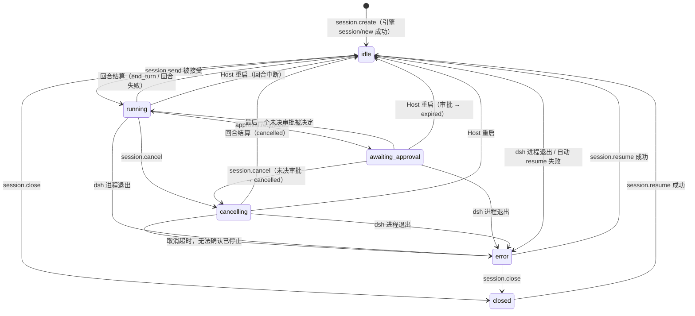
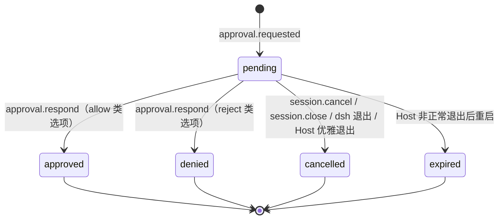

# Wevir 领域模型 v0

> 状态：v0（T1.1）· 日期：2026-10-12
> 依据：[SKELETON_PLAN](../archive/skeleton/SKELETON_PLAN.md) §2、§6 M1；[ADR-0001](../adr/0001-runtime-integration.md)、[ADR-0002](../adr/0002-host-transport-and-process-model.md)；[dsh 接入 Spike](../research/dsh-integration-spike.md)（样本在 `spikes/dsh-acp/fixtures/`）；[Paseo 研读](../research/paseo-notes.md) §7.1、A20；[OpenWork 研读](../research/openwork-notes.md) §3.2、§3.9、§4.5
> 下游：T1.2（`packages/protocol` 的 schema 与 `host-api.md`）、T1.3（`AgentEvent`）、T2.1–T2.3（表结构、事件库、状态机）、T3.2–T3.3（ACP 映射、审批桥接）、T4.1（客户端投影）

本文件定义 Wevir 拥有哪些实体、它们的字段和状态怎么变、Host 往事件库里写哪些事件。不含实现代码；TS 代码块是给后续任务落地的类型草案，每块标注落在哪个包：

| 标注 | 落地位置 | 任务 |
|---|---|---|
| `// → protocol` | `packages/protocol`，线缆类型，配 zod schema | T1.2 |
| `// → adapter 接口` | T1.3 的接口包，Host 与适配器之间的类型，不上线缆 | T1.3 |
| `// → client-sdk` | 客户端投影，只在客户端存在 | T4.1 |

字段名、错误码名在本文件里原是草案，T1.2 已在 [host-api.md](./host-api.md) 定稿并回写本文件（错误码名见 host-api.md §9）；以后以 host-api.md 为准。

---

## 1. 两类事实

Host 是唯一的事实来源（计划 §2.1）。Host 里的数据分两类：

- **产品层事实**：Wevir 自己创建、自己决定的数据。dsh 不知道它们，或者 ACP 不提供。
- **引擎事实的投影**：dsh 是事实的拥有者，Host 把 ACP 消息翻译成 Wevir 事件存一份，供回放和多端同步。投影只增不改；引擎的原值（工具名、`rawInput`、选项 ID、错误原文）原样保留。

| 事实 | 类别 | 来源 | 说明 |
|---|---|---|---|
| 工作区（`Workspace`） | 产品 | Host | dsh 只看到 `session/new` 的 `cwd` |
| Provider 配置（`ProviderProfile`） | 产品 | Host（SQLite + SecretStore） | 由 T3.4 投影成 dsh overlay；Key 只经子进程环境变量传入 |
| 会话身份、所属工作区、标题、创建与更新时间、会话列表 | 产品 | Host | ACP `session/list` 只有 `sessionId` + `cwd`，且不含活跃会话（T0.3 §3.2）；标题取首条提示词（ADR-0001 §5 第 4 条） |
| 会话状态（`SessionState`） | 产品，由引擎信号驱动 | Host 状态机（§4） | ACP 只有 `session/prompt` 的结算 |
| 事件序号 `seq` | 产品 | Host | ACP 没有序号（ADR-0001 §5 第 3 条） |
| 回合（`turnId`）与用户消息 | 产品 | Host | ACP 不回发用户消息 |
| 审批的身份、状态、`decidedBy`、过期 | 产品 | Host | 选项列表与 `toolCallId` 来自引擎 |
| todo 列表 | 产品，从引擎数据推导 | 解析 `todo_write` 的 `rawInput` | ADR-0001 §5 第 5 条 |
| 工具展示类型、路径 | 产品，从引擎数据推导 | 按工具名映射（§7） | ACP `kind` 恒为 `other` |
| 错误分类 | 产品，从引擎数据推导 | 按错误原文前缀归类，保留原文 | ADR-0001 §5 第 9 条 |
| 已提交的助手消息与思考 | 引擎投影 | `agent_message_chunk` / `agent_thought_chunk` | |
| 增量文本 | 引擎投影（非公开契约） | stream-tap 旁路（T3.2a） | 被已提交消息替换（§6.3） |
| 工具调用输入、结果、状态 | 引擎投影 | `tool_call` / `tool_call_update` | `cancelled`、`unknown` 两个状态由 Host 推导（§6.4） |
| 上下文用量 | 引擎投影 | `usage_update` | |
| 可选模型与推理强度 | 引擎投影 | `session/new` 的 `configOptions` | |
| 模型可见的对话上下文 | **只属于引擎** | dsh 会话日志 | Wevir 不复制、不重建；resume 由 dsh 负责（T0.3 §8） |

### 1.1 ID 与映射

Host 生成的 ID 都是带类型前缀的不透明字符串，客户端不得解析其内容；生成算法见 [host-api.md](./host-api.md) §6（`<前缀>_<ULID>`）。

| ID | 生成者 | 形式 | 唯一范围 |
|---|---|---|---|
| `WorkspaceId` | Host | `ws_…` | Host |
| `SessionId` | Host | `ses_…` | Host |
| `TurnId` | Host | `trn_…` | Host |
| `ApprovalId` | Host | `apr_…` | Host |
| `StreamId` | Host | `stm_…`（每个 LLM attempt 一个） | 会话 |
| `ProviderId` | 用户（或 Host 按显示名生成建议值） | `^[a-z][a-z0-9-]{0,31}$` | Host |
| 引擎会话 ID | dsh | ACP `sessionId`（UUID） | dsh 的 `DSH_HOME` |
| `toolCallId` | dsh | 原样，如 `call_mv4pwxip_0` | 会话 |
| `messageId` | dsh | 原样（UUID） | 会话 |
| `optionId` | dsh | 原样，如 `allow-once` | 单个审批请求 |

**Wevir 会话 ↔ 引擎会话**：

- 一对一。`session.create` 时 Host 先调用适配器 `createSession`（ACP `session/new`），拿到引擎会话 ID 后才写 `session.created`；之后 `Session.engine.sessionId` 不再改变。ACP 的 `session/resume` 沿用同一个 `sessionId`（T0.3 §3.2），所以 resume、Host 重启、dsh 进程重启都不改映射。
- 映射只由 Host 保存（`sessions` 表，T2.1；对引擎会话 ID 建唯一索引）。适配器上报的事件以引擎会话 ID 为键，Host 据此路由到 Wevir 会话；Wevir 会话 ID 从不发给 dsh。
- 客户端只用 Wevir 会话 ID。`session.get` 可以带出 `engine` 字段用于诊断，客户端不得据此做任何操作。
- `Session.cwd` 是创建时工作区 `rootPath` 的 realpath，同样不可变：ACP resume 必须用同一个 cwd（按 realpath 比较，T0.3 §3.2）。
- dsh 的 LLM attempt ID（形如 `<引擎会话 ID>:<n>`）只在适配器内部出现，Host 为每个 attempt 分配 `StreamId`。

---

## 2. 公共类型

```ts
// → protocol
type WorkspaceId = `ws_${string}`
type SessionId = `ses_${string}`
type TurnId = `trn_${string}`
type ApprovalId = `apr_${string}`
type StreamId = `stm_${string}`
type ProviderId = string // ^[a-z][a-z0-9-]{0,31}$，创建后不可改

type IsoTime = string // ISO 8601，UTC，毫秒精度

type ClientKind = 'desktop' | 'cli' | 'mobile' // mobile 预留（ADR-0002 §2）

// 发起操作的客户端，取自该连接 host.hello 的参数（ADR-0002 §2）
interface ClientIdentity {
  deviceId: string
  clientId: string
  clientKind: ClientKind
}
```

---

## 3. 实体

每个实体的“创建者 / 修改者”指 Host 内负责它的模块。所有修改都经过事件（会话相关）或 RPC 方法（工作区、Provider）；客户端只能通过 Host API 发起。

### 3.1 Workspace

用户授权给 Wevir 的一个本地目录。会话在其中运行，`session/new` 的 `cwd` 就是它的 `rootPath`。

```ts
// → protocol
interface Workspace {
  id: WorkspaceId
  rootPath: string
  displayName: string
  createdAt: IsoTime
  updatedAt: IsoTime
}
```

| 字段 | 含义 | 创建 | 修改 |
|---|---|---|---|
| `id` | Host 分配 | `workspace.add` | 不可改 |
| `rootPath` | 目录的 realpath（`fs.realpath` 之后的绝对路径）。Host 按它去重：同一路径（含经符号链接到达的同一目录）再次添加，返回已有的工作区 | `workspace.add` | 不可改。目录被移动或删除后工作区仍在，在其中建会话或 resume 会失败 |
| `displayName` | 显示名，默认取目录名 | `workspace.add` | 用户改名（T5.4） |
| `createdAt` / `updatedAt` | 时间 | Host | Host |

规则：

- 一个 Session 恰属一个工作区（ACP 只有一个主 workspace，T0.3）。工作区之间不嵌套检查：两个工作区可以是父子目录，各自独立。
- `workspace.remove` 只注销，不删除磁盘上任何文件（OpenWork §4.5）。有未关闭会话（状态不是 `closed`）的工作区不能移除，返回错误。已关闭会话的历史随工作区一起从列表中隐藏，事件库不删；同一 `rootPath` 再次添加时恢复原 `id`，历史重新可见。实现上用 `removedAt` 软删除列，不进线缆类型。
- 工作区本身不带权限设置。dsh 的权限模式是进程级的 `workspace-write`（ADR-0001 §4）；“工作区外授权目录”之类的设置推迟到 Phase 1，届时按工作区生效（OpenWork §4.5）。

### 3.2 ProviderProfile

一个模型服务的配置。T3.4 把它翻译成 dsh 的 `--patch` overlay，映射、compat 默认值、生效策略与国内服务示例见 [providers.md](./providers.md)。

```ts
// → protocol
type ProviderKind = 'deepseek-official' | 'openai-compatible'
type ProviderApi = 'openai-completions' | 'openai-responses' | 'anthropic-messages'

type ProviderReasoningLevel = 'off' | 'minimal' | 'low' | 'medium' | 'high' | 'xhigh' | 'max'

interface ProviderModel {
  id: string              // 发给服务端的模型 ID
  displayName?: string
  contextWindow?: number  // 不填时 dsh 按 262144 猜，usage.updated 的 contextSize 会失真
  maxTokens?: number      // 最大输出（协议 0.2.0）
  supportsImages?: boolean // 是否接受图片（0.2.0）；省略沿用 dsh 目录
  reasoningEfforts?: ProviderReasoningLevel[] // 推理档位（0.2.0，只对 openai-compatible）；[] 表示不推理
}

interface ProviderCompat { // 只对 openai-compatible 有意义，原样写进 overlay 的 compat
  supportsDeveloperRole?: boolean
  maxTokensField?: 'max_tokens' | 'max_completion_tokens'
  thinkingFormat?: string
  requiresReasoningContentOnAssistantMessages?: boolean
}

interface ProviderProfile {
  id: ProviderId
  kind: ProviderKind
  displayName: string
  api?: ProviderApi       // openai-compatible 必填
  baseURL?: string        // openai-compatible 必填；deepseek-official 可选（覆盖官方地址）
  compat?: ProviderCompat
  models: ProviderModel[] // deepseek-official 可为空，用 dsh 自带目录
  defaultModelId: string
  hasSecret: boolean      // 线缆上只暴露有没有 Key，不暴露 secretRef
  createdAt: IsoTime
  updatedAt: IsoTime
}
```

| 字段 | 含义 | 创建 | 修改 |
|---|---|---|---|
| `id` | Provider ID，同时是 dsh 的 provider 路由名。**会写进 dsh 会话日志，创建后不可改名**（T0.3 §6.2）；要“改名”只能新建一个再删旧的 | `provider.upsert`（新 ID） | 不可改 |
| `kind` | `deepseek-official` 走 `llm-deepseek`，dsh 的路由名固定为 `deepseek-official`，所以这类 Profile 最多一个，`id` 必须是 `deepseek-official`；`openai-compatible` 走 `llm-pi-ai` 的自定义 provider | 创建时 | 不可改 |
| `displayName` | 显示名，写进 overlay 的 `displayName` | 创建时 | `provider.upsert` |
| `api`、`baseURL`、`compat`、`models`、`defaultModelId` | 写进 overlay；写库前经适配器检查（dsh 不接受的配置回 `INVALID_PARAMS`） | 创建时 | `provider.upsert`。dsh 不热加载，适配器在没有回合时重启 dsh 才生效，挂着的会话以 `engine.exited`（`config_changed`）转 `error`、resume 后用新配置（ADR-0001 补记 5，providers.md §5） |
| `hasSecret` | Key 是否已存 | Host | `provider.upsert` 带 Key 时 |
| `createdAt` / `updatedAt` | 时间 | Host | Host |

规则：

- Key 不在 Profile 里。Host 的 `SecretStore`（ADR-0003）以 Provider ID 为键保存；存储层的 `secretRef` 列不上线缆。Key 只经子进程环境变量 `WEVIR_PROVIDER_<ID>_KEY` 传给 dsh，`<ID>` 是 Provider ID 转大写、`-` 换成 `_`（ID 只含小写字母、数字和 `-`，不会撞名）。overlay 里只写 `apiKeyEnv` 变量名。`deepseek-official` 的 Key 同时用于 `web-search-deepseek`（T0.3 §6.2）。
- 被未关闭会话引用的 Profile 不能删除。已关闭会话引用的 Profile 删除后，这些会话不能 resume，直到再建一个同 ID 的 Profile。
- `openai-compatible` 的 ID 不能是 `deepseek-official`、`deepseek-account`（dsh 内置路由名）；`api` 暂只支持 `openai-completions`、`openai-responses`，`anthropic-messages` 只预留类型（providers.md §2）。
- OAuth 类 Provider 不在 v0（ADR-0001 未决事项 1）。

### 3.3 Session

一次与 Agent 的对话，恰属一个工作区，对应恰好一个引擎会话。

```ts
// → protocol
type SessionState = 'idle' | 'running' | 'awaiting_approval' | 'cancelling' | 'error' | 'closed'

interface ActiveTurn {
  turnId: TurnId
  startedAt: IsoTime
  clientMessageId?: string
}

interface Session {
  id: SessionId
  workspaceId: WorkspaceId
  cwd: string                      // 创建时的 rootPath（realpath），resume 用
  engine: { kind: 'dsh'; sessionId: string } // 仅诊断用
  providerId: ProviderId
  modelId: string
  reasoningEffort?: string         // dsh 的 reasoning_effort 选项值，原样（off / low / high / max）
  title: string
  titleSource: 'first_prompt' | 'user'
  state: SessionState
  activeTurn?: ActiveTurn
  lastError?: { category: EngineErrorCategory; message: string }
  readOnly?: SessionReadOnly       // 0.3.0：引擎会话恢复不了（§4.4）
  createdAt: IsoTime
  updatedAt: IsoTime               // 最后一个事件的 ts
  lastSeq: number
}

type SessionReadOnlyReason =
  | 'engine_session_not_found'     // 引擎找不到这个会话（dsh 会话日志被删，例如 DSH_HOME 被清理）
  | 'engine_session_incompatible'  // 当前引擎读不了它的格式（更新的 dsh 写的，或更旧且没有升级路径）
  | 'engine_session_corrupted'     // 引擎的会话日志损坏

interface SessionReadOnly {
  reason: SessionReadOnlyReason
  message: string                  // 引擎原文
  since: IsoTime                   // 最近一条 session.read_only 的 ts
}

// session.get 的结果（ADR-0002 §3）
interface SessionSnapshot {
  session: Session
  pendingApprovals: ApprovalRequest[]
  todos?: TodoItem[]               // 最近一次 todo.updated
  usage?: { contextUsed: number; contextSize: number } // 最近一次 usage.updated
}
```

| 字段 | 含义 | 创建 | 修改 |
|---|---|---|---|
| `id`、`workspaceId`、`cwd`、`engine` | 身份与映射（§1.1） | 会话管理器（T2.3），`session.create` | 不可改 |
| `providerId`、`modelId`、`reasoningEffort` | 创建时选定；v0 没有中途切换模型的方法（预留 `session.config_changed`，§6.6） | `session.create` | v0 不可改 |
| `title`、`titleSource` | 首条非空用户消息生成：各段文本以空格相连、空白折叠后取前 50 个字符（按码点，`TITLE_MAX_LENGTH`，T2.3） | 首个 `user.message` 时 Host 写 `session.title_changed` | 用户改名（方法在 T1.2 之后按需加） |
| `state`、`activeTurn`、`lastError` | 状态机（§4） | Host | 只由状态机修改 |
| `readOnly` | 引擎会话恢复不了（§4.4），状态是 `error` 或 `closed` | `session.read_only` | 之后的 `session.resumed` 清除 |
| `createdAt`、`updatedAt`、`lastSeq` | | 事件库（T2.2） | 每次追加事件 |

除身份字段外，`Session` 的其余字段都可以由事件序列推导出来。`sessions` 表存一份缓存供会话列表使用，与事件推导结果不一致时以事件为准（T2.2 的“Host 重启后状态一致”）。

T2.2 定下的推导规则（`packages/host/src/snapshot.ts` 的 `applyEvent`）：`title` / `titleSource` 取最近一条 `session.title_changed`，没有时为空串与 `first_prompt`；`activeTurn` 由 `turn.started` 设置（`startedAt` 是该事件的 `ts`，`clientMessageId` 取同一 `turnId` 的 `user.message`），`turn.finished` 清空；`lastError` 由每条 `engine.error` 覆盖（含回合失败这类不改变状态的错误，界面据此在 `idle` 下显示上次失败原因），状态以 `turn_started` 或 `resumed` 转换时清空；`readOnly` 由 `session.read_only` 设置（`since` 是该事件的 `ts`），`session.resumed` 清空（T3.5）。`sessions` 表的缓存列与 `approvals` 表都是事件的投影，由事件库在写事件的同一事务里更新。

### 3.4 ApprovalRequest

引擎要求用户批准的一次操作。dsh 的审批只来自沙箱升级（ADR-0001 §6）：工作区外、且不在系统临时目录的操作先被沙箱拒绝，模型带 `sandbox_permissions` 重试时才发出 `session/request_permission`。

```ts
// → protocol
type ApprovalStatus = 'pending' | 'approved' | 'denied' | 'cancelled' | 'expired'

interface ApprovalOption {
  optionId: string            // 引擎原样，approval.respond 回传它
  label: string               // 引擎原样（dsh 给英文 "Allow once" / "Reject"），界面按 kind 本地化，未知 kind 才显示 label
  kind: string                // 引擎原样（ACP: allow_once / allow_always / reject_once / reject_always）
  category: 'allow' | 'reject'
}

interface ApprovalDetail {     // 取自同一 toolCallId 的 tool.started
  toolName: string
  display: ToolDisplay        // §7
  input: unknown              // rawInput 原样（截断规则同工具输出）
  justification?: string      // rawInput.justification
  sandboxPermissions?: string // rawInput.sandbox_permissions，如 "danger-full-access"
}

type ApprovalResolutionReason =
  | 'user'            // 某个客户端做了选择
  | 'turn_cancelled'  // session.cancel
  | 'session_closed'  // session.close
  | 'engine_exited'   // dsh 进程退出
  | 'host_shutdown'   // Host 优雅退出
  | 'host_restarted'  // Host 非正常退出后重启时发现残留

interface ApprovalResolution {
  optionId?: string          // reason 为 'user' 时必有
  decidedBy?: ClientIdentity // reason 为 'user' 时必有
  reason: ApprovalResolutionReason
}

interface ApprovalRequest {
  id: ApprovalId
  sessionId: SessionId
  turnId: TurnId
  toolCallId: string
  options: ApprovalOption[]
  detail: ApprovalDetail | null // 找不到对应 tool.started 时为 null，界面显示通用文案
  status: ApprovalStatus
  createdAt: IsoTime
  resolvedAt?: IsoTime
  resolution?: ApprovalResolution
}
```

| 字段 | 含义 | 创建 | 修改 |
|---|---|---|---|
| `id` | Host 分配 | 适配器上报审批请求时，会话管理器写 `approval.requested` | 不可改 |
| `toolCallId`、`options` | 引擎原样。`category` 由 `kind` 前缀推导：`allow_` 开头为 `allow`，其余一律 `reject`（保守，未知 kind 不会被当作批准） | 同上 | 不可改 |
| `detail` | Host 在同一会话里找 `toolCallId` 相同的 `tool.started`，取其 `toolName`、`display` 与 `input` | 同上 | 不可改 |
| `status`、`resolvedAt`、`resolution` | §5 | 同上（`pending`） | 只由审批状态机修改，写 `approval.resolved` |

`approval.respond` 的参数是 `{ approvalId, optionId }`，`optionId` 必须是该请求 `options` 里的一个。适配器内部保留回复 ACP 请求所需的句柄（dsh 适配器：ACP SDK 交给审批处理器、等它兑现的 Promise），它不属于领域模型；适配器给 Host 的 `requestId` 是它自己分配的（acp-event-mapping.md §5.2）。

“总是允许”：dsh 只给 `allow_once` / `reject_once`（T0.3 §5.2），v0 不做；将来由 Host 记规则自动应答，届时 `ApprovalResolutionReason` 增加 `'rule'`，`decidedBy` 为空。

### 3.5 WevirEvent

会话内追加写的事件，是会话所有产品状态的来源。信封沿用计划 §6 T1.2：

```ts
// → protocol
interface WevirEventEnvelope<T extends string, P> {
  seq: number                 // 会话内从 1 开始连续递增，无空洞
  sessionId: SessionId
  ts: IsoTime                 // Host 追加时的时间
  type: T
  source: 'host' | 'engine'   // engine = 引擎事实的投影；host = Host 自己的事实或推导
  payload: P
}

type WevirEvent = /* §6.2 的判别联合，按 type 区分 payload */
```

规则：

- 只有事件库（T2.2）分配 `seq`，在会话锁内原子追加。增量文本先按短窗口合并（60 ms，ADR-0002 §3）再分配 `seq`：静默超过一个窗口后的第一个增量立即写入（窗口首），其余等到窗口尾一起写入，相邻的同一块（同 `turnId`、`streamId`、`blockIndex`、`kind`）合并成一条 `assistant.delta`；不能合并的事件到达时先 flush 已缓冲的增量，保证顺序。
- 事件库写入前校验（T2.2）：payload 合 schema；第一条事件是 `session.created` 且只有一条；`session.state_changed` 的 `from` 是当前状态、`(from, to, reason)` 在 §4.1 的表里；回合不重叠、`turn.finished` 结束的是当前回合；`approval.requested` 是本会话的 `pending` 审批，`approval.resolved` 只结算未决审批。违反时整批不写。
- 事件不修改、不删除。“替换”（已提交消息替换增量）是投影层的语义，事件本身都保留。
- 客户端遇到不认识的 `type` 必须忽略内容、照常推进 `lastSeq`（向前兼容）。Host 不扣下任何事件（订阅内 `seq` 连续），能力位只用来降级已知事件里的新枚举值或新形状（host-api.md §4、§10；ADR-0002 补记 1）。
- 工具输出、`input` 等大字段入库前按统一上限截断，上限写进 `host-api.md`（ADR-0002 §3）。

### 3.6 预留实体（v0 不实现）

| 实体 | 用途 | 与现有实体的关系 |
|---|---|---|
| `Task` | 用户的一个目标，可能跨多个会话、多次回合完成（例如“整理本周周报”），对应 dsh 的 goal 能力或 Wevir 自己的任务编排；Phase 1 的任务视图以它为单位 | 一个 Task 关联多个 Session（Session 增加可选 `taskId`）；属于一个 Workspace |
| `Artifact` | Agent 交付给用户的文件成果（文档、表格、代码文件），可预览、可在访达中显示 | 由某个 Session 的某次工具调用产生（`write` / `edit` 的路径、dsh `present` 工具的文件列表），以 `(sessionId, toolCallId, path)` 关联；路径必须在所属 Workspace 内。骨架只在工具卡片上显示路径 chip（OpenWork §3.9），成果面板放 Phase 1 |
| `Device` | 一台配对过的设备（桌面、手机），带设备凭据和权限，可撤销 | `host.hello` 的 `deviceId`、`ApprovalResolution.decidedBy.deviceId`、`user.message.sentBy.deviceId` 都指向它；骨架只有 ID，没有实体（ADR-0002 未决事项 3） |

---

## 4. 会话状态机



状态含义：

| 状态 | 含义 |
|---|---|
| `idle` | 没有进行中的回合，可以接受 `session.send`。引擎会话可能已挂在 dsh 进程上，也可能尚未挂上（Host 或 dsh 重启后）；后者在下一次 send 前由 Host 自动 resume，对客户端透明 |
| `running` | 一个回合正在执行（`session/prompt` 未结算） |
| `awaiting_approval` | 回合中，至少有一个 `pending` 审批 |
| `cancelling` | 已向引擎发出取消，等 `session/prompt` 以 `cancelled` 结算 |
| `error` | 引擎会话不可用：dsh 进程退出、取消无法确认、resume 失败。历史保留，`session.resume` 可恢复；引擎会话恢复不了时会话另带 `readOnly`（§4.4） |
| `closed` | 用户关闭；引擎会话已 `session/close`，可 resume |

### 4.1 转换与触发事件

“写入的事件”按顺序列出，都在同一把会话锁内追加。`session.state_changed` 每次都写，表里省略。

| # | 从 | 到 | 触发 | 写入的事件（`reason`） |
|---|---|---|---|---|
| 1 | — | `idle` | `session.create`：适配器 `createSession` 成功 | `session.created`（初始状态隐含为 `idle`，不写 `state_changed`）。失败时不建会话，RPC 返回错误 |
| 2 | `idle` | `running` | `session.send` 被接受（必要时先自动 resume） | `user.message`、`turn.started`、首个回合还有 `session.title_changed`（`turn_started`） |
| 3 | `running` | `awaiting_approval` | 适配器上报审批请求 | `approval.requested`（`approval_requested`） |
| 4 | `awaiting_approval` | `running` | 某个审批被决定后不再有 `pending` 审批 | `approval.resolved`（`approvals_settled`） |
| 5 | `running` / `awaiting_approval` | `cancelling` | `session.cancel` | 每个未决审批一条 `approval.resolved`（`turn_cancelled`），适配器以 `cancelled` 回复 ACP；然后发 `session/cancel`（`cancel_requested`） |
| 6 | `running` | `idle` | `session/prompt` 结算为 `end_turn` | 未收尾工具的 `tool.finished`（`unknown`，§6.4）、`turn.finished`（`completed`）（`turn_finished`） |
| 7 | `running` | `idle` | `session/prompt` 以 `-32603` 失败（回合失败，如缺 Key） | `engine.error`（`fatal: false`）、未收尾工具的 `tool.finished`、`turn.finished`（`failed`）（`turn_finished`）。会话仍可用，修好配置后可继续发送 |
| 8 | `cancelling` | `idle` | `session/prompt` 结算（`cancelled`，或取消过程中失败） | 未收尾工具的 `tool.finished`、`turn.finished`（`cancelled`）（`turn_finished`） |
| 9 | `cancelling` | `error` | 适配器报 `cancel_unconfirmed`，或取消后 5 s 内仍未结算（`CANCEL_TIMEOUT_MS`，T2.3；T0.3 实测 3–64 ms 结算） | `engine.error`（`cancel_unconfirmed`，`fatal: true`）、`turn.finished`（`interrupted`）（`cancel_unconfirmed`）。适配器随后按 T3.1 重启 dsh |
| 10 | `idle` / `running` / `awaiting_approval` / `cancelling` | `error` | dsh 进程退出（不论是否在回合中，ADR-0001 §2）；只影响已挂在该进程上的会话。适配器调用失败（`send`、`respondToApproval` 抛错）、事件流中断或意外结束同样视为引擎不可用，走这一行（T2.3），`engine.error` 的 `category` 与 `message` 记录具体原因 | 未决审批 `approval.resolved`（`engine_exited`）、有回合时 `turn.finished`（`interrupted`）、`engine.error`（`engine_exited`，`fatal: true`）（`engine_exited`） |
| 11 | `idle` | `error` | send 前的自动 resume 失败 | `engine.error`（`session_unavailable`）（`resume_failed`），引擎会话恢复不了时其后再写 `session.read_only`（§4.4）；本次 send 返回错误，不写 `user.message`。自动 resume 成功时只写 `session.resumed`，状态不变 |
| 12 | `error` / `closed` | `idle` | `session.resume` 成功（ACP `session/resume`，同一 cwd） | `session.resumed`（`resumed`） |
| 13 | `idle` / `error` | `closed` | `session.close` | （`closed`）。`error` 状态下引擎会话可能已不存在，ACP `session/close` 失败不阻止关闭 |
| 14 | `running` / `awaiting_approval` / `cancelling` | `closed` | `session.close`：先按 #5 取消（审批 `reason` 为 `session_closed`），等回合结算（同 #8 / #9），再关闭 | 依次为 #5、#8、#13 的事件；取消无法确认时仍转 `closed`，适配器重启 dsh |
| 15 | `running` / `awaiting_approval` / `cancelling` | `idle` | Host 非正常退出后重启，发现会话停在活动状态 | 未决审批 `approval.resolved`（`expired`，`host_restarted`）、`turn.finished`（`interrupted`）（`host_restarted`）。Host 优雅退出时已按 ADR-0002 §6 取消回合，不会走到这里 |

resume 失败（#12 的反面）不改变状态：`error` 仍是 `error`，`closed` 仍是 `closed`，追加一条 `engine.error`（`session_unavailable`），RPC 返回错误；引擎会话恢复不了时另写 `session.read_only`（§4.4）。工作区目录已不存在时，`session.resume` 与 send 前的自动 resume 都返回 `WORKSPACE_PATH_INVALID`，不调引擎、不写事件、状态不变（T3.5；dsh 对不存在的 cwd 只会报 cwd 不一致）。

### 4.2 各状态下的命令

每个会话的命令在 Host 内串行执行（ADR-0002 §4）。错误码名已由 T1.2 定稿（host-api.md §7）。

| 命令 | `idle` | `running` / `awaiting_approval` | `cancelling` | `error` | `closed` |
|---|---|---|---|---|---|
| `session.send` | 接受（#2） | `SESSION_BUSY`，`data` 带当前状态；不排队、不打断（ADR-0002 §4） | `SESSION_BUSY` | `INVALID_STATE`（`data.state`；只读时另有 `data.readOnly`），需先 resume | `INVALID_STATE` |
| `session.cancel` | 成功，无操作（幂等） | 接受（#5） | 成功，无操作 | 成功，无操作 | 成功，无操作 |
| `approval.respond` | `ALREADY_DECIDED` 或 `APPROVAL_NOT_FOUND` | 对 `pending` 审批接受（§5） | `ALREADY_DECIDED`（已结为 `cancelled`） | `ALREADY_DECIDED` | `ALREADY_DECIDED` |
| `session.close` | 接受（#13） | 接受（#14） | 接受（#14） | 接受（#13） | 成功，无操作 |
| `session.resume` | 成功，无操作 | 成功，无操作 | 成功，无操作 | 接受（#12） | 接受（#12） |

`session.send` 的 `clientMessageId` 幂等（ADR-0002 §4）在状态检查之前：同一 ID 重发返回原结果，不论现在处于什么状态。

### 4.3 实现约定（T2.3）

`packages/host` 的 `SessionManager` 落地本节与 §5，以下是表里没写明、由实现定下的细节：

- **命令队列与 `send` 的到达检查。** 命令按会话排队；`session.send` 到达时先在队列外查一遍回执与状态，会话不是 `idle` 就立即返回 `SESSION_BUSY` / `INVALID_STATE`，不排在进行中的命令（例如等结算的取消）后面，进入队列后再查一遍。`approval.respond` 照 §5 第 3 条排队。
- **`session.cancel` 等到结算才返回。** 写完 #5 的事件后等到 `turn.finished` 写入（#8，或经引擎退出等别的路径），适配器报 `cancel_unconfirmed` 或超过 5 s 则走 #9。
- **`send` 先写事件再交给引擎。** `user.message`、`turn.started`、标题与 idle→running 在一个事务里写入，同一事务记回执 `accepted`；适配器 `send` 成功后回执改为 `confirmed`。适配器拒收时走 #10，`session.send` 仍返回已接受的 `turnId` 与 `seq`（与重发时的原结果一致），回执保持 `accepted`。
- **引擎侧结掉的审批（`approval.cancelled`）。** `turn_cancelled` 与 `turn_ended` 结为 `cancelled`（`turn_cancelled`），`disposed` 结为 `cancelled`（`host_shutdown`），已被 Host 结算的忽略；`engine_exited` 不单独结算，由随后的 `engine.exited` 按 #10 一并处理，会话从 `awaiting_approval` 直接转 `error`。回合结算时仍未决的审批同样结为 `cancelled`（`turn_cancelled`），并先 awaiting_approval→running（`approvals_settled`）再按 #6–#8 回到 `idle`。
- **取消开始之后到达的审批请求**照记 `approval.requested`，同一事务里结为 `cancelled`（`turn_cancelled`）。
- **引擎不可用后断开订阅。** 进入 `error`（#9、#10）或关闭（#13）时 Host 断开对该引擎会话事件流的订阅，之后到达的残余事件丢弃；`resume`（及 `send` 前的自动 resume）重新订阅。适配器调用失败或事件流中断时，Host 还会尽力调用一次适配器 `cancel`，让引擎侧可能还在跑的回合停下。
- **Host 优雅退出（T2.5）。** `SessionManager.shutdown()` 之后到达的命令返回 `HOST_SHUTTING_DOWN`；每个会话排在已有命令之后，活动中的按 #5 取消（未决审批结为 `cancelled`，原因 `host_shutdown`），等 #8 结算或 #9 判定无法确认，然后停止消费引擎事件。正常退出的 Host 不会留下活动会话，下次启动的对账（#15）没有可修正的。
- **`approval.respond` 的引擎失败。** 适配器回复失败按 #10 处理，审批随之结为 `cancelled`（`engine_exited`），本次返回 `ALREADY_DECIDED`；适配器报 `approval_not_found`（引擎侧已结束该审批）时先处理暂扣的事件，再返回 `ALREADY_DECIDED` 与结算结果。

### 4.4 恢复与只读（T3.5）

- **什么时候 resume。** 引擎会话只在 Host 需要它时挂上：`session.resume`（`error` / `closed`，#12），或 `idle` 而未挂上时的 send（#11 的成功分支，Host 重启后的常态）。Host 启动对账不碰引擎。同一 dsh 进程里仍活跃的会话不能 resume（`-32602 session is already active`），状态机保证这一点：活动状态下 resume 是无操作，进入 `error` / `closed` 时 Host 已断开订阅；`cancel` 得不到确认（#9）时适配器重启 dsh，挂在同一进程上的会话都按引擎退出（#10）处理，之后 resume 到新进程上（acp-event-mapping.md §6）。
- **`session.resumed`。** 每次引擎会话重新挂上写一条，带引擎版本（dsh：`@deepseek-ai/dsh` 的包版本；ACP 的 `agentInfo.version` 恒为 0.0.1）。`session.created` 同样记下建会话时的版本，两者对比即可看出会话是否跨了引擎版本。
- **历史不靠引擎。** dsh 的 resume 不回放任何 `session/update`，`session/list` 只有 `sessionId` 与 `cwd`。界面历史、会话列表、标题、快照都从事件库推导（§3.3），resume 前后一致；模型可见的上下文由 dsh 的会话日志恢复（T0.3 §8）。
- **只读。** 适配器报 `session_lost`（引擎找不到会话、读不了它的格式、日志损坏）时，Host 在 `engine.error` 之后写 `session.read_only`（同一原因已只读时不重复写），会话停在 `error` 或 `closed` 并带 `readOnly`。只读会话的 `session.send` 返回 `INVALID_STATE`，`data.readOnly` 给出原因；`session.close` 照常；`session.resume` 仍会问引擎一次（引擎数据可能已经找回），成功即写 `session.resumed` 解除只读，失败只追加 `engine.error`。其余 resume 失败（cwd 不一致、引擎不可用）不标只读。
- **基于历史新建会话。** 只读会话的出路是用它的历史开一个新会话。T3.5 只定接口（`packages/host` 的 `SessionFromHistory`）：在原会话的工作区新建引擎会话，Provider 与模型默认沿用，历史从事件库读，交给新引擎会话的方式由实现决定，新会话的 `session.created` 记下来源；实现时 Host API 加对应方法并在 `HOST_FEATURES` 声明。在那之前桌面端（T5.5）用客户端的做法：把只读会话的对话记录（用户消息、助手正文、工具摘要，超长时保留最近的部分）放进同一工作区新会话的输入框，Provider 沿用原会话，用户看过、改过再发；新会话的 `session.created` 不记来源。

---

## 5. 审批生命周期



1. **创建**：适配器上报 `request_permission` 时，会话管理器分配 `ApprovalId`，从同一会话里 `toolCallId` 相同的 `tool.started` 取详情，写 `approval.requested`，会话转 `awaiting_approval`。
2. **首个决定生效**：`approval.respond` 按会话串行处理。第一个到达的请求把审批锁定为“提交中”，经适配器回复引擎（ACP `{"outcome":{"outcome":"selected","optionId":…}}`）；成功后写 `approval.resolved`，`status` 按所选选项的 `category` 取 `approved` 或 `denied`，`decidedBy` 取该连接的 `ClientIdentity`。
3. **后到者**：审批已不是 `pending` 时，`approval.respond` 返回 `ALREADY_DECIDED`，`data` 带既有的 `status` 与 `resolution`。因为命令串行，“提交中”期间到达的请求会排在后面，拿到的同样是 `ALREADY_DECIDED`。`optionId` 不在选项里返回 `INVALID_PARAMS`，不改变审批。
4. **暂扣引擎事件**：提交期间，同一会话里适配器上报的引擎事件先缓冲，等 `approval.resolved` 写入后再追加。dsh 回复后几毫秒就发出该工具的 `tool_call_update`（`B-permission-allow.jsonl`：回复 901 ms，更新 906 ms），不暂扣会出现“工具已完成、审批还未决定”的顺序（ADR-0002 §4）。
5. **由 Host 结算为 `cancelled`**：`session.cancel`（`turn_cancelled`）、`session.close`（`session_closed`）、dsh 进程退出（`engine_exited`）、Host 优雅退出（`host_shutdown`）。前两种情况适配器必须以 `{"outcome":{"outcome":"cancelled"}}` 回复 ACP，否则 dsh 侧悬挂（ADR-0001 §6）；`decidedBy` 为空。
6. **由 Host 结算为 `expired`**：Host 非正常退出后重启，启动对账时把残留的 `pending` 审批结为 `expired`（`host_restarted`）。此时 dsh 进程已随 Host 消失，没有可回复的请求。
7. 审批结算后，引擎随后的 `tool_call_update` 照常映射为 `tool.finished`：批准后通常 `completed`；拒绝后 `failed`，结果文本是 dsh 的拒绝说明；取消后 `cancelled`（§6.4）。

---

## 6. 事件类型目录 v0

### 6.1 总表

| `type` | `source` | 含义 | 来源 |
|---|---|---|---|
| `session.created` | host | 会话建立，`seq = 1` | `session.create` + ACP `session/new` 结果 |
| `session.resumed` | host | 引擎会话重新挂上，带引擎版本（0.3.0） | `session.resume`、send 前的自动 resume（§4.4） |
| `session.read_only` | host | 引擎会话恢复不了，会话只读（0.3.0） | 适配器的 `session_lost`（§4.4） |
| `session.title_changed` | host | 标题变化 | 首个 `user.message`；用户改名 |
| `session.state_changed` | host | 状态机转换（§4.1） | Host |
| `user.message` | host | 用户发出的消息 | `session.send`（ACP 不回发用户消息） |
| `turn.started` | host | 回合开始 | `session.send` 被接受，Host 发出 `session/prompt` |
| `turn.finished` | host | 回合结束 | `session/prompt` 的结果或失败；进程退出；Host 重启 |
| `assistant.delta` | engine | 助手文本或思考的增量 | stream-tap 旁路的 `text-delta` / `reasoning-delta`（T3.2a） |
| `assistant.stream_ended` | engine | 一个 LLM attempt 的增量流结束 | stream-tap 的 `end` 帧 |
| `assistant.message` | engine | 已提交的助手消息，替换对应增量 | ACP `agent_message_chunk` |
| `assistant.thought` | engine | 已提交的思考内容，替换对应增量 | ACP `agent_thought_chunk` |
| `tool.started` | engine | 工具调用开始 | ACP `tool_call` |
| `tool.updated` | engine | 工具调用的中间更新 | ACP `tool_call_update`（非终态） |
| `tool.finished` | engine / host | 工具调用结束 | ACP `tool_call_update`（`completed` / `failed`）；Host 收尾时补写（`source: host`） |
| `todo.updated` | host | 待办列表（完整列表） | 从 `todo_write` 的 `tool_call.rawInput` 推导 |
| `approval.requested` | engine | 新的审批请求 | ACP `session/request_permission` |
| `approval.resolved` | host | 审批结算，带 `decidedBy` | `approval.respond` 或 Host 结算 |
| `usage.updated` | engine | 上下文用量 | ACP `usage_update` |
| `engine.error` | engine / host | 引擎错误，已归类并保留原文 | `-32603` 回合失败、进程退出、resume 失败、取消超时 |
| `engine.raw` | engine | 适配器不认识的引擎消息，原样保留 | 未识别的 `sessionUpdate` 或通知 |

和计划草稿相比的调整，都来自 Spike 样本：

- 新增 `user.message`、`turn.started` / `turn.finished`：ACP 不回发用户消息，回合边界只有 `session/prompt` 的请求与结算；回放和快照的 `activeTurn` 需要它们。
- 新增 `assistant.stream_ended`：旁路的 `end` 帧区分 `committed` 与 `abandoned`（重试时被丢弃的 attempt），客户端据此丢掉不会被替换的增量。
- 新增 `todo.updated`、`session.created`、`session.title_changed`：ADR-0001 §5 规定由 Host 推导的事实，以事件形式落库，快照和回放都从事件得到。
- 没有 `plan.*`、`subagent.*`：dsh 的 ACP 从不发 `plan`（T0.3 §3.3），子 agent 只能看到父会话的 `subagent` 工具调用（ADR-0001 §5 第 10 条），按普通工具处理。

### 6.2 payload 类型

```ts
// → protocol
type StateChangeReason =
  | 'turn_started' | 'approval_requested' | 'approvals_settled' | 'cancel_requested'
  | 'turn_finished' | 'cancel_unconfirmed' | 'engine_exited' | 'resume_failed'
  | 'resumed' | 'closed' | 'host_restarted'

type TurnOutcome =
  | 'completed'   // ACP stopReason end_turn
  | 'cancelled'   // ACP stopReason cancelled
  | 'failed'      // session/prompt 以 JSON-RPC 错误结束（见同回合的 engine.error）
  | 'interrupted' // 没有拿到结算：进程退出、取消超时、Host 重启

type EngineErrorCategory =
  | 'missing_credentials' // "no API key" / "no credential for provider route"
  | 'provider'            // Provider 返回的错误（前缀规则见 acp-event-mapping.md §3）
  | 'engine_exited'       // dsh 进程退出
  | 'cancel_unconfirmed'  // 取消后超时未结算
  | 'session_unavailable' // resume / close 被拒：unknown session、cwd 不一致等
  | 'unknown'

interface StreamBlockRef { streamId: StreamId; blockIndex: number }

interface TodoItem {
  content: string
  status: string // dsh todo_write 原值，样本里只有 pending / in_progress / completed；其他值原样保留，界面按 pending 显示
}

interface ToolOutput {
  text: string        // ACP content[] 里所有 text 拼接（T0.3 只见到 {type:'content', content:{type:'text'}}）
  truncated: boolean
  originalLength?: number
}

type WevirEvent =
  | WevirEventEnvelope<'session.created', {
      workspaceId: WorkspaceId
      cwd: string
      providerId: ProviderId
      modelId: string
      reasoningEffort?: string
      engineVersion?: string       // 0.3.0：建立引擎会话的引擎版本
    }>
  | WevirEventEnvelope<'session.resumed', { engineVersion?: string }> // 0.3.0
  | WevirEventEnvelope<'session.read_only', { reason: SessionReadOnlyReason; message: string }> // 0.3.0
  | WevirEventEnvelope<'session.title_changed', { title: string; source: 'first_prompt' | 'user' }>
  | WevirEventEnvelope<'session.state_changed', {
      from: SessionState
      to: SessionState
      reason: StateChangeReason
    }>
  | WevirEventEnvelope<'user.message', {
      turnId: TurnId
      clientMessageId?: string
      content: Array<{ type: 'text'; text: string }> // v0 只有文本；dsh promptCapabilities 不支持图片、音频
      sentBy: ClientIdentity
    }>
  | WevirEventEnvelope<'turn.started', { turnId: TurnId }>
  | WevirEventEnvelope<'turn.finished', {
      turnId: TurnId
      outcome: TurnOutcome
      engineStopReason?: string // 引擎原值
      durationMs: number
    }>
  | WevirEventEnvelope<'assistant.delta', {
      turnId: TurnId
      streamId: StreamId
      blockIndex: number        // attempt 内的块序号，取旁路 chunk 的 index
      kind: 'text' | 'reasoning'
      text: string              // Host 按 60 ms 合并后的片段
    }>
  | WevirEventEnvelope<'assistant.stream_ended', {
      turnId: TurnId
      streamId: StreamId
      outcome: 'committed' | 'abandoned'
    }>
  | WevirEventEnvelope<'assistant.message', {
      turnId: TurnId
      messageId: string         // 引擎原值
      text: string
      replaces: StreamBlockRef[] // 本条替换的增量块；没有旁路或对不上时为空
    }>
  | WevirEventEnvelope<'assistant.thought', {
      turnId: TurnId
      messageId: string         // 与同一 attempt 的 assistant.message 相同（F-stream-granularity.jsonl）
      text: string
      replaces: StreamBlockRef[]
    }>
  | WevirEventEnvelope<'tool.started', {
      turnId: TurnId
      toolCallId: string
      toolName: string          // ACP tool_call.title，dsh 里就是工具名
      display: ToolDisplay      // §7
      input: unknown            // rawInput 原样（截断后）
    }>
  | WevirEventEnvelope<'tool.updated', {
      turnId: TurnId
      toolCallId: string
      display?: ToolDisplay
      input?: unknown
      output?: ToolOutput
    }>
  | WevirEventEnvelope<'tool.finished', {
      turnId: TurnId
      toolCallId: string
      status: 'completed' | 'failed' | 'cancelled' | 'unknown'
      output?: ToolOutput       // Host 收尾补写（unknown）时没有
    }>
  | WevirEventEnvelope<'todo.updated', {
      turnId: TurnId
      toolCallId: string        // 来源 todo_write 调用
      items: TodoItem[]
    }>
  | WevirEventEnvelope<'approval.requested', { approval: ApprovalRequest }> // status 恒为 pending
  | WevirEventEnvelope<'approval.resolved', {
      approvalId: ApprovalId
      status: Exclude<ApprovalStatus, 'pending'>
      resolution: ApprovalResolution
    }>
  | WevirEventEnvelope<'usage.updated', {
      contextUsed: number       // ACP usage_update.used
      contextSize: number       // ACP usage_update.size（模型未声明 contextWindow 时是猜测值）
    }>
  | WevirEventEnvelope<'engine.error', {
      category: EngineErrorCategory
      message: string           // 引擎原文，始终保留
      code?: number             // JSON-RPC 错误码
      turnId?: TurnId
      fatal: boolean            // true：会话因此进入 error
    }>
  | WevirEventEnvelope<'engine.raw', {
      protocol: 'acp'
      method: string            // 如 'session/update'
      kind?: string             // session/update 的 sessionUpdate 值
      params: unknown           // 原样（截断后）
    }>
```

适配器向 Host 上报的 `AgentEvent` 是这份目录去掉 Host 自己的事实（`session.*`、`user.message`、`turn.started`、`approval.resolved`）、换成引擎 ID 的版本。T1.3 已定稿，以 `packages/runtime-adapter/src/events.ts` 为准（接口与类型见同目录 `adapter.ts`、`types.ts`），这里只记与原草案的差异：

| 事件 | 定稿 |
|---|---|
| `assistant.message` / `assistant.thought` | 加 `replaces: DeltaBlockRef[]`（`{ attemptId, blockIndex }`），由适配器对齐增量（§6.3 规则 2），Host 只把 `attemptId` 换成 `StreamId` |
| `tool.started` / `tool.updated` | 加 `display: ToolDisplay`（§7），由适配器按工具名映射；`input` 可省略 |
| `todo.updated` | 新增：适配器从 `todo_write` 的 `rawInput` 解析出完整列表，Host 照写成 `todo.updated` |
| `approval.requested` | `requestKey` 改名 `requestId`；选项 `{ optionId, label, kind }` 原样，`category` 由 Host 推导 |
| `approval.cancelled` | 新增：没经过 `respondToApproval` 就结束的审批（`turn_cancelled` / `turn_ended` / `engine_exited` / `disposed`），Host 据此对账 |
| `usage.updated` | 字段改为 `contextUsed` / `contextSize`，与 WevirEvent 同名 |
| `turn.settled` | 加 `outcome: 'completed' \| 'cancelled'`，`stopReason` 保留引擎原值 |
| `turn.failed` | 加 `category`（`missing_credentials` / `provider` / `unknown`），由适配器按错误原文归类；`code` 可省略 |
| `engine.exited` | 发给每个挂在该进程上的会话（带 `engineSessionId`），是该会话订阅的最后一个事件；字段 `exitCode`、`signal`、`stderrTail?`，以及 `reason?`：`config_changed` 表示适配器为应用新的 Provider 配置主动重启（T3.4，只在没有回合时，Host 照 #10 转 `error`、消息提示 resume） |
| `engine.raw` | 加 `protocol`、`kind?`；`engineSessionId` 必填（按会话订阅） |

规则放在哪一侧：依赖 dsh 工具名、错误措辞或旁路帧细节的放适配器（展示类型、`todo.updated`、错误归类、增量对齐）；依赖 Host 状态的放 Host（取消期间的 `failed` 记为 `cancelled`、回合结束补 `unknown`、60 ms 合并增量、截断）。

### 6.3 增量与已提交消息的合并规则

依据：T0.3 §4、ADR-0001 §3；样本 `stream-tap/mock/frames.sample.json`、`acp/mock/transcripts/F-stream-granularity.jsonl`、`todo-subagent.jsonl`。

事实：

- 旁路每个 LLM attempt 一组帧：`start`（`attemptId`、`turn`、`step`）→ 若干 `chunk`（`block-start` / `text-delta` / `reasoning-delta` / `tool-call-delta` / `block-end` / `usage` / `finish`）→ `end`（`outcome.kind` 为 `committed` 或 `abandoned`）。
- ACP 对每个已提交的 attempt 按块各发一条：每个推理块一条 `agent_thought_chunk`、每个文本块一条 `agent_message_chunk`，`messageId` 都相同（T0.3 样本里每个 attempt 只有一个文本块、至多一个推理块，T3.2 核对上游源码）；`messageId` 与旁路的 `attemptId` 不同。一个回合可以有多个 attempt，各自产生已提交消息（`todo-subagent.jsonl`：子 agent 启动后一条消息，最后一条消息）。
- 取消时 ACP 一次性补发已生成的部分，作为一条 `agent_message_chunk`，随后结算为 `cancelled`（`E2-cancel-during-generation.jsonl`）。

规则：

1. Host 为每个 `start` 帧分配 `StreamId`；`text-delta` / `reasoning-delta` 合并后写 `assistant.delta`；`end` 帧写 `assistant.stream_ended`。其余 chunk 类型（`block-start`、`block-end`、`tool-call-delta`、`usage`、`finish`）只供适配器内部判断块边界，不落库：工具调用以 ACP `tool_call` 为准，用量以 `usage_update` 为准。
2. 对齐：每个会话维护一个“等待替换”的 attempt 队列，只收含 `text` 或 `reasoning` 块、且没有以 `abandoned` 结束的 attempt。ACP 出现一个新的 `messageId` 时，取队列里第一个内容对得上的 attempt 与之配对（它的某个同类块是已提交文本的前缀），每条 chunk 替换该 attempt 里对应的一个块：`assistant.thought` 的 `replaces` 是 reasoning 块，`assistant.message` 是 text 块。配不上（队列为空、旁路缺失）时 `replaces` 为空。两条管道先后不定时的处理（已提交消息先到、尾部增量后到）见 acp-event-mapping.md §4。
3. 客户端投影：收到 `assistant.message` / `assistant.thought` 后，删掉 `replaces` 指向的增量块，在原位置显示已提交内容；`replaces` 为空时追加在回合末尾。
4. 兜底：`turn.finished` 之后，本回合仍未被替换的增量块丢弃，以已提交消息为准。例外是回合以 `interrupted` 结束（Host 非正常退出后的对账 #15、引擎不可用 #10）：已提交消息不会再来，保留中断前已生成的非空白块（T5.5，否则 Host 崩溃后已经显示的输出会消失）。`abandoned` 的 attempt 在收到 `assistant.stream_ended` 时即可丢弃。
5. 旁路缺失或没有数据时，事件流里只有 `assistant.message` / `assistant.thought`，其余行为不变（ADR-0001 §3）。

取消时 dsh 只保留含非空白字符的块（正常提交时只含空白的块照发），一个都不剩时不提交消息，旁路的 end 帧落成 `assistant/attempt`，适配器按 `abandoned` 上报。对齐细节由 T3.2 用样本测试固定（`packages/adapter-dsh/src/delta-merge.test.ts`）；规则 4 保证正常结束的回合里任何对齐错误都不会留下重复文本；被中断的回合保留增量，只有在已提交消息先到却没配上（`replaces` 为空）之后又被中断时才会重复，这种情况比丢掉已显示的输出代价小。

### 6.4 工具调用的收尾规则

- ACP `tool_call` 的 `status` 直接是 `in_progress`，没有 `pending`（T0.3 §3.3），所以 `tool.started` 即“运行中”。
- `tool_call_update` 的 `status` 为 `completed` 或 `failed` 时写 `tool.finished`；为空或 `in_progress` 时写 `tool.updated`（T0.3 未观测到，按 ACP 协议预留）。
- **`cancelled` 由 Host 推导**：dsh 对被取消的工具报 `failed`，文本是 `Error: tool call aborted`（E1）或 `Error: approval for escalating … was cancelled`（D）。会话处于 `cancelling` 时到达的 `failed` 一律记为 `cancelled`，原文保留在 `output`。不靠文本匹配。
- **`unknown` 由 Host 补写**：`turn.finished` 之前，本回合仍未收尾的工具调用补一条 `tool.finished`（`status: 'unknown'`，`source: 'host'`），回放时不会一直转圈（OpenWork §3.4）。
- 沙箱拒绝后的升级重试是**两个**工具调用（不同 `toolCallId`），各自完整收尾（T0.3 §5.3）；第一次的 `failed` 文本带沙箱提示，界面可据此折叠。
- `todo_write` 照常产生 `tool.started` / `tool.finished`，同时 Host 在 `tool.started` 之后追加 `todo.updated`（`rawInput.todos` 是完整列表）。
- `subagent` 的结果是 `started subagent <id>`，立即 `completed`（`todo-subagent.jsonl`）；子会话的活动 v0 看不到。

---

## 7. 工具调用的展示类型

ACP `kind` 恒为 `other`、没有 `locations` / `diff`（T0.3 §3.3），Host 按工具名映射展示类型，并从 `rawInput` 提取界面要用的字段。下表是 dsh 的；Codex 的 item 自带类型、命令有解析好的 `commandActions`，展示类型由 adapter-codex 直接得出，不按工具名猜（[codex-event-mapping.md](./codex-event-mapping.md) §6.3）。分类参考 Paseo `ToolCallDetail`（`shell`、`read`、`edit`、`write`、`search`、`fetch`、`plan`、`sub_agent`、`unknown`；Paseo 的 `worktree_setup`、`plain_text` 对 dsh 无对应，不采用）。

```ts
// → protocol
type ToolDisplayKind = 'shell' | 'read' | 'edit' | 'write' | 'search' | 'fetch' | 'plan' | 'sub_agent' | 'unknown'

interface ToolDisplay {
  kind: ToolDisplayKind
  summary?: string   // 一行摘要：路径、命令、查询词或 URL
  paths?: string[]   // 涉及的文件路径（rawInput 原值，可能是相对路径）；界面做路径 chip
  command?: string   // shell
  query?: string     // search
  url?: string       // fetch
  mcpServer?: string // mcp__<server>__<tool> 的 server 部分
}
```

映射草案。“观测”列：✅ 在 T0.3 样本中出现过；源码 = 只在上游 `d743267` 的 `dsh-base` 组合中注册过，未在 Spike 中出现，`rawInput` 字段名取自工具定义，T3.2 遇到真实样本再核对。

| dsh 工具名 | 观测 | 展示类型 | 提取字段（`rawInput`） |
|---|---|---|---|
| `read` | ✅ | `read` | `file_path` → `paths`、`summary` |
| `read_image` | 源码 | `read` | `file_path` |
| `write` | ✅ | `write` | `file_path` → `paths`；`content` 不进 `display`（在 `input` 里）；`sandbox_permissions`、`justification` 进审批详情 |
| `edit` | 源码 | `edit` | `file_path`；`old_string` / `new_string` 供界面生成 diff（T5.3） |
| `str_replace_editor` | 源码 | `edit` | `path` |
| `bash`、`pwsh` | ✅（bash） | `shell` | `command` → `command`、`summary`；`description` 作副标题 |
| `job_output`、`job_list`、`job_kill` | 源码 | `shell` | 后台任务操作，`summary` 取任务 ID |
| `grep` | 源码 | `search` | `pattern` → `query`；`path` → `paths` |
| `glob` | 源码 | `search` | `pattern` → `query`；`path` → `paths` |
| `web_search` | 源码 | `search` | 查询词列表拼成 `query` |
| `web_fetch` | 源码 | `fetch` | `url` |
| `todo_write` | ✅ | `plan` | `todos`（另写 `todo.updated`） |
| `plan` | 源码 | `plan` | `plan`（Markdown，计划模式；dsh ACP 不发 plan 事件） |
| `subagent` | ✅ | `sub_agent` | `description` → `summary`；`prompt` 在 `input` 里 |
| `send_message`、`interrupt_agent`、`list_agents`、`list_subagent_models` | 源码 | `sub_agent` | |
| `mcp__<server>__<tool>` | 源码（命名规则） | `unknown` | `mcpServer` |
| `present`、`skill`、`working_directory`、`lsp`、goal 系列等其他工具 | 源码 | `unknown` | `present` 的文件列表 → `paths`（将来的 Artifact 来源） |
| 其他任何名字 | — | `unknown` | 无 |

映射表属于 dsh 适配器（依赖 dsh 工具名），已由 T3.2 落成 `packages/adapter-dsh/src/tool-display.ts` 的 `DSH_TOOLS`，定稿的表（含各字段的提取规则）以 [acp-event-mapping.md](./acp-event-mapping.md) §2 为准。展示类型只影响界面，不影响任何状态转换。

---

## 8. 客户端消息投影与 AI SDK `UIMessage`

**决定：不直接采用 `UIMessage` 及其部件类型；照它的分层做，文本与思考部件保持同形，工具与审批部件用 Wevir 自己的形状。** 投影代码与类型放在 `packages/client-sdk`（原定 T4.1，由 T5.3 落地），CLI 与桌面共用；协议包和 client-sdk 都不依赖 `ai`。

分层（OpenWork §3.2）：协议事件（`WevirEvent`，按 `seq` 应用）→ 客户端投影（消息 + 部件）→ 渲染。

理由（核对的是 npm 上的 `ai@6.0.303` 与当前 `latest` `ai@7.0.137`，均为 Apache-2.0）：

1. **审批语义装不下。** `UIMessage` 的工具审批是二元的：`approval: { id, approved: boolean, reason? }`，状态只有 `approval-requested` / `approval-responded` / `output-denied`。Wevir 要原样携带引擎的选项列表、回传 `optionId`、记录 `decidedBy`，还有 `cancelled`、`expired` 两种非用户结算，都没有位置。
2. **工具状态装不下。** `UIMessage` 的工具状态没有“已取消”和“状态未知”，也没有展示类型和路径；硬塞进 `toolMetadata` 等于自定义形状，失去采用它的意义。
3. **它变得比 Wevir 的协议快。** 部件联合在 v6 → v7 里新增了 `custom`、`reasoning-file` 两种部件，审批对象也加了字段。客户端对部件做穷举 `switch` 时，升级 `ai` 就编译失败；Wevir 的兼容纪律（只增不减、新字段 optional，ADR-0002 §2）不能绑在第三方的发版节奏上。
4. **依赖边界。** client-sdk 只依赖 `packages/protocol`（ADR-0002 §7）。`ai` 即使只 `import type` 也要装进依赖树，并带上 `@ai-sdk/gateway`、`@ai-sdk/provider`、`@ai-sdk/provider-utils` 三个运行时依赖。
5. **同形的部分照搬。** `text` / `reasoning` 部件用 `{ type, text, state: 'streaming' | 'done' }`，与 `UIMessage` 一致；消息用 `{ id, role, parts }` 的外形。桌面（T5.3）如果要用基于 `UIMessage` 的现成渲染组件，在 `apps/desktop` 写一个单向转换函数，届时只在 `apps/desktop` 以 `import type` 引入 `ai`，并锁定精确版本。

定稿（T5.3，`packages/client-sdk/src/projection.ts` 的 `TranscriptProjection`；与 T1.1 草案的差异写在代码块之后）：

```ts
// → client-sdk
interface MessageBase { id: string; parts: readonly ChatPart[]; seqRange: readonly [number, number] }
interface UserChatMessage extends MessageBase {       // id = turnId
  role: 'user'; turnId: TurnId; sentBy: ClientIdentity; clientMessageId?: string; ts: IsoTime
}
interface AssistantChatMessage extends MessageBase {  // id = `${turnId}:assistant`
  role: 'assistant'; turnId: TurnId
  startedAt?: IsoTime                                 // turn.started 的时刻
  finished?: { outcome: TurnOutcome; durationMs: number }
}
interface SystemChatMessage extends MessageBase { role: 'system' } // id = `system:${seq}`，不属于回合的提示与错误
type ChatMessage = UserChatMessage | AssistantChatMessage | SystemChatMessage

interface StreamPartFields { key: string; text: string; state: 'streaming' | 'done'; stream?: StreamBlockRef }
type ChatPart =
  | ({ type: 'text' } & StreamPartFields)
  | ({ type: 'reasoning' } & StreamPartFields)
  | {
      type: 'tool'; key: string; toolCallId: string; toolName: string; display: ToolDisplay
      status: 'running' | 'awaiting_approval' | 'completed' | 'failed' | 'cancelled' | 'unknown'
      input: unknown; output?: ToolOutput
      approval?: { approvalId: ApprovalId; status: ApprovalStatus; options: readonly ApprovalOption[]; resolution?: ApprovalResolution }
      startedAt: IsoTime; finishedAt?: IsoTime
    }
  | { type: 'todo'; key: string; items: readonly TodoItem[] }        // 每个回合一份，原位更新
  | { type: 'error'; key: string; category: EngineErrorCategory; message: string; fatal: boolean }
  | { type: 'raw'; key: string; method: string; kind?: string; params: unknown } // 只在 includeRaw 时投影
  | { type: 'notice'; key: string; notice: { kind: 'resumed'; engineVersion?: string } | { kind: 'read_only'; reason: SessionReadOnlyReason; message: string } | { kind: 'closed' } }

interface Transcript {                // TranscriptProjection.snapshot()
  sessionId: SessionId | undefined
  messages: readonly ChatMessage[]
  approvals: ReadonlyMap<ApprovalId, ApprovalRequest>  // 含已结算
  pendingApprovals: readonly ApprovalRequest[]          // 按 createdAt
  state: SessionState | undefined; activeTurnId: TurnId | undefined; title: string
  readOnly: SessionReadOnly | undefined; lastError: EngineErrorInfo | undefined; usage: Usage | undefined
  lastSeq: number
}
```

一个回合投影成一条 `user` 消息加一条 `assistant` 消息，回合内多个 attempt 的文本、思考与工具按事件顺序排成部件；`state: 'streaming'` 的部件来自增量，被已提交消息替换后变为 `'done'`，并沿用增量块的 `key`（渲染层据此复用 DOM，§6.3 规则 3）。`turn.finished` 时丢掉本回合仍未替换的增量（规则 4；回合被中断时保留），仍在运行的工具投影为 `unknown`（§6.4 的客户端兜底）。审批按同一 `toolCallId` 挂到工具部件上，未决时工具为 `awaiting_approval`。`engine.raw` 默认不投影（`includeRaw`），桌面端只在开发模式打开。

与草案相比：加了 `system` 角色（引擎在空闲时退出、resume 失败这类没有回合的错误，以及恢复、只读、关闭提示）、部件的 `key`、工具的起止时刻、`notice` 与 `raw` 部件；`Transcript` 带着会话状态与审批，界面的状态指示与审批卡片与消息流出自同一条事件流。性能约定：`snapshot()` 只为改动过的消息生成新对象，没有新事件时返回同一个快照，调用方可以攒一批事件再取（桌面按帧）。

会话列表的实时状态另有 `applySessionEvent(session, event)`（`packages/client-sdk/src/session-state.ts`），规则同 Host 的快照推导（§3.3），只更新 `Session` 自己的字段。

---

## 9. ACP 样本对照（验收）

`spikes/dsh-acp/fixtures/` 下每个 ACP 样本对应的 Wevir 事件。`sdk/` 下的样本属于未采用的 SDK 路径（ADR-0001），不在此列；`providers/`、`env-hygiene/`、`measure/` 是 Provider 请求与测量记录，不是 ACP 消息。

覆盖范围：对 `acp/` 下全部 JSON 与 JSONL（`acp/transcripts/lifecycle.jsonl`、`acp/mock/transcripts/*.jsonl` 含 `concurrency`、`flow-process-1/2`，`acp/mock/scenarios/*.json` 是同一批帧的按场景摘要）逐条枚举，出现过的消息种类只有：`session/update` 的 5 种 `sessionUpdate`（`agent_message_chunk`、`agent_thought_chunk`、`tool_call`、`tool_call_update` 的 `completed` / `failed`、`usage_update`），`session/request_permission` 及其 3 种回复，方法 `initialize`、`session/new`、`prompt`、`cancel`、`close`、`list`、`resume`、`load`，`stopReason` `end_turn` / `cancelled`，以及 6 个错误。下面 9.1–9.4 逐一给出对应。

### 9.1 引擎 → 客户端的会话更新（`session/update`）

| ACP | 样本 | Wevir 事件 |
|---|---|---|
| `agent_message_chunk` | `acp/mock/updates/agent_message_chunk.json`；全部 transcripts | `assistant.message` |
| `agent_thought_chunk` | `acp/mock/updates/agent_thought_chunk.json`；`F-stream-granularity.jsonl` | `assistant.thought` |
| `tool_call`（`in_progress`） | `acp/mock/updates/tool_call.json`；`permission/after-*.tool-lifecycle.json` | `tool.started`（`todo_write` 另加 `todo.updated`） |
| `tool_call_update`（`completed`） | `acp/mock/updates/tool_call_update.completed.json` | `tool.finished`（`completed`） |
| `tool_call_update`（`failed`） | `acp/mock/updates/tool_call_update.failed.json`；`E1`、`D` transcripts | `tool.finished`（`failed`；会话在 `cancelling` 时为 `cancelled`，§6.4） |
| `usage_update` | `acp/mock/updates/usage_update.json` | `usage.updated` |
| `tool_call_update`（非终态） | 未观测 | `tool.updated` |
| `config_option_update` | 未观测（dsh 源码存在） | v0：`engine.raw`；将来 `session.config_changed` |
| 其他任何 `sessionUpdate` | — | `engine.raw` |

### 9.2 引擎 → 客户端的请求

| ACP | 样本 | Wevir 事件 |
|---|---|---|
| `session/request_permission` | `acp/mock/permission/request.json`；`B`、`C`、`D` transcripts | `approval.requested`；会话 → `awaiting_approval` |

### 9.3 客户端 → 引擎的请求与结果

这些是 Host 经适配器发出的调用。它们本身不是事件，但请求被接受、结果或错误都会落成事件：

| ACP | 样本 | Wevir 事件 |
|---|---|---|
| `initialize` 请求 / 结果 | `acp/initialize.*.json` | 无：dsh 进程级握手，不属于任何会话。适配器据 `agentCapabilities` 确认 `close` / `list` / `resume` 可用 |
| `session/new` 请求 / 结果 | `acp/session-new*.json` | `session.created`（`configOptions` 的当前模型与推理强度写入 payload） |
| `session/prompt` 请求 | 全部场景 transcripts | `user.message`、`turn.started`；会话 → `running` |
| `session/prompt` 结果 `end_turn` | 全部场景 | `turn.finished`（`completed`）；会话 → `idle` |
| `session/prompt` 结果 `cancelled` | `D`、`E1`、`E2` | `turn.finished`（`cancelled`）；会话 → `idle` |
| `session/cancel` 通知 | `D`、`E1`、`E2` | `session.state_changed`（→ `cancelling`），之前先结掉未决审批 |
| `request_permission` 的回复 `selected allow-once` | `permission/responses.json` 的 `allow`；`B-permission-allow.jsonl` | `approval.resolved`（`approved`） |
| 回复 `selected reject-once` | `responses.json` 的 `deny`；`C-permission-deny.jsonl` | `approval.resolved`（`denied`） |
| 回复 `cancelled` | `responses.json` 的 `cancelled`；`D-permission-cancel.jsonl` | `approval.resolved`（`cancelled`，`turn_cancelled`） |
| `session/close` 结果 | `acp/session-close.response.json`；`acp/transcripts/lifecycle.jsonl` | `session.state_changed`（→ `closed`） |
| `session/resume` 结果 | `acp/session-resume.response.json`；`lifecycle.jsonl`、`flow-process-2.jsonl` | `session.state_changed`（→ `idle`，`resumed`） |
| `session/list` 结果 | `acp/session-list.response.json`；`lifecycle.jsonl` | 无：Wevir 不用它（ADR-0001 §5 第 2 条），会话列表来自事件库 |
| `session/load` 请求 | `lifecycle.jsonl` | 无：Spike 的探测调用，Wevir 不调用（错误见 9.4） |

### 9.4 错误

| ACP 错误 | 样本 | Wevir 事件 |
|---|---|---|
| `-32603 turn failed: llm-pi-ai: no credential for provider route …` | `acp/errors/prompt-missing-key.openai-compatible.json` | `engine.error`（`missing_credentials`，`fatal: false`）+ `turn.finished`（`failed`）；会话 → `idle` |
| `-32603 turn failed: llm-deepseek: no API key for provider route …` | `acp/errors/prompt-missing-key.deepseek-official.json` | 同上 |
| `-32602 unknown session` | `acp/errors/close-unknown-session.json` | close 时：不阻止关闭，适配器只记告警日志（适配器接口的 `close` 不报这类错误，T3.2）；resume 时：`engine.error`（`session_unavailable`），状态不变 |
| `-32602 session cwd does not match` | `acp/errors/resume-cwd-mismatch.json` | `engine.error`（`session_unavailable`）；状态不变。Host 用 `Session.cwd` resume，出现即说明工作区目录被替换 |
| `-32602 session is already active` | `acp/errors/resume-active-session.json` | 无：适配器视为“已挂上”，resume 按成功处理（T3.5） |
| `-32601 Method not found`（`session/load`） | `acp/errors/session-load-unsupported.json` | 无：Wevir 从不调用 `session/load`，历史来自事件库 |
| 进程退出（不是 ACP 消息：连接随进程关闭） | T3.1：`DshProcess` 的 `exit` 事件（`DshExit`：`exitCode`、`signal`、`stderrTail`），进行中的 ACP 请求以 `engine_unavailable`（“dsh 进程已退出（退出码 3；stderr 尾部：…）”）失败；`packages/adapter-dsh/src/dsh-process.test.ts` | `engine.error`（`engine_exited`，`fatal: true`）等，§4.1 #10 |

### 9.5 增量旁路帧（非 ACP）

| 帧 | 样本 | Wevir 事件 |
|---|---|---|
| `start` | `stream-tap/mock/frames.sample.json` | 无单独事件：分配 `StreamId` |
| `chunk` / `text-delta`、`reasoning-delta` | 同上 | `assistant.delta` |
| `chunk` / `block-start`、`block-end`、`tool-call-delta`、`usage`、`finish` | `block-start`、`block-end` 见同上；其余见上游 `StreamChunk` 定义 | 不落库，只供适配器判断块边界（§6.3 规则 1） |
| `end` | 未录到：`stream-tap/mock/summary.json` 记 36 帧 = 1 个 `start` + 35 个 `chunk`；形状取自上游 `AssistantStreamFrame`（`packages/core/agent/src/runtime-types.ts`）。T3.2a 需确认插件能收到 `end` 帧，收不到时以 ACP 已提交消息为准关闭 attempt | `assistant.stream_ended` |

### 9.6 两个完整场景

**B：审批批准**（`acp/mock/transcripts/B-permission-allow.jsonl`），会话初始 `idle`：

| ACP | Wevir 事件（`seq` 递增） |
|---|---|
| `session/prompt` 请求 | `user.message` → `turn.started` → `session.state_changed` idle→running |
| `usage_update` | `usage.updated` |
| `tool_call` write | `tool.started`（`write`，`paths` = 工作区外路径） |
| `tool_call_update` failed（沙箱拒绝） | `tool.finished`（`failed`） |
| `usage_update` | `usage.updated` |
| `tool_call` write（带 `sandbox_permissions`） | `tool.started` |
| `session/request_permission` | `approval.requested`（详情取自上一条 `tool.started`）→ `session.state_changed` running→awaiting_approval |
| 回复 `allow-once` | `approval.resolved`（`approved`，`decidedBy`）→ `session.state_changed` awaiting_approval→running |
| `tool_call_update` completed（提交期间暂扣，审批结算后追加） | `tool.finished`（`completed`） |
| `agent_message_chunk` | `assistant.message` |
| `usage_update` | `usage.updated` |
| 结果 `end_turn` | `turn.finished`（`completed`）→ `session.state_changed` running→idle |

**E2：生成中取消**（`E2-cancel-during-generation.jsonl`，带旁路时）：

| 输入 | Wevir 事件 |
|---|---|
| `session/prompt` 请求 | `user.message` → `turn.started` → `session.state_changed` idle→running |
| 旁路 `start`、`text-delta` × N | `assistant.delta` × M（按 60 ms 合并） |
| `session.cancel` | `session.state_changed` running→cancelling；适配器发 `session/cancel` |
| 旁路 `end`（`committed`） | `assistant.stream_ended` |
| `agent_message_chunk`（已生成的半段） | `assistant.message`（`replaces` 指向上述增量块） |
| 结果 `cancelled` | `turn.finished`（`cancelled`）→ `session.state_changed` cancelling→idle |

---

## 10. 留给后续任务

| 事项 | 任务 |
|---|---|
| ~~ID 生成算法、错误码最终命名、截断上限、`engine.raw` 是否按能力门控~~：已定稿，见 host-api.md §6、§7、§9、§11；`engine.raw` 不门控（§5） | T1.2 ✅ |
| ~~展示类型映射、错误归类、增量对齐放在适配器还是 Host；`AgentEvent` 定稿~~ 已定稿：放适配器，见 §6.2 末尾与 `packages/runtime-adapter` | T1.3 |
| ~~`workspaces.removed_at`、`sessions` 缓存列、`approvals` 表、引擎会话 ID 唯一索引~~ 已落地，见 `packages/storage/migrations/0001_init.sql`（引擎会话 ID 按 `(engine, engine_session_id)` 唯一） | T2.1 ✅ |
| ~~`seq` 分配、增量合并、截断、快照推导~~ 已落地，见 `packages/host`（`EventStore`、`snapshot.ts`、`truncate.ts`）；推导规则见 §3.3 末尾，写入前校验见 §3.5 | T2.2 ✅ |
| ~~标题截取长度、取消超时、Host 重启对账的实现~~ 已落地，见 `packages/host/src/session-manager.ts`；标题 50 字符（§3.3）、取消时限 5 s（§4.1 #9）、启动对账 `recover()`（#15）；其余实现约定见 §4.3 | T2.3 ✅ |
| ~~增量对齐的边界情况（空白块、多 attempt）用样本测试固定；`provider` 错误前缀；映射表写入 `acp-event-mapping.md`~~ 已落地，见 [acp-event-mapping.md](./acp-event-mapping.md) 与 `packages/adapter-dsh` | T3.2 ✅ |
| ~~resume 的 cwd、活跃会话、引擎会话丢失；历史不依赖引擎回放~~ 已落地，见 §4.4、[acp-event-mapping.md](./acp-event-mapping.md) §6 | T3.5 ✅ |
| 基于只读会话的历史新建会话：历史怎样交给新引擎会话、Host API 方法与 `HOST_FEATURES` 项（接口 `SessionFromHistory` 已定） | 待排期 |
| 真实模型下 `agent_thought_chunk` 的频率、`usage_update` 数值（ADR-0001 未决事项 3） | 有 Key 后补跑 Spike |
