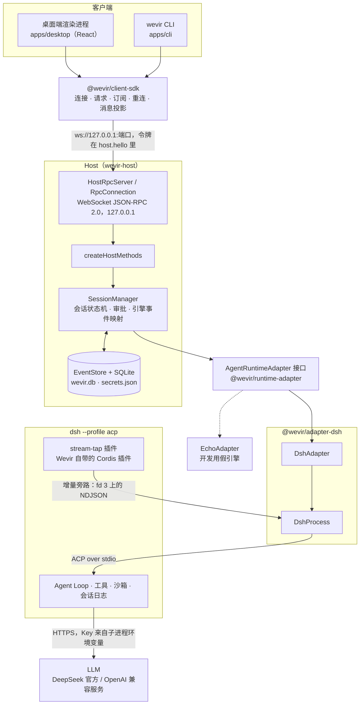
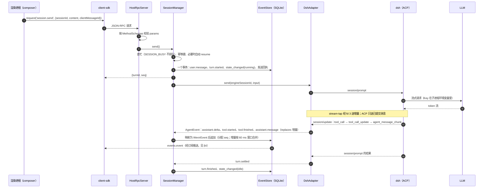

# Wevir 架构总览

> 状态：骨架阶段（T6.1）· 日期：2026-10-14 · 协议版本 0.3.0
> 细节在各自的文档里：[Host API](./host-api.md) · [领域模型](./domain-model.md) · [ACP → Wevir 事件映射](./acp-event-mapping.md) · [Provider 桥接](./providers.md) · [ADR](../adr/README.md) · [安全说明](../security.md)

本文件给第一次读代码的人一张地图：进程与包怎样分层、一次请求怎样走完、事件怎样从引擎到界面。具体规则以上面链接的文档和代码为准，这里不重复。

> 引擎方向已变（[ADR-0005](../adr/0005-agent-runtime-and-model-gateway.md)，2026-10-14）：默认引擎换成 Codex 的 `codex-app-server`，Host 内置模型协议网关，dsh 保留为可选引擎。本文仍描述当前代码（dsh），各包落地时随之更新。

## 1. 分层



| 层 | 进程 | 拥有的事实 |
|---|---|---|
| 客户端 | Electron 渲染进程；CLI 的 Node 进程 | 只有界面状态与本地缓存（按 `seq` 的投影），不读写文件和数据库 |
| client-sdk | 跑在客户端进程里 | 无，负责把 Host 的事件流可靠地交给界面 |
| Host | 独立 Node 进程，每个数据目录一个 | **产品层事实**：工作区、Provider、会话、审批、事件（`seq` 由它分配）。唯一的调度者 |
| 适配器 | 在 Host 进程里 | 引擎会话 ID 与 Wevir 会话的对应、增量与已提交消息的对齐 |
| dsh | Host 的子进程，一个进程承载多个会话 | **引擎层事实**：dsh 自己的会话日志（resume 时用），不对外 |

桌面端还有一个**主进程**：读 `run/host.json` 附着已有 Host 或拉起一个（持有它的 stdin 作为归属管道，退出时只停自己拉起的），经 preload 把连接信息 `{url, token}` 交给渲染进程（ADR-0002 §6，补记 5、6）。dsh 只由 `adapter-dsh` 启动和回收，Host 被强杀时 dsh 因 stdin EOF 自行退出（ADR-0001 补记 1）。

## 2. 包与职责

依赖只朝一个方向：客户端 → client-sdk → protocol；Host → runtime-adapter、storage、protocol、adapter-dsh；只有 `adapter-dsh` 依赖 `@deepseek-ai/*`（AGENTS.md 规则 2，`pnpm lint` 强制）。

| 包 | 职责 | 主要依赖 |
|---|---|---|
| `packages/protocol` | Host API 的契约：zod schema、20 个方法与 `events.event` 通知的注册表、事件的判别联合、错误码与关闭码、协议版本与兼容规则 | zod |
| `packages/runtime-adapter` | 引擎适配接口 `AgentRuntimeAdapter` 与引擎事件 `AgentEvent`；`./contract` 契约测试套件；`./echo` 假引擎 | 无 |
| `packages/storage` | `node:sqlite` 驱动（只在 `driver.ts`）、事务、手写 SQL 迁移、各表仓储、`FileSecretStore` | 无 |
| `packages/adapter-dsh` | dsh 进程管理（独立 `DSH_HOME`、白名单环境、启动与回收）、ACP → `AgentEvent` 映射、stream-tap 增量旁路、增量对齐、审批桥接、Provider overlay 与 `provider.test`、会话恢复 | dsh、ACP SDK、runtime-adapter |
| `packages/model-gateway` | Codex 用的模型协议网关（ADR-0005 决策 2，[model-gateway.md](./model-gateway.md)）：`127.0.0.1` 上的 `POST /v1/p/<providerId>/responses`，一次性令牌；Responses 上游透传（剥掉 Codex 的元数据、按服务挂方言修正），Chat Completions 上游转换；`testProvider`。R2 接进 Host 之前还没有调用方 | runtime-adapter（只用类型） |
| `packages/host` | `EventStore`（`seq`、增量合并、截断）、`SessionManager`、`HostRpcServer`、`createHostMethods`、进程入口 `wevir-host` 与运行时文件；子路径 `./runtime` 给拉起 Host 的客户端用 | protocol、runtime-adapter、storage、adapter-dsh、ws |
| `packages/client-sdk` | `WevirClient`（hello、类型安全的请求、断线排队、心跳、重连状态机）、`subscribe()` 异步迭代器（按 `seq` 去重补缺口）、`TranscriptProjection`（事件 → 消息与部件）；`./node` 读 `host.json`。浏览器入口不碰 Node 内置模块 | protocol |
| `apps/desktop` | Electron 桌面端：主进程（窗口安全基线、`HostLifecycle`）、preload、渲染进程（三栏布局、会话视图、设置） | client-sdk、host（只用 `./runtime`）、protocol |
| `apps/cli` | `wevir` 命令行：`host start\|status\|stop`、工作区、Provider、会话、`session attach`（T4.2，进行中） | client-sdk、host、protocol |

## 3. 一次请求的完整数据流

以桌面端发一条消息、模型调一次工具后回答为例（dsh 已在运行；第一次时 `DshAdapter` 先启动 dsh 并 `initialize`，约 0.5–2 s）。



要点：

- **`session.send` 的响应不等回合结束。** 响应只说明消息已落库、回合已开始；之后的一切都通过事件流到达，客户端靠订阅而不是靠响应更新界面。
- **落库先于推送。** 事件先在 SQLite 事务里拿到 `seq`，再交给进程内的 `EventBus` 推给订阅者；Host 崩溃后从库里回放出来的事件与崩溃前推送过的逐条一致（Gate M2）。
- **审批是同一条路上的一个分叉。** dsh 只在沙箱升级时发 `session/request_permission`（只带 `toolCallId`），`DshAdapter` 转成 `approval.requested`，Host 从同一 `toolCallId` 的 `tool.started` 取出路径、内容与理由写进事件并记入 `approvals` 表；任一客户端 `approval.respond`，首个决定生效，Host 写 `approval.resolved`（带 `decidedBy`），`DshAdapter` 只回复 dsh 一次。规则见 acp-event-mapping.md §5、domain-model.md §5。
- **取消**：`session.cancel` → ACP `session/cancel`，dsh 结束正在跑的子进程并补发已生成的部分；5 s 内得不到确认时适配器重启 dsh（acp-event-mapping.md §6）。
- **Provider**：`provider.upsert` 时 Key 进 `secrets.json`，配置进 `wevir.db`；适配器把全部 Provider 写成 `<DSH_HOME>/wevir/providers.yml`（只有 Key 的变量名），没有回合时重启 dsh 生效，每个会话的 Provider 与模型由 `session/set_config_option` 选定（providers.md）。

## 4. 事件从引擎到界面

```text
dsh 进程内                                  adapter-dsh（Host 进程内）
──────────                                  ───────────────────────────
agent/assistant-stream ─▶ stream-tap 插件 ─fd 3 NDJSON─▶ StreamTapDecoder ─┐
ACP session/update  ──────────────stdout──▶ DshProcess（在 ACP SDK 之前截下）─┤
session/prompt 结果、request_permission ──▶ ACP SDK ─────────────────────────┤
                                                                           ▼
                        SessionEventQueue（每个引擎会话一个，按调用顺序产出）
                        mapAcpUpdate → DeltaMerger（增量与已提交消息对齐）→ EventHub
                                                                           │ AgentRuntimeAdapter.subscribe()
Host                                                                       ▼
────  SessionManager.#handle：AgentEvent → WevirEvent（审批详情、取消期间的失败改记为取消、回合结束补收尾）
      EventStore：事务内分配 seq、合并增量、截断超长工具输出、更新会话快照列 ──▶ EventBus
      RpcConnection 的订阅：先补发 (sinceSeq, replayedThroughSeq]，再推实时事件 ──▶ events.event
客户端                                                                      ▼
──────  client-sdk subscribe()：按 seq 去重，缺口退订重订，断线后以最大 seq 续订，caught_up 标记回放结束
        TranscriptProjection：事件 → 消息与部件（增量被已提交消息替换、未收尾的工具记为状态未知、审批挂到工具上）
        桌面：TranscriptStore 每帧取一次快照 → TranscriptView（Markdown 流式只重渲染末尾块）
        CLI：attach.ts → render.ts 逐条写到终端
```

几条贯穿全程的约定：

1. **一个事实来源。** 会话、回合、审批的状态都由事件推导，快照（`session.get`）只是缓存；客户端中途加入时先取快照、再从 `lastSeq` 订阅（host-api.md §4）。
2. **增量是临时的。** 增量只为“看到正在生成”；已提交的 `assistant.message` / `assistant.thought` 用 `replaces` 指出它替换哪些增量块。旁路失效时只有已提交消息，功能不受影响（ADR-0001 §3）。回合以 `interrupted` 结束时保留已显示的增量（domain-model.md §6.3）。
3. **不认识的东西原样保留。** 适配器不认识的 ACP 消息成为 `engine.raw`；客户端不认识的事件类型跳过内容但照常推进 `seq`（host-api.md §10）。
4. **多个客户端看同一条流。** 桌面与 CLI 各自订阅同一会话，收到同样的事件；谁发的消息、谁做的审批记录在事件里（`sentBy`、`decidedBy`）。Host 不推送会话列表的变化，桌面端靠每个会话一条从 `lastSeq` 开始的订阅跟上状态，再定时重读列表发现新会话。

## 5. 进程与文件

| 文件（数据目录下） | 写入者 | 读取者 |
|---|---|---|
| `run/host.json` | Host（启动时排他占位，就绪后原子写入 `url` 与令牌，退出时删除） | 桌面主进程、CLI、client-sdk 的 `./node` |
| `wevir.db`、`secrets.json` | Host（storage 包） | 只有 Host |
| `engines/dsh/` | dsh；Wevir 只写 `wevir/providers.yml` | dsh |
| `logs/host.log` | Host | 人 |

客户端从不直接读写 `wevir.db`、`secrets.json` 与 dsh 的目录。完整的目录表见 [development.md](../development.md) §5，安全上的含义见 [security.md](../security.md)。
